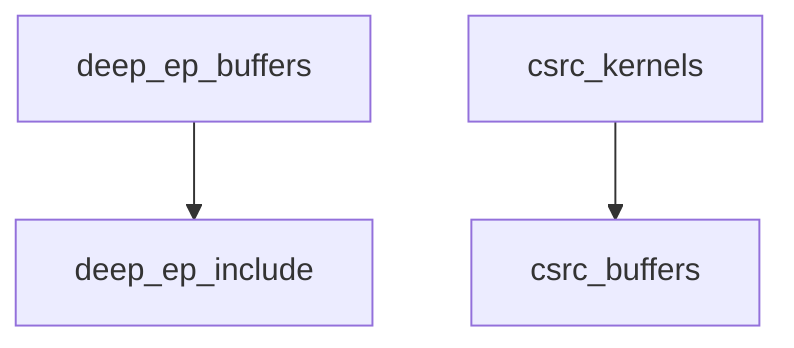

# 开源项目深度分析系统 · 设计方案

> **当前版本：v1.7** · **对应 tag**：`l5` · **生成日期**：2026-11-19
> **文件名固定不带版本号**；版本由文档头与《文档维护日志》标识，历史由 git 管理。
> **状态**：定稿（基于 2026-10-30 实测）
> **上一版**：设计方案初版（含 ⚠️ 推算值）——v1.0 **已用实测数据替换全部 ⚠️**
> **v1.7 变更（2026-11-19，负责人决定）**：建池由「watchlist + 池内已有仓库」扩展为**每日 GitHub Search 自动发现**（`/search/repositories`，零 LLM）：搜索只扩大候选集，`archived/fork/低星/久未更新/已入池` 在本地剔除，放行仍由 hot/classic 门槛与 `pool eligible` 决定；单轮新入池上限由 `pool.discovery.max_new_per_run` 控制。
> **v1.6 变更（2026-11-19，负责人决定）**：§11 周配额 `fast` 由 **3 调整为 5**（`strong` 仍 1）；目的是配合 `auto_chain.analysis_interval_days=1` 加速积累样本，同时验证「间隔闸门 + 周配额 + 预算」的配合。成本上限约 ¥0.25/周（按 ¥0.05/次估算）。
> **v1.5 变更（2026-11-07）**：① §8.2 把 `site/` 从「可再生缓存」精确化为**可重建的派生基线（入库）**，给出理由 / 纪律 / 推翻判据（D32=A）② 目录树注释同步。★ §10 里程碑、其余章节一律未改
> **v1.4 变更（2026-11-05）**：★ 闭 L3 首轮两处规格缺口（L3 任务卡 S1/S2）——
> ① §8.2 把 `reports/` 从「append-only 真源」精确化为**确定性 regenerate 产物**，
> 同一 `(repo, as-of)` 换档位覆盖属允许行为，历史由 git tag 兜底（L2 已实证）；
> **文件名 / 幂等键 / render 与 cli 路径均不变**
> ② §10 里程碑 L3 判据「积累 ≥5 个项目」→ **「同 `domain.id` 簇自上次抽象 run 以来新增 ≥6 个真实项目」**，
> 与《规律库与范围配置》§E 默认值一致；阈值进 `config.yaml` 可配置；样本不足时只验证链路、不产条目
> **v1.3 变更（2026-11-04）**：★ §8 按**可再生性分层**重写——目录树对齐 L1 实跑形态（`data/snapshots/<owner>__<repo>/<date>.json + src/ + external/`），裁定 `external/` 为不可再生真源、`src/` 与 `data/llm_cache/` 为可再生缓存。起因：init 审阅发现 `docs/成本预算.md` 把二者定为可丢弃，与旧 §8「整块 snapshots 是真源」冲突（见决策台账 D15）
> **v1.2 变更（2026-11-01）**：① §6.1 打分公式补齐**权重数值**并对齐原型实现，未落地分量标 ⚠️ 延后 ② 新增 §6.3 入池阈值（双通道）③ 新增 §6.4 watchlist 边界（意图层，非入口过滤器）④ 新增 §6.5 依赖图 Mermaid 规格
> **v1.1 变更**：§11 周配额由"待确认"改为**已定**（strong ≤1/周、fast ≤3/周）
> **v1.0 新结论**：实测推翻了原方案 2 个假设、修正了 1 个字段设计缺陷、发现 2 个新的幂等坑
> **★ 文档分工**：本文件写 **what / why**（规格与取舍）；《执行手册》写 **how**（流程、红线、验收）。同一条要求只在一边出现。

---

## 0. 本版变更摘要（先看这个）

| #    | 变更                                                         | 性质           |
| ---- | ------------------------------------------------------------ | -------------- |
| 1    | **"越新越火越可能没被 DeepWiki 索引"——实测未证实**，但**样本有偏**，风险改为**运行时 fail-closed**而非设计期假设 | 假设被数据修正 |
| 2    | **Zread 当前不可用**：新近组命中 ≈10%，且大量"处理失败/通用界面" → **本期不接线**，只保留适配器留空 | 决策变更       |
| 3    | **token 压缩比实测**：GitHub 元数据仅为整仓源码的 **0.76%–9.36%** → 降本的关键**不是外部工具，是"不喂整仓"** | ★ 核心结论     |
| 4    | **特征卡原 8 字段里有 1 个设计缺陷**：「关键取舍」不是零 LLM 可提取的 → 特征卡**拆 L0（确定性）/ L1（LLM）** | 字段设计纠错   |
| 5    | **模式召回算法定稿**：规则匹配 + **自动产出反例候选**        | §5-3 关闭      |
| 6    | **新增 2 个幂等坑**：运行时刻时间戳、集合遍历顺序 → 不处理则"字节一致"永远做不到 | 新发现         |
| 7    | **打分模型首次定义**，并钉死边界：**只用于排序，绝不用于升档** | 补齐缺口       |

---

## 1. 实测结果（替换初版全部 ⚠️）

### 1.1 实测一：DeepWiki / Zread 命中率

样本：20 个「2026 年新建或近月爆红」的仓库（推理 Infra 10 + Agent/训练 10）+ 5 个经典仓库对照。
判定口径：**必须看到仓库专属的模块/文件路径**才算命中；只有"Index your code"按钮或通用导航页 = 未命中。

| 分组                 | 样本 | DeepWiki 命中 | Zread 命中 |
| -------------------- | ---: | ------------: | ---------: |
| 新近组（推理 Infra） |   10 |   **8 (80%)** |    1 (10%) |
| 新近组（Agent/训练） |   10 | **10 (100%)** |   9 (~89%) |
| 经典组对照           |    5 |  **5 (100%)** |    3 (60%) |

**读法（不要读反）**：

1. **"越新越火越没被索引"这个假设，本轮没有证实**——20 个新仓库 DeepWiki 命中 18 个（90%）。
2. **但这个结论可信度有限**：被抽到的新仓库 star 普遍在 **2 千–29 万**。命中机制极可能是"**高 star 触发自动索引**"，而**没有测到 star 100–2000、创建不满 2 周的长尾**——那才是真正危险的区域。
3. 因此**风险不能被删除，只能被工程化兜住**：保留 **fail-closed**（§2.3），并且在系统里加一个**持续监测位**：每次采集记录命中/未命中 + 当时 star，跑够 50 个自然得到真实曲线。
4. **Zread 两组结论互相矛盾**（10% vs 89%），说明**页面状态不稳定**（明确出现 `Repository processing failed`、抓取失败、仅返回通用界面）。**结论：本期不接线 Zread**，只保留 `ExternalAdapter` 抽象位，`zread` 实现留空并标注"待复测"。

> ★ 顺带验证了一个重要的反面案例：`openlake-project/OpenLake` 的 DeepWiki 页面能显示仓库名与索引按钮，但**正文无任何专属内容**——这正是"伪装成正常内容的回退"，证明 fail-closed 的判定必须看**正文有没有仓库专属信息**，不能只看 HTTP 200。

### 1.2 实测二：token 压缩比（★ 本版最重要的数字）

方法：下载仓库 tarball → 统计全部文本文件（跳过 tests/examples/third_party/lock 文件/单文件 >2MB）→ token 估算；对照组为 GitHub 元数据（README + 完整文件树路径）。

| 仓库                  | 整仓源码 token | 文件数 | GitHub 元数据 token | **元数据 / 整仓** |
| --------------------- | -------------: | -----: | ------------------: | ----------------: |
| deepseek-ai/FlashMLA  |        228,797 |     97 |               8,914 |         **3.90%** |
| deepseek-ai/DeepInfer |        701,471 |    289 |               5,335 |         **0.76%** |
| deepseek-ai/DeepEP    |        110,080 |     65 |              10,308 |         **9.36%** |
| verl-project/verl     |      2,026,843 |    627 |              27,100 |         **1.34%** |

> token 为确定性估算器（非 CJK 3.6 字符/token、CJK 1 字/token）。沙盒无法下载 cl100k 词表，**但结论用比值表达，对估算系数不敏感**。

**三个直接推论（改写成本模型）**：

1. **降本的第一杠杆是"不喂整仓"，不是外部工具。** 元数据只占整仓的 **1%–9%**，即**两个数量级**的差距；外部工具文档带来的压缩是**同一量级内的**优化。
2. **整仓喂给 LLM 在中等项目上就已不可行**：verl 200 万 token，单次即超出绝大多数模型的上下文与预算。**"喂关键源文件"必须受硬性 token 预算约束**（§2.4）。
3. **off 档的成本优势被实测证实**：off 档完全基于元数据层（<3 万 token 甚至 <1 万），且**零 LLM 调用**。

### 1.3 实测三：watchlist 复核（2026-10-30）

| 项目            | 真实地址                                |   Star | 最近提交   | 状态                          |
| --------------- | --------------------------------------- | -----: | ---------- | ----------------------------- |
| DeepInfer       | `deepseek-ai/DeepInfer`                 | 24,445 | 2026-10-25 | 活跃                          |
| DeepSeek-OCR    | `deepseek-ai/DeepSeek-OCR`              | 24,101 | 2026-01-27 | 放缓                          |
| FlashMLA        | `deepseek-ai/FlashMLA`                  | 13,223 | 2026-10-27 | 活跃                          |
| 3FS             | `deepseek-ai/3FS`                       | 10,400 | 2026-05-07 | 放缓                          |
| DeepEP          | `deepseek-ai/DeepEP`                    | 10,389 | 2026-10-21 | 活跃                          |
| DeepGEMM        | `deepseek-ai/DeepGEMM`                  |  9,130 | 2026-10-20 | 活跃                          |
| TileLang        | `tile-ai/tilelang`                      |  8,857 | 2026-10-30 | 活跃                          |
| DeepSpec        | `deepseek-ai/DeepSpec`                  |  7,267 | 2026-07-09 | 放缓                          |
| smallpond       | `deepseek-ai/smallpond`                 |  5,028 | 2025-03-05 | 停止维护                      |
| DualPipe        | `deepseek-ai/DualPipe`                  |  3,031 | 2026-01-14 | 停止维护                      |
| deepseek-recipe | `deepseek-ai/deepseek-recipe`           |  2,650 | 2026-10-19 | 活跃                          |
| EPLB            | `deepseek-ai/EPLB`                      |  1,466 | 2025-03-24 | 停止维护                      |
| vLLM            | `vllm-project/vllm`                     | 95,914 | 2026-10-30 | 活跃                          |
| AutoGen         | `microsoft/autogen`                     | 61,632 | 2026-10-28 | **maintenance mode**          |
| SGLang          | `sgl-project/sglang`                    | 38,305 | 2026-10-30 | 活跃                          |
| veRL            | **`verl-project/verl`**                 | 24,075 | 2026-10-30 | 活跃                          |
| Megatron-LM     | `NVIDIA/Megatron-LM`                    | 18,298 | 2026-10-30 | 活跃                          |
| TGI             | `huggingface/text-generation-inference` |      — | 2026-03-21 | **已归档 + maintenance mode** |

**纠正 2 处原始 watchlist 错误**：

- `volcengine/veRL` **不存在**，真实地址是 `verl-project/verl`（字节 Seed 发起，已迁至 verl 社区）
- DeepInfer 归属 `deepseek-ai`，非独立组织

**反例位两条均已官方证实**：

- TGI：自 2025-12-11 起 maintenance mode，官方 README 明确推荐 vLLM / SGLang（本地场景 llama.cpp / MLX），仓库已 `archived`
- AutoGen：maintenance mode，官方引导新用户转向 Microsoft Agent Framework；**未归档**，仍在接收维护 PR

**DeepInfer 开源边界已确认**（README 原文列出"未包含"）：KV Cache 系统 / VE-Prefill-Decode 分离 / PD 副本间负载均衡；当前仅 NVIDIA SM100 + 华为昇腾 950，仅离线推理，仅 DeepSeek-V4.1-Flash。

> ★ **新的规律库素材（实测顺带产出）**：DeepSeek 系**不能按品牌整体跟踪**。12 个项目分成三层——近期迭代（DeepInfer/FlashMLA/DeepEP/DeepGEMM/recipe/tilelang，0–11 天）、已放缓（113–289 天）、停止维护（smallpond/EPLB >550 天）。
> **"发布 ≠ 被采用 ≠ 持续维护"**：DualPipe、EPLB 都是开源周三连发成员，如今已停更。**这本身就是一条可入库的模式/反例。**

---

## 2. 档位决策机制（§5-1 定稿）

### 2.1 四层结构

```
┌ L1 通道基线（自动）     热点 → fast      经典 / watchlist → strong
├ L2 周配额包（自动）     每周 strong ≤ 1、fast ≤ 5（2026-11-19 起）；用完降级 + 留痕
├ L3 预算闸门（自动）     周/月 token 上限；调用前预估，超限 → 裁上下文（不中途降质）
└ L4 人工 override        显式 --depth 强指定，绕过 L1/L2，仍受 L3 约束
```

**为什么是这四层**（对项目负责人"既想自动化又不想失控"的直接回答）：

> **能失控的东西只有两个：次数、单次输入体积。**
>
> - L2 管**次数**：配额是离散事件，用完就降级，且**进报告、进台账**，下周可见——它是"自动化"但**不会静默失控**。
> - L3 管**体积**：以 **token** 为预算单位（不是次数——档位间成本差 10 倍以上，用次数管不住钱）。
> - L4 保留人的最终裁决：**"你有多想看这个项目"这个信号只有你有，系统猜不准**。
>
> **明确否掉：按打分自动升档 = 循环论证**（打分是自己造的指标，拿它决定花多少钱）。

### 2.2 降级必须留痕（硬规则）

任何自动降级写入两处，缺一不可：

1. 报告头部的 `## 运行元数据` 块：`requested_depth` / `actual_depth` / `reason` / `quota_state`
2. `data/costs/costs.jsonl`：追加一条 `{"event":"downgrade", ...}`

> 静默降级 = 失控。**看得见的降级不是缺陷，是功能。**

### 2.3 外部工具：fail-closed（不可协商）

```
采集 DeepWiki → 判定"正文是否含仓库专属内容"（目录/文件路径/模块名）
  ├ 是  → 存快照 _sources/<repo>/<date>.md + content_hash，可用
  └ 否  → 返回 None，报告标注「外部资料：不可用（未索引）」
```

**绝不能回退成模板化页面。** 实测已捕获真实案例（OpenLake）：页面 HTTP 200、显示仓库名，正文零专属内容。
判定器不能用"能否访问"，必须用"**正文是否包含 ≥N 个仓库内真实路径**"（默认 N=3）。

### 2.4 上下文裁剪优先级（L3 超限时的执行顺序）

按**信息密度 / token** 从高到低保留，从低到高丢弃：

| 优先级    | 内容                                  | 说明                             |
| --------- | ------------------------------------- | -------------------------------- |
| 1（必留） | 特征卡 L0                             | 确定性、密度最高、模式召回的输入 |
| 2（必留） | README                                | 作者自己的陈述，不可再生         |
| 3         | DeepWiki 快照（若命中）               | 可再生的二手理解                 |
| 4         | 入口文件 / 核心模块源码               | 按"被引用度"排序取前 N           |
| 5（先弃） | tests / examples / 生成物 / lock 文件 | 实测已确认其体积占比极高         |

> **裁剪发生在调用之前**（预估 → 组装 → 校验），**绝不在生成中途降质**。

---

## 3. 特征卡 schema（§5-2 定稿）

### 3.1 ★ 纠错：原草案 8 字段里有 1 个不成立

初版写「特征卡 = 全为确定性可提取项，零 LLM」，8 字段含 **关键取舍**。
**这一条是自相矛盾的**：「关键取舍」是语义判断（"它押注了碎片而不是重复计算"），正则和 AST 提不出来。

**解法：特征卡拆两层。**

| 层            | 内容                                                  | 提取方式                       | 哪一档有                     |
| ------------- | ----------------------------------------------------- | ------------------------------ | ---------------------------- |
| **L0 机读层** | 结构 / 规模 / 依赖 / 并行 / 缓存 / 硬件 / 治理 / 信号 | **确定性**（API + 正则 + AST） | **off / fast / strong 全有** |
| **L1 语义层** | 关键取舍 / 架构范式标签                               | LLM                            | **fast / strong 才有**       |

**这个拆分带来一个额外收益**：模式召回**只用 L0**（§4），于是**off 档项目也能参与召回**——符合"召回零 LLM"，且让零成本的体检报告也进入规律积累。

### 3.2 L0 schema（v1.0，确定性）

```jsonc
{
  "schema_version": "1.0",
  "identity":  { "repo":"deepseek-ai/DeepEP", "commit":"<sha>", "analyzed_at":"<来自 --as-of>",
                 "channel":"classic", "created_at":"...", "age_days": 0 },
  "scale":     { "stars":0,"forks":0,"open_issues":0,"used_by":0,
                 "contributors":0,"top10_share":0.0,
                 "commits_90d":0,"commits_365d":0,"last_commit":"...","release_count_365d":0 },
  "lang":      { "shares": {"Python":0.0,"CUDA":0.0} },
  "structure": { "entrypoints":[], "top_modules":[{"path":"","files":0,"bytes":0}],
                 "max_depth":0, "monorepo":false, "loc_total":0 },
  "deps":      { "direct":0,"transitive":0,"external_top":[], "internal_edge_count":0 },
  "parallel":  { "hits": {"TP":false,"PP":false,"DP":false,"EP":false,"CP":false,"SP":false},
                 "evidence": {"TP":[{"file":"","line":0,"snippet":""}]} },
  "cache":     { "hits": {"paged":false,"radix":false,"prefix_reuse":false,"kv_offload":false},
                 "evidence": {} },
  "hardware":  { "vendors":["nvidia"], "arch_gates":["hopper"],
                 "kernel_langs":["cuda"], "lock_in_score": 0.0 },
  "governance":{ "org_type":"company|foundation|community|personal",
                 "license":"Apache-2.0", "has_governance_docs":true,
                 "cncf_or_foundation": false },
  "signals":   { "maintenance_state":"active|slowed|maintenance|archived",
                 "days_since_commit":0,
                 "bus_factor_top1_share":0.0,
                 "issue_close_ratio_90d":0.0 }
}
```

**硬约束**：`parallel.hits` / `cache.hits` / `hardware.*` 的**每一个 true 都必须带 evidence（文件+行号+片段）**。
带不出证据就置 `false`——对应红线「无证据的模式 = 猜测」。

### 3.3 L1 schema（fast+ 才有）

```jsonc
{
  "key_tradeoffs": [ { "chose":"", "alternative":"", "cost":"", "evidence":"<file:line>" } ],
  "paradigm_tags":  [],      // 受控词表，见 §4.3
  "confidence":     "high|med|low"
}
```

---

## 4. 模式召回算法（§5-3 定稿）

### 4.1 三分类输出（★ 核心设计）

召回不是"匹配/不匹配"二值，而是**三分类**：

| 类别                     | 判定                                                         | 价值               |
| ------------------------ | ------------------------------------------------------------ | ------------------ |
| **采用**                 | 规则 `all_of` 全命中                                         | 正例               |
| **★ 未采用（反例候选）** | 规则的 **适用域命中**（domain/scope 对得上），但**关键特征未命中** | **自动生成反例位** |
| 不适用                   | 适用域都没命中                                               | 丢弃               |

> **这是召回算法最漂亮的一点：它顺手把「必须有反例位」这条红线自动化了。**
> 「同方向项目没这么做也活得很好」这种证伪材料，**不需要人去挖，规则跑一遍就出来**。

### 4.2 规则 DSL

```yaml
- id: kv-cache-reuse-cost-center
  domain: [inference]                    # 适用域
  scope:  { requires_any: [cache.hits.paged, cache.hits.radix] }
  match:
    all_of: [ "domain in {inference}", "cache.hits.radix == true" ]
    any_of: [ "parallel.hits.TP", "parallel.hits.EP" ]
  axis: [通用vs专用]
```

求值器：纯 Python 表达式/路径求值，遍历模式库，**零 LLM、可单元测试、可 diff**。
输出每条带 `matched_fields: [...]`（命中的特征卡字段路径）→ **可解释、可回溯**。

### 4.3 跨域召回（相似度通道）

规则通道只能召回"已写成规则的模式"。为召回**还没写成规则**的相似性，加一条确定性通道：

1. 把 L0 特征卡**扁平化成稀疏布尔向量**（`parallel.*` / `cache.*` / `hardware.*` / `governance.*` 全部展开）
2. 与库中已有项目算 **Jaccard 相似度**，取 top-k
3. 叠加 **模式轴**加权（§4.4）

### 4.4 ★ 模式轴（跨域召回的抓手）

三条已验证在推理 / 训练 / Agent 三个方向**同时存在**的轴，作为跨域召回的加权维度：

| 轴                   | 两端                                               |
| -------------------- | -------------------------------------------------- |
| 通用 vs 专用         | vLLM/SGLang（任意模型） vs DeepSeek 系（自家模型） |
| 广适配 vs 深优化     | 多厂商 vs 直达 kernel/通信/文件系统                |
| 社区治理 vs 厂商主导 | 基金会/社区 vs 公司自研生产验证后开源              |

> 这三条轴让「DeepEP 的硬件窄适配」和「LangGraph vs OpenAI SDK」能被归到同一条轴上比较——**这是本项目最强的洞见来源**。

### 4.5 触发：批量式（不变）

每积累 **5–10 个**项目触发一次横向抽象；第 1–4 个项目**产出必然薄**，这是设计代价，需容忍。

---

## 5. Web UI（§5-4 定稿）

**结论：做，但必须是 L4（最后），且只能是「静态只读站点」。**

| 做                                             | 不做             |
| ---------------------------------------------- | ---------------- |
| 由 MD + 特征卡 JSON **生成静态 HTML**          | 后端服务、数据库 |
| 列表 + 检索 + 标签过滤（前端读本地 JSON 索引） | 在线调用 LLM     |
| 特征卡对比视图（选 2–3 个项目并排）            | 交互式问答       |
| 规律库浏览 + 正反例对照                        | 编辑功能         |

> 理由：静态生成 = **零运行时成本、零运维、可 diff、可版本化**，且与"MD 是真源"不冲突。
> ai-scholar 的 L5b 交互层是前车之鉴——**交互是成本陷阱，检索不是**。

---

## 6. 打分模型

### 6.1 公式（只用于排序）

两个通道**分开排序**，分数**不可跨通道比较**（量纲不同）。
`z()` = 在**同通道内**做 z-score 标准化；样本 <2 时返回 `0.0`（不是估算）。

```
hot_score     = 1.0*z(star_delta_7d)  + 0.6*z(stars) + 0.4*z(fork_delta_7d)
classic_score = 1.0*z(stars)          + 0.7*z(observations)
```

| 通道    | 分量            | 权重 | 说明                                   |
| ------- | --------------- | ---- | -------------------------------------- |
| hot     | `star_delta_7d` | 1.0  | 主分量：近 7 天 star 增量              |
| hot     | `stars`         | 0.6  | 抑制"小基数暴涨"                       |
| hot     | `fork_delta_7d` | 0.4  | 交叉验证                               |
| classic | `stars`         | 1.0  | 主分量                                 |
| classic | `observations`  | 0.7  | 在池中被观测的次数（代理"长期被看到"） |

**增量口径**：`delta` 由 append-only 观测序列计算（末次 − 窗口起点）；**观测不足 2 次返回 0**，不估算、不外推。

⚠️ **未实现的分量（初版列出、原型未落地，标记为延后）**：
`star_velocity_accel` / `contributor_delta_30d` / `trending_bonus` / `used_by` / `age_years_clamped` / `commits_365d` / `watchlist_bonus`。
**不因其"应该更好"就补实现**——先跑够样本，用实测判断哪个分量真的区分度更高再加。

### 6.2 ★ 边界（写死，防止未来被误用）

> **分数只用于「从池子里选谁」，绝不用于「给谁花多少钱」。**
> 后者 = 循环论证（自己造的指标决定自己花多少钱）。档位只由 §2 的四层决定。

### 6.3 入池阈值（双通道）

`config.yaml → pool.*`。两个通道**各自独立**，不合并成单一榜单。

| 通道    | 参数                    | 默认值   | 含义                                                      |
| ------- | ----------------------- | -------- | --------------------------------------------------------- |
| hot     | `hot_min_star_delta_7d` | **200**  | 近 7 天 star 增量门槛                                     |
| hot     | `hot_observe_days`      | **7**    | ★ **观察期**：一日爆红 ≠ 值得深挖，未满观察期不进深挖候选 |
| classic | `classic_min_stars`     | **5000** | star 门槛                                                 |
| classic | `classic_min_age_days`  | **730**  | 年龄门槛（≈2 年），排除"短期冲高"                         |
| 通用    | `dedupe`                | `true`   | 同一 repo 重复入池只追加观测，不新增条目                  |

★ **观察期是被刻意设计的摩擦**：热点通道的价值信号需要时间验证，`hot_observe_days` 就是"让它先跑几天"。
★ 通道 ≠ 档位：入池通道决定**基线档位**（§2 L1），但**不决定最终档位**（还受配额与预算闸门约束）。

### 6.4 关注清单（watchlist）

`config.yaml → watchlist`（数组，元素为 `owner/repo`）。

| 项     | 规则                                                         |
| ------ | ------------------------------------------------------------ |
| 作用   | ① 入池时打标 ② 通道基线 = `strong` ③ 参与排序                |
| ★ 边界 | **watchlist 是意图层，不是入口过滤器**——不在这里的仓库照常入池（否则池子只剩我关心的方向，背叛"发现共性"这一终极目标） |
| 当前值 | `[]`（空）——由项目负责人按兴趣填充                           |

---

### 6.5 依赖图（Mermaid，确定性强约束）

依赖图由**特征卡 `deps.graph`** 生成，以 Mermaid 代码块**内嵌**在报告中（输出自包含，不依赖外部渲染服务）。

| 项       | 规格                                                         |
| -------- | ------------------------------------------------------------ |
| 方向     | `graph TD`（自顶向下）                                       |
| 节点     | 内部模块路径；ID = 路径经 `re.sub(r"\W","_")` 清洗后的安全标识符，标签 = 原始路径 |
| 边       | `from --> to`，方向语义 = **from 依赖 to**（内部模块 import 关系） |
| ★ 空态   | 无边时输出 `A[无可提取的内部模块依赖边]`，**不省略该块、不画空图** |
| ★ 确定性 | 节点与边**必须排序后输出**（路径升序），否则破坏幂等（§7 坑 2） |



> ⚠️ 边界：只画**内部模块**依赖边，不画第三方依赖（第三方依赖在 `deps.external_top` 以列表呈现）。

---

## 7. ★ 两个会让"字节一致"永远做不到的坑

初版把幂等收窄为「同一 commit + 同一批快照重跑，产出字节一致」。实现时会撞上两个杀手：

### 坑 1：运行时刻时间戳

报告里的 `generated_at` 若取 `datetime.now()`，**每次重跑必然不同** → 永远不幂等。

**规约**：所有时间字段必须来自 **输入**，不来自运行时钟。

- 报告时间 = `--as-of` 参数；未传时取**输入快照的 `fetched_at`**（而非 now）
- 重跑必须显式传同样的 `--as-of`

### 坑 2：集合遍历顺序

`top_modules`、依赖边、`contributors` 若来自 `dict` / `set` 迭代，顺序在不同运行间可能变化。

**规约**：所有渲染前的集合**必须确定性排序**（路径升序 / 计数值降序 + 路径升序作 tie-break），依赖边按 `(from, to)` 排序。

### 补充规约

- 浮点一律 `round(x, 4)` 后输出，禁止直接打印原始 float
- JSON 输出 `sort_keys=True`、`ensure_ascii=False`、固定 `indent=2`
- 外部快照的 `content_hash` 用 sha256，写入前先排序

---

## 8. 输出与数据布局

### 8.1 目录形态（★ v1.3 对齐 L1 实跑，不再用旧 `<date>.md` 写法）

```
repo/
├── config.yaml                        # 唯一配置真源
├── patterns/*.yaml                    # 规律库（真源，可 diff）
├── data/
│   ├── ledger/selected.jsonl          # ★ 真源 append-only：何时选过、为什么选
│   ├── pool/pool.jsonl                # ★ 真源 append-only + 观测序列
│   ├── costs/costs.jsonl              # ★ 真源 append-only：调用/降级/预算事件
│   ├── snapshots/<owner>__<repo>/<date>.json      # 采集快照元数据
│   │   ├── src/                       # 源码切片 + manifest.json（可再生）
│   │   └── external/                  # ★ deepwiki.json + source.txt + sha256（不可再生真源）
│   ├── featcards/<owner>__<repo>__<commit>.json   # 可再生
│   └── llm_cache/*.json               # 可再生（丢了只是重花钱，不丢事实）
├── reports/<owner>__<repo>__<date>.md # ★ 真源
└── site/                              # L4 静态站（可重建派生基线，入库作 --check 基线）
```

### 8.2 ★ 真源 vs 缓存：按**可再生性**分层（v1.3 裁决，唯一权威）

> 旧版把 `data/snapshots/` **整块**列为真源，粒度太粗——同一目录里混了
> 「错过就不可复现的外部资料」与「按 commit 随时可重拉的源码切片」。
> `docs/成本预算.md:70-76` 把 `src/` 与 `llm_cache/` 定为可丢弃，两边其实都对，冲突来自粒度。

| 路径                                                         | 归类                                                        | 规则                                                         |
| ------------------------------------------------------------ | ----------------------------------------------------------- | ------------------------------------------------------------ |
| `patterns/` · `data/ledger` · `data/pool` · `data/costs`     | **真源**                                                    | append-only；旧 ID 保留 alias；删除先列清单 + 停下等确认     |
| `reports/`                                                   | ★ **确定性 regenerate 产物**（v1.4 精确化，非 append-only） | 同一 `(repo, as-of)` 换档位重跑**允许覆盖**：内容由快照 + 特征卡确定性重建，**历史由 git tag 兜底**。★ L2 实证：strong 实跑覆盖 L1 fast 版报告，L1 版仍可从 `l1` 取回。文件名 / 幂等键 / render 与 cli 路径**均不变** |
| `data/snapshots/**/external/`（deepwiki.json / source.txt / sha256） | ★ **不可再生真源**                                          | 外部索引状态错过可能无法复现，且带来源四元组（红线 #13）→ **不删、不覆盖** |
| `data/snapshots/**/src/`（源码切片 + manifest.json）         | **可再生缓存**                                              | 按 commit 从 codeload tarball 可重拉（L1 坑 E7）→ 可丢弃、可去重、可归档清理 |
| `data/featcards/` · `data/llm_cache/` · 任何 DB 索引         | **可再生缓存**                                              | 可丢弃、可重建                                               |
| `site/`（15 个产物 / 104K）                                  | ★ **可重建的派生基线**（v1.5 精确化，**入库**，非真源）     | 由 5 类真源确定性渲染；`site --check` 需与**已提交**的确定性产物比对，不入库则干净 clone 无对象可比、检查点退化为自证。★ 真源变更后须重跑 `site` 并提交，`--check` 差异清单即发现机制；**不得手写编辑产物**。可再生性≠禁止入库，与 `reports/` regenerate 精确化同构 |

**★ v1.5 补：为什么 `site/` 入库却不违反「可重建」**（D32=A，2026-11-07）
「可丢弃 / 可重建」描述的是**可再生性**，不是「禁止入库」。L4 卡 DoD 要求站点产物为真实运行证据，
且 `--check` 的语义是「与已提交的确定性基线比对」；若 `site/` 不入库，干净 clone 上必须先跑一次
`site` 生成再自比，等于自证。104K / 15 文件体积可忽略，增量成本恒 ¥0。
推翻判据：仓库体积增长超阈值，或出现「产物与真源长期不一致」的实跑案例 → 改 `.gitignore` +
只保留 `site/SHA256SUMS` 作基线，走 `l4` 之后的新 commit 移除（**不 force 改 tag**），代价是 `--check` 语义变弱。

**★ v1.4 补：为什么 `reports/` 不算 append-only 真源**
append-only 的目标是「不丢历史事实」，不是「文件永不覆写」。报告可由真源确定性重建，
且每次换档位重跑本来就是「用新结论替换旧结论」的语义；把覆盖判为违规会迫使改文件名加 depth 后缀，
牵动幂等键、既有报告与 render/cli，代价倒挂。历史可追溯性已由 git tag 提供（`l1` 实测可取回）。
推翻判据：若出现「同一 as-of 需并存多档位报告」的真实需求 → 再评估加 depth 后缀。

**★ 与红线 #6 的精确对应**：红线 #6 的 append-only 清单是
`data/ledger/selected.jsonl` / `data/pool/pool.jsonl` / `data/costs/costs.jsonl` + `patterns/`；
它**从未**把 `data/snapshots` 整块列入。本表只是把 `external/` 单独钉成真源。
→ 因此 **L2「不删真源」= 不删 `external/` 与上述四个真源**；清理 `src/` / `llm_cache/`、覆盖 `reports/` **均不违反红线 #6**。

**推翻判据**：若 codeload tarball 不再按 commit 可重拉（仓库被删 / 私有化）→ `src/` 升格为真源。

> 对应红线 1：**真源 append-only，缓存可丢弃。**
> ★ 归类冲突时以本表为准；`CODEBUDDY.md` §8 与 `docs/成本预算.md` 只作复述/证据层。

---

## 9. 成本可观测（`cost` 命令口径）

先有观测再谈优化（红线 4）。`costs.jsonl` 每条记录：

```
{ run_id, repo, depth, model, prompt_tokens, completion_tokens,
  estimated_cost, source("cache|api|skipped"), event("call|downgrade|blocked|cache_hit"), as_of }
```

`cost` 子命令输出：本周/本月 token 与费用、按档位分布、**降级次数**、**预算剩余**。
★ **单价表放在 config 里由项目负责人填**，代码不内置任何价格（避免写死过期数字）。

---

## 10. 里程碑（重排）

| 阶段   | 目标                                                  | 完成判据                                                     |
| ------ | ----------------------------------------------------- | ------------------------------------------------------------ |
| **L0** | 采集 + 建池 + 去重 + **off 档体检报告**               | 对 1 个真实仓库跑出完整体检报告（**零 LLM**）                |
| **L1** | 特征卡 L0 + 依赖图 + 外部工具（fail-closed）+ fast 档 | 特征卡含证据；Mermaid 图可渲染                               |
| **L2** | 档位四层 + 预算闸门 + 成本观测 + 定时                 | `cost` 命令可用；配额用完能自动降级并留痕                    |
| **L3** | 模式召回 + 批量抽象 + 反例自动挖掘                    | ★ **同 `domain.id` 簇自上次抽象 run 以来新增 ≥6 个真实项目**触发第一次簇内抽象（阈值进 `config.yaml` 可配置）；样本不足时只验证链路、**不产条目**（L3 卡 S1/S4） |
| **L4** | 静态站点（只读）                                      | 由 MD + JSON 生成，无后端                                    |

**L0 优先的理由**：实测已证明 off 档基于元数据层（<1 万 token）即可产出，且**零成本**——它是唯一可以立刻开始积累样本、且不会烧钱的路径。

> **★ v1.4 为何改 L3 判据**：原写「积累 ≥5 个项目」，但聚类主键是 `domain.id`——
> 全池 5 个项目可能分散在多个簇，任何一簇都不到阈值 → **永不触发**。
> 与《规律库与范围配置》§E「同簇新增 ≥6 个项目」及 ops 示例 `trigger: 新增样本 6 (>=6)` 对齐后，
> 首次 run 即累计 ≥6，此后每新增 ≥6 触发一次增量 run。

---

## 11. L2 周配额（§5-1 关闭，2026-11-01 拍板）

| 配额     | 值           |
| -------- | ------------ |
| `strong` | **≤ 1 / 周** |
| `fast`   | **≤ 3 / 周** |

- 落地位置：`config.yaml` → `depth.weekly_quota`。
- 理由：与「每周深挖 1 个」的双节奏主设计自洽；真正的钱闸是 L3 token 预算，配额只防**次数**失控。
- 调用上限之外仍受 `depth.budget.*`（周 200 万 / 月 600 万 token、单次 run 12 万 prompt token）约束。
- 配额耗尽 → 按 §2.2 双写留痕（报告头部 + `costs.jsonl`），**不得静默降级**。

> ★ 本节已关闭；后续调整须同时改 `config.yaml` 与本节，并同步决策台账 D9。