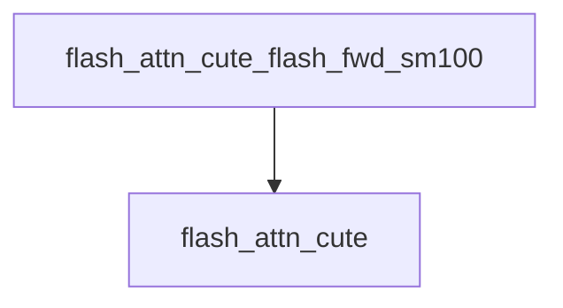

# 开源项目分析 · Dao-AILab/flash-attention

## 运行元数据

| 项 | 值 |
|---|---|
| 仓库 | Dao-AILab/flash-attention |
| commit | `f63c472c4dc19237c0635d6a629df065ff64796e` |
| 分析基准时间 (as-of) | 2026-11-13T16:16:57Z |
| 通道 / 领域 | classic / 未指定 |
| 请求档位 (requested_depth) | fast |
| **实际档位** (actual_depth) | fast |
| 降级原因 (reason) | baseline — 按通道基线 |
| 配额状态 (quota_state) | strong 0/1、fast 0/3（周起点 2026-11-09）；tokens 周 0/2000000、月 97234/6000000（月起点 2026-11-01） |
| 快照 sha256 | `0045085fe68688c21518ba79bb5f44bdc69f243b369c0c6458d8e3978a004266` |
| 成本说明 | 本次 ¥0.0278（模型调用 1 次）；输入 12,591 tok / 命中 0 tok / 输出 325 tok |
| 累计 | 本周 ¥0.0278 / 12,916 tok；本月 ¥0.5873 / 110,150 tok |
| 单价 | deepseek-flash 输入未命中 ¥2/M · 缓存命中 ¥0.04/M · 输出 ¥8/M（官方中文页，核对 2026-11-03，取高峰价；低谷约为一半） |
| 口径 | 本次分析的成本（不含开发期重复调用）；账户累计见 cost；成本说明同 as-of 重跑不变（幂等优先）；两者不一致是设计，不是 bug |

**档位决策链路**：

1. L1 通道基线：classic → strong；自动链按 auto_default=fast 取更省档位 → fast（非 L4 人工 override）
2. 凭据：齐全
3. L2 周配额：fast 已用 0/3，未用满
4. L3 预算：估算 7557 × 安全系数 1.3 = 9824 tok（单选上限 120000），周 0/2000000
5. 结论：实际档位 fast（按通道基线）

**上下文组装**（裁剪发生在调用之前）：

| 块 | 优先级 | 估算 token |
|---|---|---|
| featcard | 1 | 1,776 |
| readme | 2 | 2,490 |
| source_files:csrc/flash_attn/src/flash_fwd_kernel.h | 4 | 1,512 |
| source_files:flash_attn/__init__.py | 4 | 122 |
| source_files:flash_attn/cute/__init__.py | 4 | 122 |
| source_files:flash_attn/cute/flash_fwd_sm100.py | 4 | 1,511 |
| source_files:flash_attn/ops/triton/__init__.py | 4 | 11 |
| source_files:hopper/__init__.py | 4 | 13 |

- 丢弃：—
- 合计 7,557 / 上限 120,000

## 体检事实（确定性，零 LLM）

| 指标 | 值 |
|---|---|
| Star / Fork | 25,292 / 3,224 |
| 被依赖 (Used by) | — |
| 贡献者 / Top1 占比 | 218 / 59.23% |
| Top10 贡献集中度 | 77.64% |
| 90 天 / 365 天提交 | 96 / 512 |
| 最近提交 / 距今天数 | 2026-11-11T23:13:38Z / 2 |
| 维护状态 | active |
| 项目年龄 / 发布数(365d) | 1,639 天 / 41 |
| 组织类型 / 许可证 | — / BSD-3-Clause |
| 文件数 / 体积 | 1,116 / 22.1 MiB |
| 内部模块依赖边 | 1 |

**语言构成**：C 0.02%、C++ 18.56%、Cuda 6.22%、Dockerfile 0.07%、Makefile 0.00%、Python 75.06%、Shell 0.07%

**模块体量 Top10**

| 模块 | 文件数 | 字节 |
|---|---|---|
| assets | 17 | 15,129,325 |
| flash_attn | 114 | 3,288,530 |
| tests | 73 | 1,748,796 |
| hopper | 507 | 1,480,464 |
| csrc | 197 | 795,356 |
| training | 145 | 219,180 |
| benchmarks | 13 | 162,789 |
| AI | 16 | 141,168 |
| . | 12 | 84,704 |
| tools | 11 | 43,543 |

**未获得的指标**：

- `used_by`：GitHub 无公开 API；L0 标注为未获得，不估算

## 特征卡摘要

- 卡文件：`data/featcards/Dao-AILab__flash-attention__f63c472c4dc19237c0635d6a629df065ff64796e.json`（schema 1.0）
- 入口文件：—
- 最大目录深度：5；monorepo：是
- 源码切片：17 个文件（tarball `e58083f8cca64e73`）
- 依赖：直接 / 传递 = — / —（L1 未解析清单文件）

**并行轴**

- 并行 `CP` = false（无证据）
- 并行 `DP` = false（无证据）
- 并行 `EP` = false（无证据）
- 并行 `PP` = true（证据 1 条）
  - `training/README.md:24` — `training techniques (e.g., pipeline parallelism, tensor parallelism),`
- 并行 `SP` = false（无证据）
- 并行 `TP` = true（证据 1 条）
  - `training/README.md:24` — `training techniques (e.g., pipeline parallelism, tensor parallelism),`

**缓存**

- 缓存 `kv_offload` = false（无证据）
- 缓存 `paged` = true（证据 3 条）
  - `flash_attn/cute/flash_fwd_sm100.py:37` — `from flash_attn.cute.paged_kv import PagedKVManager, resolve_paged_token`
  - `flash_attn/cute/flash_fwd_sm100.py:188` — `paged_kv_non_tma: bool = False,`
  - `flash_attn/cute/flash_fwd_sm100.py:201` — `assert not (config.pack_gqa or is_varlen_q or paged_kv_non_tma or config.num_splits > 1)`
- 缓存 `prefix_reuse` = false（无证据）
- 缓存 `radix` = false（无证据）

- 硬件：vendors=[amd, nvidia]、arch_gates=[ampere, blackwell, cdna, hopper]、kernel_langs=[cuda, triton]
- 治理文档：否

**依赖图**（内部模块 import 边，节点/边排序后输出）

**已知限制**：

- 证据来自 17 个源码切片的逐行扫描，未覆盖文件不计入
- issue_close_ratio_90d 需 search API，L0/L1 未调用
- cncf_or_foundation 与 Organization 的 org_type 细分需人工判定，置 null

## 洞见

| id | 选择 | 放弃的替代 | 代价 | 证据 |
|---|---|---|---|---|
| t1 | 用 CuTe DSL 重写 SM100 前向内核 | 沿用 CUDA C++ 模板内核 | 依赖 cutlass/quack 新工具链 | `flash_attn/cute/flash_fwd_sm100.py:37` |
| t2 | SM100 内核支持 paged KV 与 split-kv | 仅连续 KV 单次切分 | 非 TMA paged 与 pack_gqa 等组合被断言禁止 | `flash_attn/cute/flash_fwd_sm100.py:201` |
| t3 | 按架构分目录维护多代内核 | 单一内核兼容所有 GPU | hopper/csrc/cute 多套代码重复维护 | `hopper/flash_attn_3/__init__.py:1` |
| t4 | 用 extend_path 支持 fa2/fa4 共存安装 | 单一包名独占安装 | 命名空间路径解析更复杂 | `flash_attn/__init__.py:4` |
| t5 | 训练侧聚焦单机 8 卡性能优化 | 自研大规模分布式训练 | PP/TP 等交由 Megatron/DeepSpeed | `training/README.md:24` |

- 置信度：med
- 架构范式标签：专用优化、深优化、硬件耦合

## 外部资料

- 来源：deepwiki
- url：https://deepwiki.com/Dao-AILab/flash-attention
- fetched_at：2026-11-13T16:17:41Z
- sha256：`4bd7b82f55619280bbc158475ef51e87fcb398ac820ae89f48c0624b86bfe737`
- 判定：hit — 正文含 8 个仓库内真实路径（阈值 3）
- 原文快照：`source.txt`（与判定元数据分文件存放）
