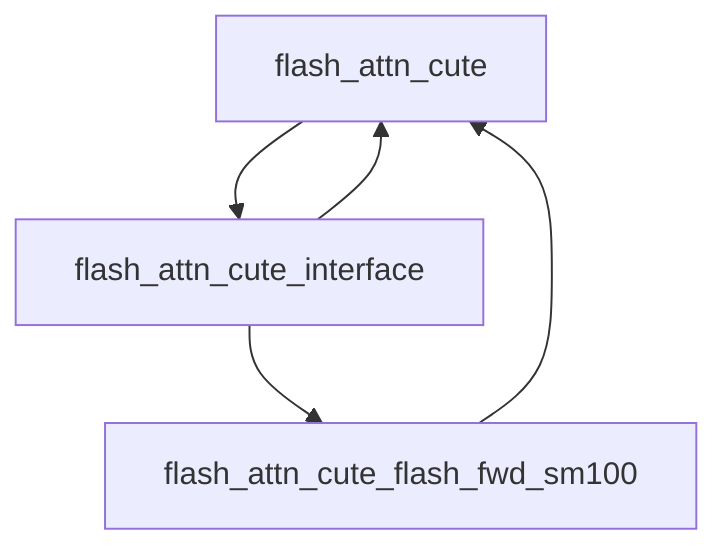

# Dao-AILab/flash-attention 深度分析

> 阅读档位：选型尽调（profile=adoption_due_diligence）
> 注意力预算：定位 15 / 架构 15 / 抽象 10 / ADR 10 / 扩展 5 / 经验卡 0 / 工程维护 45
> 证据约定：[事实] 确定性提取 · [判断] 有 file:line 或文档锚点 · [未获得] 当前未采集

## 导读

> **是什么**：Fast and memory-efficient exact attention
> **架构一句话**：[判断] 顶层以 `assets`、`flash_attn`、`tests` 为主（静态结构判断，未做动态跟踪）。
> **最大风险**：Top1 贡献者占比 58.76%，决策集中度需关注
> **不适合**：需要稳定 API/长期支持承诺的场景，请先核对发布节奏与维护状态；依赖链许可证与权重许可能力当前未采集，不能据此做出商用结论。

## 1. 项目定位与目标

[事实] Dao-AILab/flash-attention 属于 `ai_infra` 领域、`classic` 通道，主语言 Python（75%），25,316 stars / 3,243 forks。

[事实] 项目自述：Fast and memory-efficient exact attention。

[事实] README 摘要：This repo contains examples of how FlashAttention can be integrated into a model (e.g., GPT, ViT) and trained end-to-end. We also provide optimized implementations of other layers (e.g., MLP, LayerNorm, cross-entropy loss, rotary embedding). Overall this speeds up training by 3-5x compared to the baseline implementation from Huggingface, reaching up to 189 TFLOPs/sec per A100, equivalent to 60.6\% model FLOPs utilization (we don't need any activation。

- **目标用户**：[判断] 终端用户与性能调优人员
- **替代方案与差异**：[未获得] 本次未采集竞品对比与 roadmap，不得据此推断「没有替代品」。
- **不解决什么**：[未获得] 没有路线图与 issue 语料，无法可靠界定能力边界。

[判断] 阶段信号：仓库已存在 1,644 天，近一年发布 42 个版本，最近提交距今 0 天，维护状态「active」。这只说明是否仍在维护，不等于成熟度结论。

## 2. 架构全景

### 2.1 上下文边界

[判断] 架构说明文档：`.github/workflows/README.md`, `README.md`, `csrc/fused_dense_lib/README.md`, `csrc/layer_norm/README.md`, `examples/inference/README.md`；边界结论来自文档与目录结构，未经运行验证。
[事实] 硬件/内核线索：vendors=[amd, nvidia]、kernel_langs=[cuda, triton]。

### 2.2 模块职责

| 模块 | 文件数 | 职责（启发式） |
|---|---:|---|
| `assets` | 17 | 业务实现（职责需人工确认） |
| `flash_attn` | 114 | 业务实现（职责需人工确认） |
| `tests` | 75 | 测试与用例 |
| `hopper` | 507 | 业务实现（职责需人工确认） |
| `csrc` | 197 | 原生内核与算子实现 |

### 2.3 一次调用的路径（运行时视图）

[判断] 静态推断：入口未识别 → `flash_attn/cute`（依赖最集中） → `flash_attn/cute/interface`（依赖最集中） → 输出。内部 import 边约 4 条，只用于判断调用方向；**未做运行时跟踪**，参数与分支需读源码确认。

### 2.4 数据与控制流

[事实] 并行轴命中 PP, SP, TP；缓存轴命中 paged（证据见附录 A）。

## 3. 核心抽象与契约

[事实] 源码切片中命中以下模式（正则扫描，仅代表本次切片）：

| 模式 | 位置 | 说明 |
|---|---|---|
| `register` | `csrc/flash_attn/src/flash_fwd_kernel.h:142` | 候选扩展/契约点 |
| `protocol` | `flash_attn/cute/flash_fwd_sm100.py:69` | 候选扩展/契约点 |
| `backend` | `flash_attn/cute/interface.py:178` | 候选扩展/契约点 |

[判断] 这些命中说明项目存在注册/适配/分派结构，但**未做 AST 分析**，无法确认继承关系与调用契约的完整性。

## 4. 关键设计决策（ADR）

每条固定六字段：决策 / 替代 / 代价 / 证据 / 可复用规则 / 边界·反模式。

### ADR-1 · t1: 按 SM80/90/100/120 分架构各写一套前向内核

- **决策**：按 SM80/90/100/120 分架构各写一套前向内核
- **替代**：单一通用内核跨架构复用
- **代价**：代码重复，每代架构需单独维护与调优
- **证据**：`flash_attn/cute/interface.py:70`
- **可复用规则**：性能敏感内核按硬件代际分叉实现，而非抽象统一
- **边界/反模式**：架构差异小或团队人力不足时，分叉维护成本会超过收益

### ADR-2 · t2: 用 CUTE DSL 在 Python 中生成内核

- **决策**：用 CUTE DSL 在 Python 中生成内核
- **替代**：手写 CUDA C++ 模板内核
- **代价**：依赖 cutlass-dsl 版本，编译链更复杂
- **证据**：`flash_attn/cute/interface.py:2`
- **可复用规则**：用 DSL 生成内核换取开发效率，需锁定工具链版本
- **边界/反模式**：需要极致手工调度或工具链不可控时，应回退手写 CUDA

### ADR-3 · t3: SM100 前向暂不支持 page size != 128 与 hdim 192/256

- **决策**：SM100 前向暂不支持 page size != 128 与 hdim 192/256
- **替代**：一次性支持全部页大小与头维度
- **代价**：部分推理场景无法直接使用新内核
- **证据**：`flash_attn/cute/flash_fwd_sm100.py:8`
- **可复用规则**：新内核先覆盖主流配置，边缘配置延后补齐
- **边界/反模式**：若目标用户普遍使用非 128 页大小，延后会阻塞落地

### ADR-4 · t4: paged KV 与 pack_gqa/varlen/split 组合直接断言禁止

- **决策**：paged KV 与 pack_gqa/varlen/split 组合直接断言禁止
- **替代**：支持任意特性组合
- **代价**：特性组合受限，用户需自行拆分调用
- **证据**：`flash_attn/cute/flash_fwd_sm100.py:205`
- **可复用规则**：未验证的特性组合用断言显式拒绝，而非静默降级
- **边界/反模式**：面向终端用户的推理框架应改为自动回退路径

### ADR-5 · t5: 用 extend_path 让 fa2 与 fa4 共存安装

- **决策**：用 extend_path 让 fa2 与 fa4 共存安装
- **替代**：单一包名独占安装
- **代价**：命名空间路径解析更隐晦，调试成本上升
- **证据**：`flash_attn/__init__.py:4`
- **可复用规则**：多版本共存用命名空间包扩展，避免版本互斥
- **边界/反模式**：依赖静态打包分析或严格隔离的环境不适用

### ADR-6 · t6: 设备架构探测结果用 lru_cache 缓存

- **决策**：设备架构探测结果用 lru_cache 缓存
- **替代**：每次调用重新查询设备能力
- **代价**：运行中切换设备或覆盖环境变量后缓存不失效
- **证据**：`flash_attn/cute/interface.py:113`
- **可复用规则**：昂贵的设备/环境探测结果缓存，减少重复系统调用
- **边界/反模式**：需动态切换目标架构的测试场景应显式清缓存

## 5. 扩展与改造路径

[事实] 可扩展点候选（与第 3 章同源，已排除测试目录）：

- `csrc/flash_attn/src/flash_fwd_kernel.h:142` → register
- `flash_attn/cute/flash_fwd_sm100.py:69` → protocol
- `flash_attn/cute/interface.py:178` → backend

[判断] 新增能力的静态路径（需按实际代码复核）：

1. 在入口处接入参数/配置（入口候选：`csrc`）；
2. 复用上表中的注册/分派结构，实现新的后端或适配器；
3. 补对应测试与文档，再走发布流程。

- 扩展文档：[未获得]
- 改造成本：[未获得] 需要先确认契约稳定性与测试覆盖，本报告不估算人日。

## 6. 经验卡

### 经验 1 · 性能敏感内核按硬件代际分叉实现，而非抽象统一

- **证据**：`flash_attn/cute/interface.py:70`（来自 Dao-AILab/flash-attention）
- **适用边界**：架构差异小或团队人力不足时，分叉维护成本会超过收益
- **反模式**：在边界之外照搬「按 SM80/90/100/120 分架构各写一套前向内核」，代价会变成「代码重复，每代架构需单独维护与调优」
- **如果我来做**：先确认边界成立，再选择「按 SM80/90/100/120 分架构各写一套前向内核」而非「单一通用内核跨架构复用」

### 经验 2 · 用 DSL 生成内核换取开发效率，需锁定工具链版本

- **证据**：`flash_attn/cute/interface.py:2`（来自 Dao-AILab/flash-attention）
- **适用边界**：需要极致手工调度或工具链不可控时，应回退手写 CUDA
- **反模式**：在边界之外照搬「用 CUTE DSL 在 Python 中生成内核」，代价会变成「依赖 cutlass-dsl 版本，编译链更复杂」
- **如果我来做**：先确认边界成立，再选择「用 CUTE DSL 在 Python 中生成内核」而非「手写 CUDA C++ 模板内核」

### 经验 3 · 新内核先覆盖主流配置，边缘配置延后补齐

- **证据**：`flash_attn/cute/flash_fwd_sm100.py:8`（来自 Dao-AILab/flash-attention）
- **适用边界**：若目标用户普遍使用非 128 页大小，延后会阻塞落地
- **反模式**：在边界之外照搬「SM100 前向暂不支持 page size != 128 与 hdim 192/256」，代价会变成「部分推理场景无法直接使用新内核」
- **如果我来做**：先确认边界成立，再选择「SM100 前向暂不支持 page size != 128 与 hdim 192/256」而非「一次性支持全部页大小与头维度」

### 经验 4 · 未验证的特性组合用断言显式拒绝，而非静默降级

- **证据**：`flash_attn/cute/flash_fwd_sm100.py:205`（来自 Dao-AILab/flash-attention）
- **适用边界**：面向终端用户的推理框架应改为自动回退路径
- **反模式**：在边界之外照搬「paged KV 与 pack_gqa/varlen/split 组合直接断言禁止」，代价会变成「特性组合受限，用户需自行拆分调用」
- **如果我来做**：先确认边界成立，再选择「paged KV 与 pack_gqa/varlen/split 组合直接断言禁止」而非「支持任意特性组合」

### 经验 5 · 多版本共存用命名空间包扩展，避免版本互斥

- **证据**：`flash_attn/__init__.py:4`（来自 Dao-AILab/flash-attention）
- **适用边界**：依赖静态打包分析或严格隔离的环境不适用
- **反模式**：在边界之外照搬「用 extend_path 让 fa2 与 fa4 共存安装」，代价会变成「命名空间路径解析更隐晦，调试成本上升」
- **如果我来做**：先确认边界成立，再选择「用 extend_path 让 fa2 与 fa4 共存安装」而非「单一包名独占安装」

## 附录 A 证据索引与未知项

### A1. 代码证据索引

| id | 决策 | 证据 |
|---|---|---|
| t1 | 按 SM80/90/100/120 分架构各写一套前向内核 | `flash_attn/cute/interface.py:70` |
| t2 | 用 CUTE DSL 在 Python 中生成内核 | `flash_attn/cute/interface.py:2` |
| t3 | SM100 前向暂不支持 page size != 128 与 hdim 192/256 | `flash_attn/cute/flash_fwd_sm100.py:8` |
| t4 | paged KV 与 pack_gqa/varlen/split 组合直接断言禁止 | `flash_attn/cute/flash_fwd_sm100.py:205` |
| t5 | 用 extend_path 让 fa2 与 fa4 共存安装 | `flash_attn/__init__.py:4` |
| t6 | 设备架构探测结果用 lru_cache 缓存 | `flash_attn/cute/interface.py:113` |
| t7 | 大 batch 变长调度改用 O(1) 块到批查找替代二分 | `flash_attn/cute/interface.py:104` |
| t8 | 低精度缩放允许行最大值滞后以利用 dtype 上界码点 | `flash_attn/cute/flash_fwd_sm100.py:88` |

- 置信度：med
- 架构范式标签：专用优化、深优化、硬件耦合
- 模式 `register`：`csrc/flash_attn/src/flash_fwd_kernel.h:142`
- 模式 `protocol`：`flash_attn/cute/flash_fwd_sm100.py:69`
- 模式 `backend`：`flash_attn/cute/interface.py:178`

### A2. 外部资料

- 来源：deepwiki
- url：https://deepwiki.com/Dao-AILab/flash-attention
- fetched_at：2026-11-19T15:03:40Z
- sha256：`4bd7b82f55619280bbc158475ef51e87fcb398ac820ae89f48c0624b86bfe737`
- 判定：hit — 正文含 8 个仓库内真实路径（阈值 3）
- 原文快照：`source.txt`（与判定元数据分文件存放）

### A3. 未获得项

- 依赖链许可证、模型权重/数据许可、CLA —— 未采集；
- issue/PR 响应质量、CI 运行结果 —— 未采集；
- roadmap、竞品对比、用户画像 —— 未采集；
**未获得的指标**：

- `used_by`：GitHub 无公开 API；L0 标注为未获得，不估算

## 附录 B 许可证 / 维护 / 工程 / 成本

### B1. 许可证与合规风险

[事实] 主许可证 **BSD-3-Clause**；组织类型 —；治理文档：未检出。

[未获得] 依赖链是否存在 GPL/AGPL、模型权重与数据集许可、CLA 要求；这些必须人工或由后续数据源补齐，本报告不给出「可商用」结论。

### B2. 维护状态与风险

[事实] 贡献者 223 人，Top1 占比 58.76%；近 90 天 / 365 天提交 108 / 506 次；最近提交距今 0 天，维护状态「active」。

- Top1 贡献者占比 58.76%，决策集中度需关注
- 未检出治理文档，贡献与决策流程可能不透明

### B3. 运行与工程体系

[事实] 仓库约 1,118 个文件、22.1 MiB；本次采集 17 个源码切片（tarball `b19b123a8a22fd19`）。
[事实] 语言构成：C 0.02%、C++ 18.48%、Cuda 6.17%、Dockerfile 0.07%、Makefile 0.00%、Python 75.18%、Shell 0.07%；硬件 vendors=[amd, nvidia]、kernel_langs=[cuda, triton]。

[未获得] 构建脚本、依赖安装、测试体系、CI/CD、配置与 secret 管理未采集；本报告不能回答「能否在目标环境跑起来」。

**特征卡已知限制**：

- 证据来自 17 个源码切片的逐行扫描，未覆盖文件不计入
- issue_close_ratio_90d 需 search API，L0/L1 未调用
- cncf_or_foundation 与 Organization 的 org_type 细分需人工判定，置 null

### B4. 运行元数据与成本

| 项 | 值 |
|---|---|
| 仓库 | Dao-AILab/flash-attention |
| commit | `68bd095cdd338c5171bccb9c200529f3620b85c9` |
| 分析基准时间 (as-of) | 2026-11-18T00:00:00Z |
| 通道 / 领域 | classic / ai_infra |
| 请求档位 (requested_depth) | fast |
| **实际档位** (actual_depth) | fast |
| 降级原因 (reason) | manual_override — 人工 override |
| 配额状态 (quota_state) | strong 0/1、fast 14/5（周起点 2026-11-16）；tokens 周 204497/2000000、月 314647/6000000（月起点 2026-11-01） |
| 快照 sha256 | `3231dadd360410a9f3303a2a111d916e7a32710e0c433dfa8cdb55ab23556896` |
| 成本说明 | 本次 ¥0.0360（模型调用 1 次）；输入 14,982 tok / 命中 256 tok / 输出 820 tok |
| 累计 | 本周 ¥0.4141 / 220,299 tok；本月 ¥1.0014 / 330,449 tok |
| 单价 | deepseek-flash 输入未命中 ¥2/M · 缓存命中 ¥0.04/M · 输出 ¥8/M（官方中文页，核对 2026-11-03，取高峰价；低谷约为一半） |
| 口径 | 本次分析的成本（不含开发期重复调用）；账户累计见 cost；成本说明同 as-of 重跑不变（幂等优先）；两者不一致是设计，不是 bug |

**档位决策链路**：

1. L4 人工 override：--depth fast（绕过 L1 基线 / L2 配额）
2. 凭据：齐全
3. L2 周配额：人工 override 绕过（本周 strong 0/1、fast 14/5）
4. L3 预算：估算 9200 × 安全系数 1.3 = 11960 tok（单选上限 120000），周 204497/2000000
5. 结论：实际档位 fast（人工 override）

**上下文组装**（裁剪发生在调用之前）：

| 块 | 优先级 | 估算 token |
|---|---|---|
| featcard | 1 | 1,922 |
| readme | 2 | 2,490 |
| source_files:csrc/flash_attn/src/flash_fwd_kernel.h | 4 | 1,512 |
| source_files:flash_attn/__init__.py | 4 | 122 |
| source_files:flash_attn/cute/__init__.py | 4 | 122 |
| source_files:flash_attn/cute/flash_fwd_sm100.py | 4 | 1,511 |
| source_files:flash_attn/cute/interface.py | 4 | 1,510 |
| source_files:flash_attn/ops/triton/__init__.py | 4 | 11 |

- 丢弃：—
- 合计 9,200 / 上限 120,000

### B5. 特征卡摘要

- 卡文件：`data/featcards/Dao-AILab__flash-attention__68bd095cdd338c5171bccb9c200529f3620b85c9.json`（schema 1.0）
- 入口文件：—
- 最大目录深度：5；monorepo：是
- 源码切片：17 个文件（tarball `b19b123a8a22fd19`）
- 依赖：直接 / 传递 = — / —（L1 未解析清单文件）

**并行轴**

- 并行 `CP` = false（无证据）
- 并行 `DP` = false（无证据）
- 并行 `EP` = false（无证据）
- 并行 `PP` = true（证据 1 条）
  - `training/README.md:24` — `training techniques (e.g., pipeline parallelism, tensor parallelism),`
- 并行 `SP` = true（证据 1 条）
  - `flash_attn/cute/interface.py:3258` — `# return dk, dv in float32: all-reduce across sequence-parallel ranks must happen`
- 并行 `TP` = true（证据 1 条）
  - `training/README.md:24` — `training techniques (e.g., pipeline parallelism, tensor parallelism),`

**缓存**

- 缓存 `kv_offload` = false（无证据）
- 缓存 `paged` = true（证据 3 条）
  - `flash_attn/cute/flash_fwd_sm100.py:37` — `from flash_attn.cute.paged_kv import PagedKVManager, resolve_paged_token`
  - `flash_attn/cute/flash_fwd_sm100.py:188` — `paged_kv_non_tma: bool = False,`
  - `flash_attn/cute/flash_fwd_sm100.py:205` — `assert not (config.pack_gqa or is_varlen_q or paged_kv_non_tma or config.num_splits > 1)`
- 缓存 `prefix_reuse` = false（无证据）
- 缓存 `radix` = false（无证据）

- 硬件：vendors=[amd, nvidia]、arch_gates=[ampere, blackwell, cdna, hopper]、kernel_langs=[cuda, triton]
- 治理文档：否

**依赖图**（内部模块 import 边，节点/边排序后输出）

**已知限制**：

- 证据来自 17 个源码切片的逐行扫描，未覆盖文件不计入
- issue_close_ratio_90d 需 search API，L0/L1 未调用
- cncf_or_foundation 与 Organization 的 org_type 细分需人工判定，置 null

### B6. 体检事实（确定性，零 LLM）

| 指标 | 值 |
|---|---|
| Star / Fork | 25,316 / 3,243 |
| 被依赖 (Used by) | — |
| 贡献者 / Top1 占比 | 223 / 58.76% |
| Top10 贡献集中度 | 77.08% |
| 90 天 / 365 天提交 | 108 / 506 |
| 最近提交 / 距今天数 | 2026-11-18T03:47:24Z / 0 |
| 维护状态 | active |
| 项目年龄 / 发布数(365d) | 1,644 天 / 42 |
| 组织类型 / 许可证 | — / BSD-3-Clause |
| 文件数 / 体积 | 1,118 / 22.1 MiB |
| 内部模块依赖边 | 4 |

**语言构成**：C 0.02%、C++ 18.48%、Cuda 6.17%、Dockerfile 0.07%、Makefile 0.00%、Python 75.18%、Shell 0.07%

**模块体量 Top10**

| 模块 | 文件数 | 字节 |
|---|---|---|
| assets | 17 | 15,129,325 |
| flash_attn | 114 | 3,309,694 |
| tests | 75 | 1,776,588 |
| hopper | 507 | 1,494,065 |
| csrc | 197 | 796,047 |
| training | 145 | 219,180 |
| benchmarks | 13 | 162,789 |
| AI | 16 | 141,168 |
| . | 12 | 84,704 |
| tools | 11 | 47,176 |

**未获得的指标**：

- `used_by`：GitHub 无公开 API；L0 标注为未获得，不估算
