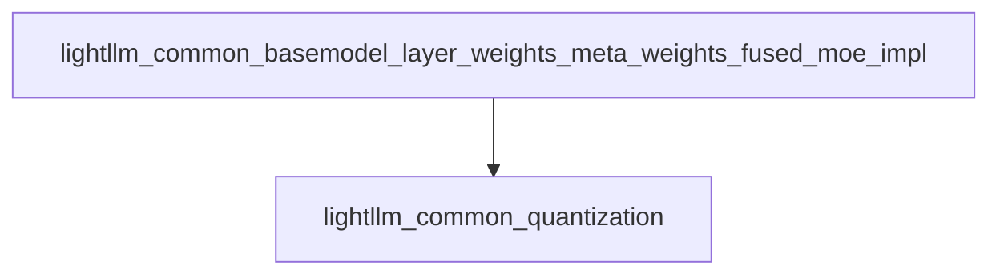

# ModelTC/lightllm 深度分析

> 阅读档位：架构学习（profile=architecture_learning）
> 注意力预算：定位 20 / 架构 30 / 抽象 15 / ADR 20 / 扩展 5 / 经验卡 10 / 工程维护 0
> 证据约定：[事实] 确定性提取 · [判断] 有 file:line 或文档锚点 · [未获得] 当前未采集

## 导读

> **是什么**：LightLLM is a Python-based LLM (Large Language Model) inference and serving framework, notable for its lightweight design, easy scalability, and high-speed performance.
> **架构一句话**：[判断] 顶层以 `lightllm`、`unit_tests`、`docs` 为主（静态结构判断，未做动态跟踪）。
> **最大风险**：Top1 贡献者占比 31.83%，决策集中度需关注
> **不适合**：需要稳定 API/长期支持承诺的场景，请先核对发布节奏与维护状态；依赖链许可证与权重许可能力当前未采集，不能据此做出商用结论。

## 1. 项目定位与目标

[事实] ModelTC/lightllm 属于 `inference` 领域、`classic` 通道，主语言 Python（99%），4,364 stars / 389 forks。

[事实] 项目自述：LightLLM is a Python-based LLM (Large Language Model) inference and serving framework, notable for its lightweight design, easy scalability, and high-speed performance.。

[事实] README 摘要：This directory contains various startup scripts for deploying DeepSeek models with LightLLM, covering different deployment modes and hardware configurations. - `single_node_tp.sh` - Single node tensor parallelism (TP) mode - `single_node_ep.sh` - Single node expert parallelism (EP) mode - `multi_node_tp_node0.sh` - Multi-node tensor parallelism node 0 - `multi_node_tp_node1.sh` - Multi-node tensor parallelism node 1 - `multi_node_ep_node0.sh` - Multi-node expert parallelism node 0。

- **目标用户**：[判断] 模型工程师 / 推理基础设施开发者；应用与平台开发者
- **替代方案与差异**：[未获得] 本次未采集竞品对比与 roadmap，不得据此推断「没有替代品」。
- **不解决什么**：[未获得] 没有路线图与 issue 语料，无法可靠界定能力边界。

[判断] 阶段信号：仓库已存在 1,215 天，近一年发布 1 个版本，最近提交距今 0 天，维护状态「active」。这只说明是否仍在维护，不等于成熟度结论。

## 2. 架构全景

### 2.1 上下文边界

[判断] 架构说明文档：`README.md`, `demos/readme.txt`, `docs/CN/README.md`, `docs/EN/README.md`, `test/start_scripts/README.md`；边界结论来自文档与目录结构，未经运行验证。
[事实] 硬件/内核线索：vendors=[nvidia]、kernel_langs=[cuda, triton]。

### 2.2 模块职责

| 模块 | 文件数 | 职责（启发式） |
|---|---:|---|
| `lightllm` | 1,671 | 业务实现（职责需人工确认） |
| `unit_tests` | 328 | 测试与用例 |
| `docs` | 89 | 文档 |
| `test` | 124 | 测试与用例 |
| `assets` | 4 | 业务实现（职责需人工确认） |

### 2.3 一次调用的路径（运行时视图）

[判断] 静态推断：入口未识别 → `lightllm/common/basemodel/layer_weights/meta_weights/fused_moe/impl`（依赖最集中） → `lightllm/common/quantization`（依赖最集中） → 输出。内部 import 边约 1 条，只用于判断调用方向；**未做运行时跟踪**，参数与分支需读源码确认。

### 2.4 数据与控制流

[事实] 并行轴命中 DP, EP, TP（证据见附录 A）。

## 3. 核心抽象与契约

[事实] 源码切片中命中以下模式（正则扫描，仅代表本次切片）：

| 模式 | 位置 | 说明 |
|---|---|---|
| `registry` | `lightllm/common/quantization/__init__.py:4` | 候选扩展/契约点 |
| `register` | `lightllm/models/deepseek3_2/__init__.py:21` | 候选扩展/契约点 |
| `factory` | `lightllm/server/audioserver/model_infer/__init__.py:9` | 候选扩展/契约点 |
| `registry` | `lightllm/server/audioserver/model_infer/__init__.py:10` | 候选扩展/契约点 |
| `protocol` | `lightllm/server/audioserver/model_infer/__init__.py:23` | 候选扩展/契约点 |
| `backend` | `lightllm/server/router/model_infer/mode_backend/prefill_queue_strategy/__init__.py:7` | 候选扩展/契约点 |
| `backend` | `lightllm/server/router/model_infer/mtp_speculative/dp_overlap_proposers/__init__.py:4` | 候选扩展/契约点 |
| `backend` | `lightllm/server/router/model_infer/mtp_speculative/proposers/__init__.py:4` | 候选扩展/契约点 |
| `factory` | `lightllm/server/visualserver/model_infer/__init__.py:9` | 候选扩展/契约点 |
| `registry` | `lightllm/server/visualserver/model_infer/__init__.py:12` | 候选扩展/契约点 |

[判断] 这些命中说明项目存在注册/适配/分派结构，但**未做 AST 分析**，无法确认继承关系与调用契约的完整性。

## 4. 关键设计决策（ADR）

每条固定六字段：决策 / 替代 / 代价 / 证据 / 可复用规则 / 边界·反模式。

### ADR-1 · t1: 按 EP/量化方法分派 MoE 后端实现

- **决策**：按 EP/量化方法分派 MoE 后端实现
- **替代**：统一单一 MoE kernel 实现
- **代价**：需维护 Triton/Marlin/DeepGEMM 三套后端
- **证据**：`lightllm/common/basemodel/layer_weights/meta_weights/fused_moe/impl/__init__.py:20`
- **可复用规则**：按部署模式与量化格式分派 kernel 后端，而非一套通用实现
- **边界/反模式**：后端数量增长会放大测试矩阵；小团队维护三套以上不划算

### ADR-2 · t2: 实现对象自持路由运行态而非仅返回类

- **决策**：实现对象自持路由运行态而非仅返回类
- **替代**：返回无状态实现类由调用方管理状态
- **代价**：状态与 kernel 绑定，复用与序列化更难
- **证据**：`lightllm/common/basemodel/layer_weights/meta_weights/fused_moe/impl/__init__.py:17`
- **可复用规则**：后端专属状态与使用它的 kernel 放在同一对象内
- **边界/反模式**：需跨层共享或持久化状态时，内聚反而阻碍复用

### ADR-3 · t3: 注意力状态按 full/bounded 两类分族扩展

- **决策**：注意力状态按 full/bounded 两类分族扩展
- **替代**：单一注意力状态类加分支判断
- **代价**：类型与配置类数量膨胀，入口分散
- **证据**：`lightllm/common/attention_state/full_att/__init__.py:1`
- **可复用规则**：按注意力语义分族建模状态，族内再按算法细分
- **边界/反模式**：模型种类少时分层过度，增加样板代码

### ADR-4 · t4: mHC 投影默认走 DeepGEMM 并留 PyTorch 回退

- **决策**：mHC 投影默认走 DeepGEMM 并留 PyTorch 回退
- **替代**：仅用 PyTorch 实现保证可移植
- **代价**：双后端需保证数值一致，增加验证成本
- **证据**：`lightllm/common/basemodel/triton_kernel/mhc/__init__.py:20`
- **可复用规则**：高性能后端默认开启，同时保留可切换的通用回退路径
- **边界/反模式**：回退路径若长期不被测试，会静默腐化

### ADR-5 · t5: Triton autotune 按 GPU/版本/形状缓存配置

- **决策**：Triton autotune 按 GPU/版本/形状缓存配置
- **替代**：每次启动重新搜索 kernel 配置
- **代价**：缓存键维度多，配置失效需手动清理
- **证据**：`lightllm/common/basemodel/triton_kernel/mhc/__init__.py:33`
- **可复用规则**：autotune 结果按硬件与形状键缓存，避免重复搜索
- **边界/反模式**：形状高度动态时缓存命中率低，收益有限

### ADR-6 · t6: PD 分离部署并提供可插拔 KV 传输后端

- **决策**：PD 分离部署并提供可插拔 KV 传输后端
- **替代**：单体 prefill+decode 同进程部署
- **代价**：多服务编排与拓扑配置复杂度上升
- **证据**：`test/start_scripts/README.md:104`
- **可复用规则**：PD 分离时把 KV 传输后端做成可配置项，两端保持一致
- **边界/反模式**：小规模单机部署下分离带来的调度开销大于收益

## 5. 扩展与改造路径

[事实] 可扩展点候选（与第 3 章同源，已排除测试目录）：

- `lightllm/common/quantization/__init__.py:4` → registry
- `lightllm/models/deepseek3_2/__init__.py:21` → register
- `lightllm/server/audioserver/model_infer/__init__.py:9` → factory
- `lightllm/server/audioserver/model_infer/__init__.py:10` → registry
- `lightllm/server/audioserver/model_infer/__init__.py:23` → protocol
- `lightllm/server/router/model_infer/mode_backend/prefill_queue_strategy/__init__.py:7` → backend

[判断] 新增能力的静态路径（需按实际代码复核）：

1. 在入口处接入参数/配置（入口候选：[未获得]）；
2. 复用上表中的注册/分派结构，实现新的后端或适配器；
3. 补对应测试与文档，再走发布流程。

- 扩展文档：[未获得]
- 改造成本：[未获得] 需要先确认契约稳定性与测试覆盖，本报告不估算人日。

## 6. 经验卡

### 经验 1 · 按部署模式与量化格式分派 kernel 后端，而非一套通用实现

- **证据**：`lightllm/common/basemodel/layer_weights/meta_weights/fused_moe/impl/__init__.py:20`（来自 ModelTC/lightllm）
- **适用边界**：后端数量增长会放大测试矩阵；小团队维护三套以上不划算
- **反模式**：在边界之外照搬「按 EP/量化方法分派 MoE 后端实现」，代价会变成「需维护 Triton/Marlin/DeepGEMM 三套后端」
- **如果我来做**：先确认边界成立，再选择「按 EP/量化方法分派 MoE 后端实现」而非「统一单一 MoE kernel 实现」

### 经验 2 · 后端专属状态与使用它的 kernel 放在同一对象内

- **证据**：`lightllm/common/basemodel/layer_weights/meta_weights/fused_moe/impl/__init__.py:17`（来自 ModelTC/lightllm）
- **适用边界**：需跨层共享或持久化状态时，内聚反而阻碍复用
- **反模式**：在边界之外照搬「实现对象自持路由运行态而非仅返回类」，代价会变成「状态与 kernel 绑定，复用与序列化更难」
- **如果我来做**：先确认边界成立，再选择「实现对象自持路由运行态而非仅返回类」而非「返回无状态实现类由调用方管理状态」

### 经验 3 · 按注意力语义分族建模状态，族内再按算法细分

- **证据**：`lightllm/common/attention_state/full_att/__init__.py:1`（来自 ModelTC/lightllm）
- **适用边界**：模型种类少时分层过度，增加样板代码
- **反模式**：在边界之外照搬「注意力状态按 full/bounded 两类分族扩展」，代价会变成「类型与配置类数量膨胀，入口分散」
- **如果我来做**：先确认边界成立，再选择「注意力状态按 full/bounded 两类分族扩展」而非「单一注意力状态类加分支判断」

### 经验 4 · 高性能后端默认开启，同时保留可切换的通用回退路径

- **证据**：`lightllm/common/basemodel/triton_kernel/mhc/__init__.py:20`（来自 ModelTC/lightllm）
- **适用边界**：回退路径若长期不被测试，会静默腐化
- **反模式**：在边界之外照搬「mHC 投影默认走 DeepGEMM 并留 PyTorch 回退」，代价会变成「双后端需保证数值一致，增加验证成本」
- **如果我来做**：先确认边界成立，再选择「mHC 投影默认走 DeepGEMM 并留 PyTorch 回退」而非「仅用 PyTorch 实现保证可移植」

### 经验 5 · autotune 结果按硬件与形状键缓存，避免重复搜索

- **证据**：`lightllm/common/basemodel/triton_kernel/mhc/__init__.py:33`（来自 ModelTC/lightllm）
- **适用边界**：形状高度动态时缓存命中率低，收益有限
- **反模式**：在边界之外照搬「Triton autotune 按 GPU/版本/形状缓存配置」，代价会变成「缓存键维度多，配置失效需手动清理」
- **如果我来做**：先确认边界成立，再选择「Triton autotune 按 GPU/版本/形状缓存配置」而非「每次启动重新搜索 kernel 配置」

## 附录 A 证据索引与未知项

### A1. 代码证据索引

| id | 决策 | 证据 |
|---|---|---|
| t1 | 按 EP/量化方法分派 MoE 后端实现 | `lightllm/common/basemodel/layer_weights/meta_weights/fused_moe/impl/__init__.py:20` |
| t2 | 实现对象自持路由运行态而非仅返回类 | `lightllm/common/basemodel/layer_weights/meta_weights/fused_moe/impl/__init__.py:17` |
| t3 | 注意力状态按 full/bounded 两类分族扩展 | `lightllm/common/attention_state/full_att/__init__.py:1` |
| t4 | mHC 投影默认走 DeepGEMM 并留 PyTorch 回退 | `lightllm/common/basemodel/triton_kernel/mhc/__init__.py:20` |
| t5 | Triton autotune 按 GPU/版本/形状缓存配置 | `lightllm/common/basemodel/triton_kernel/mhc/__init__.py:33` |
| t6 | PD 分离部署并提供可插拔 KV 传输后端 | `test/start_scripts/README.md:104` |
| t7 | 同时支持 TP 与 EP 两种并行切分 | `test/start_scripts/README.md:9` |

- 置信度：med
- 架构范式标签：专用优化、内核融合、并行切分
- 模式 `registry`：`lightllm/common/quantization/__init__.py:4`
- 模式 `register`：`lightllm/models/deepseek3_2/__init__.py:21`
- 模式 `factory`：`lightllm/server/audioserver/model_infer/__init__.py:9`
- 模式 `registry`：`lightllm/server/audioserver/model_infer/__init__.py:10`
- 模式 `protocol`：`lightllm/server/audioserver/model_infer/__init__.py:23`
- 模式 `backend`：`lightllm/server/router/model_infer/mode_backend/prefill_queue_strategy/__init__.py:7`
- 模式 `backend`：`lightllm/server/router/model_infer/mtp_speculative/dp_overlap_proposers/__init__.py:4`
- 模式 `backend`：`lightllm/server/router/model_infer/mtp_speculative/proposers/__init__.py:4`
- 模式 `factory`：`lightllm/server/visualserver/model_infer/__init__.py:9`
- 模式 `registry`：`lightllm/server/visualserver/model_infer/__init__.py:12`
- 模式 `protocol`：`lightllm/server/visualserver/model_infer/__init__.py:28`

### A2. 外部资料

- 来源：deepwiki
- url：https://deepwiki.com/ModelTC/lightllm
- fetched_at：2026-11-19T15:04:11Z
- sha256：`f9309e8988f4bda01a633ba179ea759e6c70cf245fbad5ea794dd9c216453ae4`
- 判定：miss — 正文仅含 1 个仓库内真实路径（阈值 3）→ 视为未索引/模板页
- 原文快照：`source.txt`（与判定元数据分文件存放）
- 结论：不可用（未索引）

### A3. 未获得项

- 依赖链许可证、模型权重/数据许可、CLA —— 未采集；
- issue/PR 响应质量、CI 运行结果 —— 未采集；
- roadmap、竞品对比、用户画像 —— 未采集；
**未获得的指标**：

- `used_by`：GitHub 无公开 API；L0 标注为未获得，不估算

## 附录 B 许可证 / 维护 / 工程 / 成本

### B1. 许可证与合规风险

[事实] 主许可证 **Apache-2.0**；组织类型 —；治理文档：有。

[未获得] 依赖链是否存在 GPL/AGPL、模型权重与数据集许可、CLA 要求；这些必须人工或由后续数据源补齐，本报告不给出「可商用」结论。

### B2. 维护状态与风险

[事实] 贡献者 55 人，Top1 占比 31.83%；近 90 天 / 365 天提交 144 / 360 次；最近提交距今 0 天，维护状态「active」。

- Top1 贡献者占比 31.83%，决策集中度需关注
- 外部架构资料未命中，架构判断主要依赖本地代码切片

### B3. 运行与工程体系

[事实] 仓库约 2,275 个文件、13.2 MiB；本次采集 20 个源码切片（tarball `46fcbb86f920826f`）。
[事实] 语言构成：Dockerfile 0.06%、Jinja 0.10%、Python 99.12%、Shell 0.72%；硬件 vendors=[nvidia]、kernel_langs=[cuda, triton]。

[未获得] 构建脚本、依赖安装、测试体系、CI/CD、配置与 secret 管理未采集；本报告不能回答「能否在目标环境跑起来」。

**特征卡已知限制**：

- 证据来自 20 个源码切片的逐行扫描，未覆盖文件不计入
- issue_close_ratio_90d 需 search API，L0/L1 未调用
- cncf_or_foundation 与 Organization 的 org_type 细分需人工判定，置 null

### B4. 运行元数据与成本

| 项 | 值 |
|---|---|
| 仓库 | ModelTC/lightllm |
| commit | `fa852748dcc9b9ca10710509a0b80220c0b9deb8` |
| 分析基准时间 (as-of) | 2026-11-18T00:00:00Z |
| 通道 / 领域 | classic / inference |
| 请求档位 (requested_depth) | fast |
| **实际档位** (actual_depth) | fast |
| 降级原因 (reason) | manual_override — 人工 override |
| 配额状态 (quota_state) | strong 0/1、fast 10/5（周起点 2026-11-16）；tokens 周 148807/2000000、月 258957/6000000（月起点 2026-11-01） |
| 快照 sha256 | `a7c7752ee4a03b3ff45f089dbf432b7093f52dc2fff27eaa8a0ca8a5ac37001f` |
| 成本说明 | 本次 ¥0.0282（模型调用 1 次）；输入 11,303 tok / 命中 256 tok / 输出 762 tok |
| 累计 | 本周 ¥0.2772 / 160,872 tok；本月 ¥0.8645 / 271,022 tok |
| 单价 | deepseek-flash 输入未命中 ¥2/M · 缓存命中 ¥0.04/M · 输出 ¥8/M（官方中文页，核对 2026-11-03，取高峰价；低谷约为一半） |
| 口径 | 本次分析的成本（不含开发期重复调用）；账户累计见 cost；成本说明同 as-of 重跑不变（幂等优先）；两者不一致是设计，不是 bug |

**档位决策链路**：

1. L4 人工 override：--depth fast（绕过 L1 基线 / L2 配额）
2. 凭据：齐全
3. L2 周配额：人工 override 绕过（本周 strong 0/1、fast 10/5）
4. L3 预算：估算 5548 × 安全系数 1.3 = 7212 tok（单选上限 120000），周 148807/2000000
5. 结论：实际档位 fast（人工 override）

**上下文组装**（裁剪发生在调用之前）：

| 块 | 优先级 | 估算 token |
|---|---|---|
| featcard | 1 | 2,082 |
| readme | 2 | 1,300 |
| source_files:lightllm/common/attention_state/bounded_att/__init__.py | 4 | 301 |
| source_files:lightllm/common/attention_state/full_att/__init__.py | 4 | 464 |
| source_files:lightllm/common/basemodel/__init__.py | 4 | 286 |
| source_files:lightllm/common/basemodel/layer_weights/meta_weights/fused_moe/impl/__init__.py | 4 | 275 |
| source_files:lightllm/common/basemodel/triton_kernel/fused_moe/grouped_fused_moe_ep/__init__.py | 4 | 309 |
| source_files:lightllm/common/basemodel/triton_kernel/mhc/__init__.py | 4 | 531 |

- 丢弃：—
- 合计 5,548 / 上限 120,000

### B5. 特征卡摘要

- 卡文件：`data/featcards/ModelTC__lightllm__fa852748dcc9b9ca10710509a0b80220c0b9deb8.json`（schema 1.0）
- 入口文件：—
- 最大目录深度：9；monorepo：否
- 源码切片：20 个文件（tarball `46fcbb86f920826f`）
- 依赖：直接 / 传递 = — / —（L1 未解析清单文件）

**并行轴**

- 并行 `CP` = false（无证据）
- 并行 `DP` = true（证据 1 条）
  - `test/start_scripts/README.md:107` — `- `--dp`: Data parallelism degree`
- 并行 `EP` = true（证据 3 条）
  - `test/start_scripts/README.md:10` — `- `single_node_ep.sh` - Single node expert parallelism (EP) mode`
  - `test/start_scripts/README.md:16` — `- `multi_node_ep_node0.sh` - Multi-node expert parallelism node 0`
  - `test/start_scripts/README.md:17` — `- `multi_node_ep_node1.sh` - Multi-node expert parallelism node 1`
- 并行 `PP` = false（无证据）
- 并行 `SP` = false（无证据）
- 并行 `TP` = true（证据 3 条）
  - `test/start_scripts/README.md:9` — `- `single_node_tp.sh` - Single node tensor parallelism (TP) mode`
  - `test/start_scripts/README.md:14` — `- `multi_node_tp_node0.sh` - Multi-node tensor parallelism node 0`
  - `test/start_scripts/README.md:15` — `- `multi_node_tp_node1.sh` - Multi-node tensor parallelism node 1`

**缓存**

- 缓存 `kv_offload` = false（无证据）
- 缓存 `paged` = false（无证据）
- 缓存 `prefix_reuse` = false（无证据）
- 缓存 `radix` = false（无证据）

- 硬件：vendors=[nvidia]、arch_gates=[blackwell]、kernel_langs=[cuda, triton]
- 治理文档：是

**依赖图**（内部模块 import 边，节点/边排序后输出）

**已知限制**：

- 证据来自 20 个源码切片的逐行扫描，未覆盖文件不计入
- issue_close_ratio_90d 需 search API，L0/L1 未调用
- cncf_or_foundation 与 Organization 的 org_type 细分需人工判定，置 null

### B6. 体检事实（确定性，零 LLM）

| 指标 | 值 |
|---|---|
| Star / Fork | 4,364 / 389 |
| 被依赖 (Used by) | — |
| 贡献者 / Top1 占比 | 55 / 31.83% |
| Top10 贡献集中度 | 90.23% |
| 90 天 / 365 天提交 | 144 / 360 |
| 最近提交 / 距今天数 | 2026-11-18T10:54:14Z / 0 |
| 维护状态 | active |
| 项目年龄 / 发布数(365d) | 1,215 天 / 1 |
| 组织类型 / 许可证 | — / Apache-2.0 |
| 文件数 / 体积 | 2,275 / 13.2 MiB |
| 内部模块依赖边 | 1 |

**语言构成**：Dockerfile 0.06%、Jinja 0.10%、Python 99.12%、Shell 0.72%

**模块体量 Top10**

| 模块 | 文件数 | 字节 |
|---|---|---|
| lightllm | 1,671 | 6,388,389 |
| unit_tests | 328 | 2,958,877 |
| docs | 89 | 2,501,592 |
| test | 124 | 989,301 |
| assets | 4 | 698,255 |
| skills | 16 | 122,835 |
| format_out | 14 | 59,454 |
| tools | 4 | 45,094 |
| . | 12 | 33,132 |
| demos | 5 | 12,976 |

**未获得的指标**：

- `used_by`：GitHub 无公开 API；L0 标注为未获得，不估算
