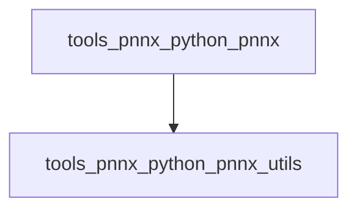

# Tencent/ncnn 深度分析

> 阅读档位：选型尽调（profile=adoption_due_diligence）
> 注意力预算：定位 15 / 架构 15 / 抽象 10 / ADR 10 / 扩展 5 / 经验卡 0 / 工程维护 45
> 证据约定：[事实] 确定性提取 · [判断] 有 file:line 或文档锚点 · [未获得] 当前未采集

## 导读

> **是什么**：ncnn is a high-performance neural network inference framework optimized for the mobile platform
> **架构一句话**：[判断] 顶层以 `src`、`examples`、`tools` 为主，入口为 `benchmark/RankCards/main.cpp`（静态结构判断，未做动态跟踪）。
> **最大风险**：Top1 贡献者占比 68.71%，决策集中度需关注
> **不适合**：需要稳定 API/长期支持承诺的场景，请先核对发布节奏与维护状态；依赖链许可证与权重许可能力当前未采集，不能据此做出商用结论。

## 1. 项目定位与目标

[事实] Tencent/ncnn 属于 `未指定` 领域、`classic` 通道，主语言 C++（56%），24,085 stars / 4,559 forks。

[事实] 项目自述：ncnn is a high-performance neural network inference framework optimized for the mobile platform。

[事实] README 摘要：[未获得] 本次未获得可用 README 文本。

- **目标用户**：[判断] 模型工程师 / 推理基础设施开发者；应用与平台开发者；终端用户与性能调优人员
- **替代方案与差异**：[未获得] 本次未采集竞品对比与 roadmap，不得据此推断「没有替代品」。
- **不解决什么**：[未获得] 没有路线图与 issue 语料，无法可靠界定能力边界。

[判断] 阶段信号：仓库已存在 3,432 天，近一年发布 3 个版本，最近提交距今 1 天，维护状态「active」。这只说明是否仍在维护，不等于成熟度结论。

## 2. 架构全景

### 2.1 上下文边界

[判断] 架构说明文档：`README.md`, `benchmark/RankCards/README.md`, `examples/squeezencnn/README.md`, `python/README.md`, `tools/darknet/README.md`；边界结论来自文档与目录结构，未经运行验证。
[事实] 硬件/内核线索：vendors=[amd, nvidia]、kernel_langs=[cuda]。

### 2.2 模块职责

| 模块 | 文件数 | 职责（启发式） |
|---|---:|---|
| `src` | 2,138 | 核心实现 |
| `examples` | 51 | 示例与基准 |
| `tools` | 1,799 | 脚本与工具 |
| `tests` | 229 | 测试与用例 |
| `benchmark` | 58 | 示例与基准 |

### 2.3 一次调用的路径（运行时视图）

[判断] 静态推断：`benchmark/RankCards/main.cpp`, `python/src/main.cpp`, `tools/pnnx/src/main.cpp` → `tools/pnnx/python/pnnx`（依赖最集中） → `tools/pnnx/python/pnnx/utils`（依赖最集中） → 输出。内部 import 边约 1 条，只用于判断调用方向；**未做运行时跟踪**，参数与分支需读源码确认。

### 2.4 数据与控制流

[未获得] 未检测到并行/缓存轴证据；不代表项目中不存在。

## 3. 核心抽象与契约

[未获得] 本次源码切片未识别到显式接口/注册模式；这不等于项目没有抽象层，只说明当前采集粒度不足。

入口候选（可作为契约阅读起点）：`benchmark/RankCards/main.cpp`、`python/src/main.cpp`、`tools/pnnx/src/main.cpp`

## 4. 关键设计决策（ADR）

[未获得] 本次未产出带证据的取舍；ADR 至少 3 条的要求未满足，不用通用判断填充。

## 5. 扩展与改造路径

[未获得] 未识别到显式插件/注册点。

[判断] 新增能力的静态路径（需按实际代码复核）：

1. 在入口处接入参数/配置（入口候选：`benchmark/RankCards/main.cpp`, `python/src/main.cpp`, `tools/pnnx/src/main.cpp`, `src`, `tools`）；
2. 复用上表中的注册/分派结构，实现新的后端或适配器；
3. 补对应测试与文档，再走发布流程。

- 扩展文档：[未获得]
- 改造成本：[未获得] 需要先确认契约稳定性与测试覆盖，本报告不估算人日。

## 6. 经验卡

[未获得] 本次没有带「可迁移规则」的条目（模型未输出 rule，或命中旧缓存）；经验卡留空，不用「要注重解耦」这类通用建议充数。

## 附录 A 证据索引与未知项

### A1. 代码证据索引

—

> 未产出洞见：off 档不发起模型请求

### A2. 外部资料

- 来源：deepwiki
- url：https://deepwiki.com/Tencent/ncnn
- fetched_at：2026-11-22T13:46:33Z
- sha256：`c3ec5b7fdf73689c3bab10363059630bffa491374494332fd81f838e2a9eacfd`
- 判定：hit — 正文含 13 个仓库内真实路径（阈值 3）
- 原文快照：`source.txt`（与判定元数据分文件存放）

### A3. 未获得项

- 依赖链许可证、模型权重/数据许可、CLA —— 未采集；
- issue/PR 响应质量、CI 运行结果 —— 未采集；
- roadmap、竞品对比、用户画像 —— 未采集；
**未获得的指标**：

- `used_by`：GitHub 无公开 API；L0 标注为未获得，不估算

## 附录 B 许可证 / 维护 / 工程 / 成本

### B1. 许可证与合规风险

[事实] 主许可证 **NOASSERTION**；组织类型 —；治理文档：有。

[未获得] 依赖链是否存在 GPL/AGPL、模型权重与数据集许可、CLA 要求；这些必须人工或由后续数据源补齐，本报告不给出「可商用」结论。

### B2. 维护状态与风险

[事实] 贡献者 381 人，Top1 占比 68.71%；近 90 天 / 365 天提交 177 / 418 次；最近提交距今 1 天，维护状态「active」。

- Top1 贡献者占比 68.71%，决策集中度需关注

### B3. 运行与工程体系

[事实] 仓库约 4,556 个文件、61.3 MiB；本次采集 20 个源码切片（tarball `c4cdc048f7928dba`）。
[事实] 语言构成：Batchfile 0.00%、C 33.86%、C++ 56.34%、CMake 0.68%、GLSL 4.50%、Python 4.57%、SWIG 0.00%、Shell 0.02%；硬件 vendors=[amd, nvidia]、kernel_langs=[cuda]。

[未获得] 构建脚本、依赖安装、测试体系、CI/CD、配置与 secret 管理未采集；本报告不能回答「能否在目标环境跑起来」。

**特征卡已知限制**：

- 证据来自 20 个源码切片的逐行扫描，未覆盖文件不计入
- issue_close_ratio_90d 需 search API，L0/L1 未调用
- cncf_or_foundation 与 Organization 的 org_type 细分需人工判定，置 null

### B4. 运行元数据与成本

| 项 | 值 |
|---|---|
| 仓库 | Tencent/ncnn |
| commit | `eb8a50d2eddc02b914d17c7e99997936a2801bd5` |
| 分析基准时间 (as-of) | 2026-11-22T11:30:17Z |
| 通道 / 领域 | classic / 未指定 |
| 请求档位 (requested_depth) | fast |
| **实际档位** (actual_depth) | off（降级：本周配额已用满） |
| 降级原因 (reason) | weekly_quota_exhausted — 本周配额已用满 |
| 配额状态 (quota_state) | strong 0/1、fast 16/5（周起点 2026-11-16）；tokens 周 234088/2000000、月 344238/6000000（月起点 2026-11-01） |
| 快照 sha256 | `40be065a02c4f32ffbcda5e9e7ed2aa113c741ed7f2cd67cb51a671d648b088a` |
| 成本说明 | 本次 —（未调用）；输入 0 tok / 命中 0 tok / 输出 0 tok |
| 累计 | 本周 ¥0.4430 / 234,088 tok；本月 ¥1.0303 / 344,238 tok |
| 单价 | deepseek-flash 输入未命中 ¥2/M · 缓存命中 ¥0.04/M · 输出 ¥8/M（官方中文页，核对 2026-11-03，取高峰价；低谷约为一半） |
| 口径 | 本次分析的成本（不含开发期重复调用）；账户累计见 cost；成本说明同 as-of 重跑不变（幂等优先）；两者不一致是设计，不是 bug |

**档位决策链路**：

1. L1 通道基线：classic → strong；自动链按 auto_default=fast 取更省档位 → fast（非 L4 人工 override）
2. 凭据：齐全
3. L2 周配额：fast 已用 16/5 → 降级

**上下文组装**（裁剪发生在调用之前）：

| 块 | 优先级 | 估算 token |
|---|---|---|
| featcard | 1 | — |
| readme | 2 | — |
| source_files | 4 | — |

- 丢弃：—（off 档不组装上下文，未发起任何模型请求）
- 合计 0 / 上限 120000

### B5. 特征卡摘要

- 卡文件：`data/featcards/Tencent__ncnn__eb8a50d2eddc02b914d17c7e99997936a2801bd5.json`（schema 1.0）
- 入口文件：benchmark/RankCards/main.cpp, python/src/main.cpp, tools/pnnx/src/main.cpp
- 最大目录深度：6；monorepo：否
- 源码切片：20 个文件（tarball `c4cdc048f7928dba`）
- 依赖：直接 / 传递 = — / —（L1 未解析清单文件）

**并行轴**

- 并行 `CP` = false（无证据）
- 并行 `DP` = false（无证据）
- 并行 `EP` = false（无证据）
- 并行 `PP` = false（无证据）
- 并行 `SP` = false（无证据）
- 并行 `TP` = false（无证据）

**缓存**

- 缓存 `kv_offload` = false（无证据）
- 缓存 `paged` = false（无证据）
- 缓存 `prefix_reuse` = false（无证据）
- 缓存 `radix` = false（无证据）

- 硬件：vendors=[amd, nvidia]、arch_gates=[ampere]、kernel_langs=[cuda]
- 治理文档：是

**依赖图**（内部模块 import 边，节点/边排序后输出）

**已知限制**：

- 证据来自 20 个源码切片的逐行扫描，未覆盖文件不计入
- issue_close_ratio_90d 需 search API，L0/L1 未调用
- cncf_or_foundation 与 Organization 的 org_type 细分需人工判定，置 null

### B6. 体检事实（确定性，零 LLM）

| 指标 | 值 |
|---|---|
| Star / Fork | 24,085 / 4,559 |
| 被依赖 (Used by) | — |
| 贡献者 / Top1 占比 | 381 / 68.71% |
| Top10 贡献集中度 | 79.31% |
| 90 天 / 365 天提交 | 177 / 418 |
| 最近提交 / 距今天数 | 2026-11-21T00:44:28Z / 1 |
| 维护状态 | active |
| 项目年龄 / 发布数(365d) | 3,432 天 / 3 |
| 组织类型 / 许可证 | — / NOASSERTION |
| 文件数 / 体积 | 4,556 / 61.3 MiB |
| 内部模块依赖边 | 1 |

**语言构成**：Batchfile 0.00%、C 33.86%、C++ 56.34%、CMake 0.68%、GLSL 4.50%、Python 4.57%、SWIG 0.00%、Shell 0.02%

**模块体量 Top10**

| 模块 | 文件数 | 字节 |
|---|---|---|
| src | 2,138 | 40,758,930 |
| examples | 51 | 10,671,124 |
| tools | 1,799 | 7,869,722 |
| tests | 229 | 2,010,996 |
| benchmark | 58 | 1,591,465 |
| docs | 57 | 441,628 |
| .github | 51 | 347,384 |
| python | 74 | 309,369 |
| . | 18 | 124,249 |
| toolchains | 60 | 117,528 |

**未获得的指标**：

- `used_by`：GitHub 无公开 API；L0 标注为未获得，不估算
