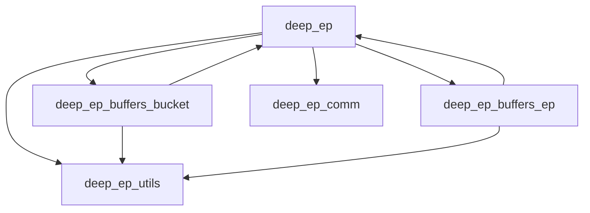

# 开源项目分析 · deepseek-ai/DeepEP

## 运行元数据

| 项 | 值 |
|---|---|
| 仓库 | deepseek-ai/DeepEP |
| commit | `f6aa38fe06cd4a0489e7730365d4e0114970a2f3` |
| 分析基准时间 (as-of) | 2026-11-03T00:00:00Z |
| 通道 / 领域 | classic / 未指定 |
| 请求档位 (requested_depth) | fast |
| **实际档位** (actual_depth) | fast |
| 降级原因 (reason) | manual_override — 人工 override |
| 配额状态 (quota_state) | strong 0/1、fast 0/3（周起点 2026-11-02）；tokens 周 0/2000000、月 0/6000000（月起点 2026-11-01） |
| 快照 sha256 | `683a825745126d231713df7763e54b69b5ad89d041703578955b4ed2a38a42bf` |
| 成本说明 | 本次 ¥0.0459（模型调用 1 次）；输入 21,803 tok / 命中 896 tok / 输出 501 tok |
| 累计 | 本周 ¥0.0459 / 22,304 tok；本月 ¥0.0459 / 22,304 tok |
| 单价 | deepseek-flash 输入未命中 ¥2/M · 缓存命中 ¥0.04/M · 输出 ¥8/M（官方中文页，核对 2026-11-03，取高峰价；低谷约为一半） |

**档位决策链路**：

1. L4 人工 override：--depth fast（绕过 L1 基线 / L2 配额）
2. 凭据：齐全
3. L2 周配额：人工 override 绕过（本周 strong 0/1、fast 0/3）
4. L3 预算：单选预估 17280 tok（上限 120000），周 0/2000000
5. 结论：实际档位 fast（人工 override）

**上下文组装**（裁剪发生在调用之前）：

| 块 | 优先级 | 估算 token |
|---|---|---|
| featcard | 1 | 2,054 |
| readme | 2 | 8,228 |
| source_files:csrc/buffers/bucket.hpp | 4 | 1,509 |
| source_files:csrc/buffers/ep.hpp | 4 | 1,508 |
| source_files:csrc/indexing/main.cu | 4 | 291 |
| source_files:deep_ep/__init__.py | 4 | 673 |
| source_files:deep_ep/buffers/bucket.py | 4 | 1,509 |
| source_files:deep_ep/buffers/ep.py | 4 | 1,508 |

- 丢弃：—
- 合计 17,280 / 上限 120,000

## 体检事实（确定性，零 LLM）

| 指标 | 值 |
|---|---|
| Star / Fork | 10,411 / 1,543 |
| 被依赖 (Used by) | — |
| 贡献者 / Top1 占比 | 50 / 36.33% |
| Top10 贡献集中度 | 82.03% |
| 90 天 / 365 天提交 | 5 / 27 |
| 最近提交 / 距今天数 | 2026-10-21T03:50:43Z / 13 |
| 维护状态 | active |
| 项目年龄 / 发布数(365d) | 624 天 / 0 |
| 组织类型 / 许可证 | — / MIT |
| 文件数 / 体积 | 126 / 2.0 MiB |
| 内部模块依赖边 | 8 |

**语言构成**：C++ 24.11%、CMake 0.28%、Cuda 41.56%、Python 33.92%、Shell 0.13%

**模块体量 Top10**

| 模块 | 文件数 | 字节 |
|---|---|---|
| figures | 2 | 1,206,548 |
| deep_ep | 62 | 496,996 |
| csrc | 36 | 208,921 |
| tests | 14 | 144,883 |
| . | 10 | 43,576 |
| third-party | 2 | 5,105 |

**未获得的指标**：

- `used_by`：GitHub 无公开 API；L0 标注为未获得，不估算

## 特征卡摘要

- 卡文件：`data/featcards/deepseek-ai__DeepEP__f6aa38fe06cd4a0489e7730365d4e0114970a2f3.json`（schema 1.0）
- 入口文件：csrc/indexing/main.cu
- 最大目录深度：7；monorepo：否
- 源码切片：20 个文件（tarball `a561c7a463ba056d`）
- 依赖：直接 / 传递 = — / —（L1 未解析清单文件）

**并行轴**

- 并行 `CP` = true（证据 1 条）
  - `README.md:3` — `DeepEP (DeepEveryParallel) is a high-performance communication library for machine learning training and inference. It p`
- 并行 `DP` = true（证据 1 条）
  - `README.md:3` — `DeepEP (DeepEveryParallel) is a high-performance communication library for machine learning training and inference. It p`
- 并行 `EP` = true（证据 3 条）
  - `deep_ep/buffers/ep.py:211` — `- high-throughput expert-parallel all-to-all (dispatch and combine, using NVLink and/or RDMA)`
  - `README.md:3` — `DeepEP (DeepEveryParallel) is a high-performance communication library for machine learning training and inference. It p`
  - `README.md:20` — `- **V2 release**: A complete refactoring of expert parallelism, with support for larger scale-up and scale-out domains a`
- 并行 `PP` = true（证据 2 条）
  - `README.md:3` — `DeepEP (DeepEveryParallel) is a high-performance communication library for machine learning training and inference. It p`
  - `README.md:388` — `### Pipeline parallelism (experimental)`
- 并行 `SP` = false（无证据）
- 并行 `TP` = false（无证据）

**缓存**

- 缓存 `kv_offload` = false（无证据）
- 缓存 `paged` = false（无证据）
- 缓存 `prefix_reuse` = false（无证据）
- 缓存 `radix` = false（无证据）

- 硬件：vendors=[amd, ascend, nvidia]、arch_gates=[blackwell, hopper]、kernel_langs=[cuda]
- 治理文档：否

**依赖图**（内部模块 import 边，节点/边排序后输出）

**已知限制**：

- 证据来自 20 个源码切片的逐行扫描，未覆盖文件不计入
- issue_close_ratio_90d 需 search API，L0/L1 未调用
- cncf_or_foundation 与 Organization 的 org_type 细分需人工判定，置 null

## 洞见

| id | 选择 | 放弃的替代 | 代价 | 证据 |
|---|---|---|---|---|
| t1 | 运行时JIT编译通信kernel（DeepJIT） | 安装期预编译全部kernel | 运行时需保留CUDA工具链与主机编译器 | `README.md:5` |
| t2 | 移除NVSHMEM后端，改用NCCL Gin | 保留NVSHMEM作为RDMA后端 | RDMA能力绑定NCCL版本与Gin接口 | `README.md:20` |
| t3 | SM与QP数量解析式估算 | 运行时自动调优 | 拓扑或负载变化时估算可能偏离最优 | `README.md:29` |
| t4 | 高吞吐与低延迟统一为单一EPBuffer接口 | 保留两套独立API | 接口参数增多，需按场景选择同步模式 | `README.md:27` |
| t5 | BucketBuffer要求NVLink与RDMA带宽均可探测 | 按实际使用的传输方式按需探测 | 仅用单一传输的组也需完整网络环境 | `README.md:57` |
| t6 | 导入时校验NCCL库二进制一致 | 仅做版本号检查 | PyTorch与DeepEP的NCCL版本必须严格匹配 | `deep_ep/__init__.py:36` |
| t7 | all-gather走拷贝引擎(num_sms=0) | 用GPU SM驱动all-gather | reduce-scatter/all-reduce仍需占用SM | `README.md:340` |
| t8 | 延迟epilogue与计算重叠 | 通信完成后立即执行epilogue | 结果须由首次wait产出并保留 | `README.md:290` |
| t9 | 默认复用PyTorch的NCCL communicator | 始终创建DeepEP自管communicator | 依赖后端暴露_comm_ptr私有接口 | `README.md:404` |
| t10 | top-k索引宽度编译期可选32/64位 | 固定64位索引 | 修改需重新编译扩展 | `README.md:452` |

- 置信度：med

## 外部资料

- 来源：deepwiki
- url：https://deepwiki.com/deepseek-ai/DeepEP
- fetched_at：2026-11-04T12:50:51Z
- sha256：`962b36db33b3c7bc0252eb81f0ceb4888678cb3d7bfa6ff66ad09a7fc54a69da`
- 判定：hit — 正文含 10 个仓库内真实路径（阈值 3）
- 原文快照：`source.txt`（与判定元数据分文件存放）
