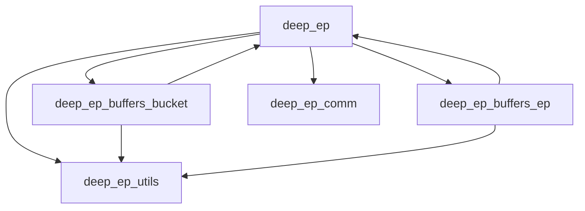

# deepseek-ai/DeepEP 深度分析

> 阅读档位：架构学习（profile=architecture_learning）
> 注意力预算：定位 20 / 架构 30 / 抽象 15 / ADR 20 / 扩展 5 / 经验卡 10 / 工程维护 0
> 证据约定：[事实] 确定性提取 · [判断] 有 file:line 或文档锚点 · [未获得] 当前未采集

## 导读

> **是什么**：DeepEP: an efficient expert-parallel communication library
> **架构一句话**：[判断] 顶层以 `figures`、`deep_ep`、`csrc` 为主，入口为 `csrc/indexing/main.cu`（静态结构判断，未做动态跟踪）。
> **最大风险**：Top1 贡献者占比 36.33%，决策集中度需关注
> **不适合**：需要稳定 API/长期支持承诺的场景，请先核对发布节奏与维护状态；依赖链许可证与权重许可能力当前未采集，不能据此做出商用结论。

## 1. 项目定位与目标

[事实] deepseek-ai/DeepEP 属于 `ai_infra` 领域、`classic` 通道，主语言 Cuda（42%），10,454 stars / 1,563 forks。

[事实] 项目自述：DeepEP: an efficient expert-parallel communication library。

[事实] README 摘要：DeepEP (DeepEveryParallel) is a high-performance communication library for machine learning training and inference. It provides high-throughput and low-latency expert-parallel (EP) all-to-all GPU kernels for MoE dispatch and combine, including FP8 dispatch, and NVLink weight and gradient exchange for redundant experts. It also offers experimental primitives for pipeline parallelism (PP), context parallelism (CP), data parallelism (DP), and remote memory access (Engram). Communication kernels are compiled at runtime via DeepJIT, with the supporting extension built during installation.。

- **目标用户**：[判断] 模型工程师 / 推理基础设施开发者；应用与平台开发者
- **替代方案与差异**：[未获得] 本次未采集竞品对比与 roadmap，不得据此推断「没有替代品」。
- **不解决什么**：[未获得] 没有路线图与 issue 语料，无法可靠界定能力边界。

[判断] 阶段信号：仓库已存在 639 天，近一年发布 0 个版本，最近提交距今 28 天，维护状态「active」。这只说明是否仍在维护，不等于成熟度结论。

## 2. 架构全景

### 2.1 上下文边界

[判断] 架构说明文档：`README.md`；边界结论来自文档与目录结构，未经运行验证。
[事实] 硬件/内核线索：vendors=[amd, ascend, nvidia]、kernel_langs=[cuda]。

### 2.2 模块职责

| 模块 | 文件数 | 职责（启发式） |
|---|---:|---|
| `figures` | 2 | 业务实现（职责需人工确认） |
| `deep_ep` | 62 | 业务实现（职责需人工确认） |
| `csrc` | 36 | 原生内核与算子实现 |
| `tests` | 14 | 测试与用例 |
| `.` | 10 | 业务实现（职责需人工确认） |

### 2.3 一次调用的路径（运行时视图）

[判断] 静态推断：`csrc/indexing/main.cu` → `deep_ep`（依赖最集中） → `deep_ep/buffers/bucket`（依赖最集中） → 输出。内部 import 边约 8 条，只用于判断调用方向；**未做运行时跟踪**，参数与分支需读源码确认。

### 2.4 数据与控制流

[事实] 并行轴命中 CP, DP, EP, PP（证据见附录 A）。

## 3. 核心抽象与契约

[事实] 源码切片中命中以下模式（正则扫描，仅代表本次切片）：

| 模式 | 位置 | 说明 |
|---|---|---|
| `dispatch` | `csrc/buffers/ep.hpp:286` | 候选扩展/契约点 |
| `hook` | `deep_ep/buffers/bucket.py:80` | 候选扩展/契约点 |
| `dispatch` | `deep_ep/buffers/ep.py:38` | 候选扩展/契约点 |
| `dispatch` | `deep_ep/include/deep_ep/impls/ep/hybrid_dispatch.cuh:506` | 候选扩展/契约点 |
| `dispatch` | `tests/ep/test_ep.py:113` | 候选扩展/契约点 |

[判断] 这些命中说明项目存在注册/适配/分派结构，但**未做 AST 分析**，无法确认继承关系与调用契约的完整性。

入口候选（可作为契约阅读起点）：`csrc/indexing/main.cu`

## 4. 关键设计决策（ADR）

每条固定六字段：决策 / 替代 / 代价 / 证据 / 可复用规则 / 边界·反模式。

### ADR-1 · t1: 运行时用 DeepJIT 编译通信内核

- **决策**：运行时用 DeepJIT 编译通信内核
- **替代**：安装期预编译全部内核
- **代价**：部署需保留 CUDA 工具链与主机编译器
- **证据**：`README.md:5`
- **可复用规则**：内核按目标设备运行时编译，换取跨架构适配与免预编译矩阵
- **边界/反模式**：仅适合内核变体多、目标 GPU 明确的场景；无工具链的推理镜像不适用

### ADR-2 · t2: V2 起移除 NVSHMEM，改用 NCCL Gin 后端

- **决策**：V2 起移除 NVSHMEM，改用 NCCL Gin 后端
- **替代**：保留 NVSHMEM 作为设备侧通信后端
- **代价**：依赖 NCCL 2.32.3+ 且需版本严格匹配
- **证据**：`README.md:20`
- **可复用规则**：复用已有 NCCL 通信器可降低部署依赖与运维成本
- **边界/反模式**：需要 NCCL 未提供的高级原语时须另接后端，不可硬套

### ADR-3 · t3: SM 与 QP 数量解析式估算，取消自动调优

- **决策**：SM 与 QP 数量解析式估算，取消自动调优
- **替代**：运行时自动搜索最优 SM/QP 配置
- **代价**：估算偏差时需调用方手动覆盖 num_sms
- **证据**：`README.md:26`
- **可复用规则**：用解析模型替代在线调优，换取启动确定性与可预测性
- **边界/反模式**：拓扑或负载高度异构时解析模型失准，应允许手动覆盖

### ADR-4 · t4: 高吞吐与低延迟统一到单一 EPBuffer 接口

- **决策**：高吞吐与低延迟统一到单一 EPBuffer 接口
- **替代**：按模式拆分两套独立 API
- **代价**：接口参数增多，需按场景选择 do_cpu_sync 等开关
- **证据**：`README.md:24`
- **可复用规则**：统一接口降低调用方迁移成本，代价是参数分支变多
- **边界/反模式**：两种模式语义差异过大时强行统一会引入隐式约束

### ADR-5 · t5: 延迟 epilogue 与异步事件实现通信计算重叠

- **决策**：延迟 epilogue 与异步事件实现通信计算重叠
- **替代**：同步返回结果后再做专家计算
- **代价**：结果由首次 wait 产生，需自行保存并管理事件生命周期
- **证据**：`README.md:186`
- **可复用规则**：把后处理推迟到消费点，用事件换取重叠窗口
- **边界/反模式**：无独立计算可重叠时应立即 wait，否则白占通信流资源

### ADR-6 · t6: 缓存 dispatch 展开布局，复用 handle 跳过重算

- **决策**：缓存 dispatch 展开布局，复用 handle 跳过重算
- **替代**：每次 dispatch 重新计算接收布局
- **代价**：topk_idx 在使用期间不可修改，需版本计数校验
- **证据**：`deep_ep/buffers/ep.py:110`
- **可复用规则**：缓存布局复用可省 CPU 同步，代价是输入不可变约束
- **边界/反模式**：路由变化必须重新 dispatch；推理模式张量无版本计数不可校验

## 5. 扩展与改造路径

[事实] 可扩展点候选（与第 3 章同源，已排除测试目录）：

- `csrc/buffers/ep.hpp:286` → dispatch
- `deep_ep/buffers/bucket.py:80` → hook
- `deep_ep/buffers/ep.py:38` → dispatch
- `deep_ep/include/deep_ep/impls/ep/hybrid_dispatch.cuh:506` → dispatch

[判断] 新增能力的静态路径（需按实际代码复核）：

1. 在入口处接入参数/配置（入口候选：`csrc/indexing/main.cu`, `csrc`）；
2. 复用上表中的注册/分派结构，实现新的后端或适配器；
3. 补对应测试与文档，再走发布流程。

- 扩展文档：[未获得]
- 改造成本：[未获得] 需要先确认契约稳定性与测试覆盖，本报告不估算人日。

## 6. 经验卡

### 经验 1 · 内核按目标设备运行时编译，换取跨架构适配与免预编译矩阵

- **证据**：`README.md:5`（来自 deepseek-ai/DeepEP）
- **适用边界**：仅适合内核变体多、目标 GPU 明确的场景；无工具链的推理镜像不适用
- **反模式**：在边界之外照搬「运行时用 DeepJIT 编译通信内核」，代价会变成「部署需保留 CUDA 工具链与主机编译器」
- **如果我来做**：先确认边界成立，再选择「运行时用 DeepJIT 编译通信内核」而非「安装期预编译全部内核」

### 经验 2 · 复用已有 NCCL 通信器可降低部署依赖与运维成本

- **证据**：`README.md:20`（来自 deepseek-ai/DeepEP）
- **适用边界**：需要 NCCL 未提供的高级原语时须另接后端，不可硬套
- **反模式**：在边界之外照搬「V2 起移除 NVSHMEM，改用 NCCL Gin 后端」，代价会变成「依赖 NCCL 2.32.3+ 且需版本严格匹配」
- **如果我来做**：先确认边界成立，再选择「V2 起移除 NVSHMEM，改用 NCCL Gin 后端」而非「保留 NVSHMEM 作为设备侧通信后端」

### 经验 3 · 用解析模型替代在线调优，换取启动确定性与可预测性

- **证据**：`README.md:26`（来自 deepseek-ai/DeepEP）
- **适用边界**：拓扑或负载高度异构时解析模型失准，应允许手动覆盖
- **反模式**：在边界之外照搬「SM 与 QP 数量解析式估算，取消自动调优」，代价会变成「估算偏差时需调用方手动覆盖 num_sms」
- **如果我来做**：先确认边界成立，再选择「SM 与 QP 数量解析式估算，取消自动调优」而非「运行时自动搜索最优 SM/QP 配置」

### 经验 4 · 统一接口降低调用方迁移成本，代价是参数分支变多

- **证据**：`README.md:24`（来自 deepseek-ai/DeepEP）
- **适用边界**：两种模式语义差异过大时强行统一会引入隐式约束
- **反模式**：在边界之外照搬「高吞吐与低延迟统一到单一 EPBuffer 接口」，代价会变成「接口参数增多，需按场景选择 do_cpu_sync 等开关」
- **如果我来做**：先确认边界成立，再选择「高吞吐与低延迟统一到单一 EPBuffer 接口」而非「按模式拆分两套独立 API」

### 经验 5 · 把后处理推迟到消费点，用事件换取重叠窗口

- **证据**：`README.md:186`（来自 deepseek-ai/DeepEP）
- **适用边界**：无独立计算可重叠时应立即 wait，否则白占通信流资源
- **反模式**：在边界之外照搬「延迟 epilogue 与异步事件实现通信计算重叠」，代价会变成「结果由首次 wait 产生，需自行保存并管理事件生命周期」
- **如果我来做**：先确认边界成立，再选择「延迟 epilogue 与异步事件实现通信计算重叠」而非「同步返回结果后再做专家计算」

## 附录 A 证据索引与未知项

### A1. 代码证据索引

| id | 决策 | 证据 |
|---|---|---|
| t1 | 运行时用 DeepJIT 编译通信内核 | `README.md:5` |
| t2 | V2 起移除 NVSHMEM，改用 NCCL Gin 后端 | `README.md:20` |
| t3 | SM 与 QP 数量解析式估算，取消自动调优 | `README.md:26` |
| t4 | 高吞吐与低延迟统一到单一 EPBuffer 接口 | `README.md:24` |
| t5 | 延迟 epilogue 与异步事件实现通信计算重叠 | `README.md:186` |
| t6 | 缓存 dispatch 展开布局，复用 handle 跳过重算 | `deep_ep/buffers/ep.py:110` |
| t7 | BucketBuffer 会话内临时分配并暂存外部张量 | `deep_ep/buffers/bucket.py:20` |
| t8 | 导入时校验 NCCL 动态库二进制一致 | `deep_ep/__init__.py:20` |
| t9 | 冗余专家权重预取与梯度归约走 NVLink 域内集合通信 | `README.md:262` |
| t10 | Bucket 集合通信按 NVLink/RDMA/混合域分实现 | `README.md:230` |

- 置信度：med
- 架构范式标签：专用优化、深优化、硬件耦合
- 模式 `dispatch`：`csrc/buffers/ep.hpp:286`
- 模式 `hook`：`deep_ep/buffers/bucket.py:80`
- 模式 `dispatch`：`deep_ep/buffers/ep.py:38`
- 模式 `dispatch`：`deep_ep/include/deep_ep/impls/ep/hybrid_dispatch.cuh:506`
- 模式 `dispatch`：`tests/ep/test_ep.py:113`

### A2. 外部资料

- 来源：deepwiki
- url：https://deepwiki.com/deepseek-ai/DeepEP
- fetched_at：2026-11-18T15:42:11Z
- sha256：`962b36db33b3c7bc0252eb81f0ceb4888678cb3d7bfa6ff66ad09a7fc54a69da`
- 判定：hit — 正文含 10 个仓库内真实路径（阈值 3）
- 原文快照：`source.txt`（与判定元数据分文件存放）

### A3. 未获得项

- 依赖链许可证、模型权重/数据许可、CLA —— 未采集；
- issue/PR 响应质量、CI 运行结果 —— 未采集；
- roadmap、竞品对比、用户画像 —— 未采集；
**未获得的指标**：

- `used_by`：GitHub 无公开 API；L0 标注为未获得，不估算

## 附录 B 许可证 / 维护 / 工程 / 成本

### B1. 许可证与合规风险

[事实] 主许可证 **MIT**；组织类型 —；治理文档：未检出。

[未获得] 依赖链是否存在 GPL/AGPL、模型权重与数据集许可、CLA 要求；这些必须人工或由后续数据源补齐，本报告不给出「可商用」结论。

### B2. 维护状态与风险

[事实] 贡献者 50 人，Top1 占比 36.33%；近 90 天 / 365 天提交 5 / 25 次；最近提交距今 28 天，维护状态「active」。

- Top1 贡献者占比 36.33%，决策集中度需关注
- 未检出治理文档，贡献与决策流程可能不透明

### B3. 运行与工程体系

[事实] 仓库约 126 个文件、2.0 MiB；本次采集 20 个源码切片（tarball `a561c7a463ba056d`）。
[事实] 语言构成：C++ 24.11%、CMake 0.28%、Cuda 41.56%、Python 33.92%、Shell 0.13%；硬件 vendors=[amd, ascend, nvidia]、kernel_langs=[cuda]。

[未获得] 构建脚本、依赖安装、测试体系、CI/CD、配置与 secret 管理未采集；本报告不能回答「能否在目标环境跑起来」。

**特征卡已知限制**：

- 证据来自 20 个源码切片的逐行扫描，未覆盖文件不计入
- issue_close_ratio_90d 需 search API，L0/L1 未调用
- cncf_or_foundation 与 Organization 的 org_type 细分需人工判定，置 null

### B4. 运行元数据与成本

| 项 | 值 |
|---|---|
| 仓库 | deepseek-ai/DeepEP |
| commit | `f6aa38fe06cd4a0489e7730365d4e0114970a2f3` |
| 分析基准时间 (as-of) | 2026-11-18T00:00:00Z |
| 通道 / 领域 | classic / ai_infra |
| 请求档位 (requested_depth) | fast |
| **实际档位** (actual_depth) | fast |
| 降级原因 (reason) | manual_override — 人工 override |
| 配额状态 (quota_state) | strong 0/1、fast 3/3（周起点 2026-11-16）；tokens 周 1856/2000000、月 112006/6000000（月起点 2026-11-01） |
| 快照 sha256 | `2d8fbfd546cd0dc4a1c4611612d835d01f50ef1bb1fe011eb959bda66250ebaa` |
| 成本说明 | 本次 ¥0.0094（模型调用 1 次）；输入 22,127 tok / 命中 21,888 tok / 输出 1,005 tok |
| 累计 | 本周 ¥0.0179 / 24,988 tok；本月 ¥0.6052 / 135,138 tok |
| 单价 | deepseek-flash 输入未命中 ¥2/M · 缓存命中 ¥0.04/M · 输出 ¥8/M（官方中文页，核对 2026-11-03，取高峰价；低谷约为一半） |
| 口径 | 本次分析的成本（不含开发期重复调用）；账户累计见 cost；成本说明同 as-of 重跑不变（幂等优先）；两者不一致是设计，不是 bug |

**档位决策链路**：

1. L4 人工 override：--depth fast（绕过 L1 基线 / L2 配额）
2. 凭据：齐全
3. L2 周配额：人工 override 绕过（本周 strong 0/1、fast 3/3）
4. L3 预算：估算 17280 × 安全系数 1.3 = 22464 tok（单选上限 120000），周 1856/2000000
5. 结论：实际档位 fast（人工 override）

**上下文组装**（裁剪发生在调用之前）：

| 块 | 优先级 | 估算 token |
|---|---|---|
| featcard | 1 | 2,054 |
| readme | 2 | 8,228 |
| source_files:csrc/buffers/bucket.hpp | 4 | 1,509 |
| source_files:csrc/buffers/ep.hpp | 4 | 1,508 |
| source_files:csrc/indexing/main.cu | 4 | 291 |
| source_files:deep_ep/__init__.py | 4 | 673 |
| source_files:deep_ep/buffers/bucket.py | 4 | 1,509 |
| source_files:deep_ep/buffers/ep.py | 4 | 1,508 |

- 丢弃：—
- 合计 17,280 / 上限 120,000

### B5. 特征卡摘要

- 卡文件：`data/featcards/deepseek-ai__DeepEP__f6aa38fe06cd4a0489e7730365d4e0114970a2f3.json`（schema 1.0）
- 入口文件：csrc/indexing/main.cu
- 最大目录深度：7；monorepo：否
- 源码切片：20 个文件（tarball `a561c7a463ba056d`）
- 依赖：直接 / 传递 = — / —（L1 未解析清单文件）

**并行轴**

- 并行 `CP` = true（证据 1 条）
  - `README.md:3` — `DeepEP (DeepEveryParallel) is a high-performance communication library for machine learning training and inference. It p`
- 并行 `DP` = true（证据 1 条）
  - `README.md:3` — `DeepEP (DeepEveryParallel) is a high-performance communication library for machine learning training and inference. It p`
- 并行 `EP` = true（证据 3 条）
  - `deep_ep/buffers/ep.py:211` — `- high-throughput expert-parallel all-to-all (dispatch and combine, using NVLink and/or RDMA)`
  - `README.md:3` — `DeepEP (DeepEveryParallel) is a high-performance communication library for machine learning training and inference. It p`
  - `README.md:20` — `- **V2 release**: A complete refactoring of expert parallelism, with support for larger scale-up and scale-out domains a`
- 并行 `PP` = true（证据 2 条）
  - `README.md:3` — `DeepEP (DeepEveryParallel) is a high-performance communication library for machine learning training and inference. It p`
  - `README.md:388` — `### Pipeline parallelism (experimental)`
- 并行 `SP` = false（无证据）
- 并行 `TP` = false（无证据）

**缓存**

- 缓存 `kv_offload` = false（无证据）
- 缓存 `paged` = false（无证据）
- 缓存 `prefix_reuse` = false（无证据）
- 缓存 `radix` = false（无证据）

- 硬件：vendors=[amd, ascend, nvidia]、arch_gates=[blackwell, hopper]、kernel_langs=[cuda]
- 治理文档：否

**依赖图**（内部模块 import 边，节点/边排序后输出）

**已知限制**：

- 证据来自 20 个源码切片的逐行扫描，未覆盖文件不计入
- issue_close_ratio_90d 需 search API，L0/L1 未调用
- cncf_or_foundation 与 Organization 的 org_type 细分需人工判定，置 null

### B6. 体检事实（确定性，零 LLM）

| 指标 | 值 |
|---|---|
| Star / Fork | 10,454 / 1,563 |
| 被依赖 (Used by) | — |
| 贡献者 / Top1 占比 | 50 / 36.33% |
| Top10 贡献集中度 | 82.03% |
| 90 天 / 365 天提交 | 5 / 25 |
| 最近提交 / 距今天数 | 2026-10-21T03:50:43Z / 28 |
| 维护状态 | active |
| 项目年龄 / 发布数(365d) | 639 天 / 0 |
| 组织类型 / 许可证 | — / MIT |
| 文件数 / 体积 | 126 / 2.0 MiB |
| 内部模块依赖边 | 8 |

**语言构成**：C++ 24.11%、CMake 0.28%、Cuda 41.56%、Python 33.92%、Shell 0.13%

**模块体量 Top10**

| 模块 | 文件数 | 字节 |
|---|---|---|
| figures | 2 | 1,206,548 |
| deep_ep | 62 | 496,996 |
| csrc | 36 | 208,921 |
| tests | 14 | 144,883 |
| . | 10 | 43,576 |
| third-party | 2 | 5,105 |

**未获得的指标**：

- `used_by`：GitHub 无公开 API；L0 标注为未获得，不估算
