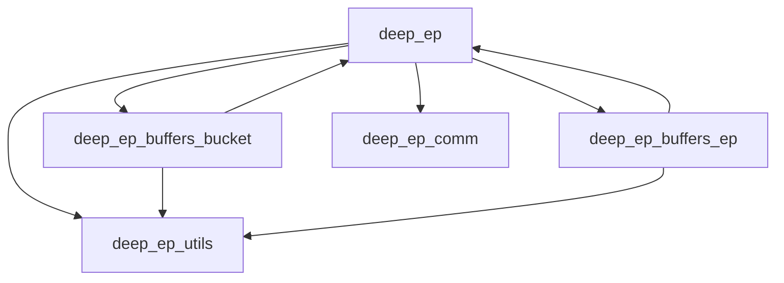

# deepseek-ai/DeepEP 深度分析

## 导读

> **一句话**：deepseek-ai/DeepEP 是一个以 Cuda（42%）为主的项目，约 10,454 stars，仓库年龄 639 天，近 90 天 5 次提交，维护状态「active」。
>
> **先注意**：许可证 MIT；依赖链许可证、模型权重/数据许可、CLA 当前未采集；以下判断凡未注明证据的，均为仓库信号推断，需人工复核。

**它大概在做什么**：DeepEP (DeepEveryParallel) is a high-performance communication library for machine learning training and inference. It provides high-throughput and low-latency expert-parallel (EP) all-to-all GPU kernels for MoE dispatch and combine, including FP8 dispatch, and NVLink weight and gradient exchange for redundant experts. It also offers experimental primitives for pipeline parallelism (PP), context parallelism (CP), data parallelism (DP), and remote memory access (Engram). Communication kernels are compiled at runtime via DeepJIT, with the supporting extension built during installation.

## 1. 项目定位与目标

从仓库元数据看，deepseek-ai/DeepEP 属于 `ai_infra` 领域、`classic` 通道，主语言为 Cuda（42%），当前约 10,454 stars / 1,563 forks。

项目阶段只能做**信号级判断**：仓库已存在 639 天，近一年发布 0 个版本，最近提交距今 28 天。这只能说明它是否还在维护，不能替代对 roadmap、竞品与真实用户群的判断。

入口文件：csrc/indexing/main.cu。本次**未采集** roadmap、竞品对比、用户画像与商业模式；这些空白不应被读成“没有”。

## 2. 许可证与合规风险

主许可证为 **MIT**，组织类型为 —，治理文档：未检出。

**当前无法回答但必须人工确认**：

- 依赖链中是否存在 GPL/AGPL 等强传染许可证；
- 模型权重、数据集、第三方素材的许可与商用限制；
- 是否要求签署 CLA，以及贡献代码的版权归属。

> 结论：许可证字段可用于初筛，但不能替代法务审查；本报告不给出“可商用”结论。

## 3. 架构与模块

代码主体集中在：`figures`（2 文件）、`deep_ep`（62 文件）、`csrc`（36 文件）、`tests`（14 文件）、`.`（10 文件）；最大目录深度 7，monorepo：否。

内部模块 import 边约 8 条（依赖图见下）。检测到并行轴 CP, DP, EP, PP，具体证据见附录 B。

从代码证据看，最关键的几个取舍是：

- 选择「运行时 DeepJIT 编译通信内核」，放弃「安装期预编译全部内核」，代价是「运行时需保留 CUDA 工具链与主机编译器」（证据 `README.md:5`）。
- 选择「基于 NCCL Gin 轻量设备端通信后端」，放弃「保留 NVSHMEM 后端」，代价是「强依赖 NCCL 版本与 Gin 能力」（证据 `README.md:20`）。
- 选择「按拓扑解析式估算 SM 与 QP 数」，放弃「自动调优搜索最优配置」，代价是「极端拓扑下可能非最优」（证据 `README.md:20`）。

## 4. 运行与工程体系

仓库约 126 个文件、2.0 MiB；本次采集到 20 个源码切片（tarball `a561c7a463ba056d`）。

语言构成：C++ 24.11%、CMake 0.28%、Cuda 41.56%、Python 33.92%、Shell 0.13%。硬件相关：vendors=[amd, ascend, nvidia]、kernel_langs=[cuda]。

**本次未采集**：构建脚本、依赖安装、测试体系、CI/CD、配置与 secret 管理。因此本报告不能回答“能否在目标环境跑起来”，只能给结构线索。

**特征卡已知限制**：

- 证据来自 20 个源码切片的逐行扫描，未覆盖文件不计入
- issue_close_ratio_90d 需 search API，L0/L1 未调用
- cncf_or_foundation 与 Organization 的 org_type 细分需人工判定，置 null

## 5. 维护状态与风险

贡献者 50 人，Top1 占比 36.33%；近 90 天 / 365 天提交 5 / 25 次；最近提交距今 28 天，维护状态「active」。

**主要风险（基于现有信号）**：

- Top1 贡献者占比 36.33%，集中度需关注
- 未检出治理文档，贡献流程可能不透明

## 6. 扩展与二次开发

本次**未识别到显式的插件/适配器注册机制**；这不等于没有，只说明当前采集粒度看不到。可优先人工检查以下位置：

- `csrc/indexing/main.cu`
- `figures`
- `deep_ep`
- `csrc`
- `tests`
- `.`

> 二次开发前建议先确认：扩展点、配置注入方式、测试与发布流程；本报告不替代实际试跑。

## 洞见（附录 A）

| id | 选择 | 放弃的替代 | 代价 | 证据 |
|---|---|---|---|---|
| t1 | 运行时 DeepJIT 编译通信内核 | 安装期预编译全部内核 | 运行时需保留 CUDA 工具链与主机编译器 | `README.md:5` |
| t2 | 基于 NCCL Gin 轻量设备端通信后端 | 保留 NVSHMEM 后端 | 强依赖 NCCL 版本与 Gin 能力 | `README.md:20` |
| t3 | 按拓扑解析式估算 SM 与 QP 数 | 自动调优搜索最优配置 | 极端拓扑下可能非最优 | `README.md:20` |
| t4 | 拆分 EP/Engram/PP/Bucket 多缓冲类 | 单一 ElasticBuffer 承载全部 | 接口与生命周期管理更复杂 | `README.md:9` |
| t5 | 延迟 epilogue 与缓存展开布局 | 每次 dispatch 立即同步完成 | 需保存 handle 并保证 topk_idx 不变 | `README.md:9` |
| t6 | NVLink 域内预取权重并归约冗余梯度 | 冗余专家各自独立计算 | 需调用方提供复制映射与预留存储 | `README.md:9` |
| t7 | Bucket 集合通信支持 NVLink/RDMA/混合域 | 仅支持单一传输域 | 需同时探测两种带宽 | `README.md:20` |
| t8 | 复用 PyTorch 进程组 NCCL 通信器 | 始终自建 DeepEP 通信器 | 依赖后端暴露 _comm_ptr | `README.md:404` |

- 置信度：med
- 架构范式标签：并行切分、深优化、硬件耦合

## 外部资料（附录 B）

- 来源：deepwiki
- url：https://deepwiki.com/deepseek-ai/DeepEP
- fetched_at：2026-11-18T15:42:11Z
- sha256：`962b36db33b3c7bc0252eb81f0ceb4888678cb3d7bfa6ff66ad09a7fc54a69da`
- 判定：hit — 正文含 10 个仓库内真实路径（阈值 3）
- 原文快照：`source.txt`（与判定元数据分文件存放）

## 运行元数据（附录 C）

| 项 | 值 |
|---|---|
| 仓库 | deepseek-ai/DeepEP |
| commit | `f6aa38fe06cd4a0489e7730365d4e0114970a2f3` |
| 分析基准时间 (as-of) | 2026-11-18T00:00:00Z |
| 通道 / 领域 | classic / ai_infra |
| 请求档位 (requested_depth) | fast |
| **实际档位** (actual_depth) | fast |
| 降级原因 (reason) | manual_override — 人工 override |
| 配额状态 (quota_state) | strong 0/1、fast 3/3（周起点 2026-11-16）；tokens 周 1856/2000000、月 112006/6000000（月起点 2026-11-01） |
| 快照 sha256 | `2d8fbfd546cd0dc4a1c4611612d835d01f50ef1bb1fe011eb959bda66250ebaa` |
| 成本说明 | 本次 ¥0.0469（模型调用 1 次）；输入 21,930 tok / 命中 128 tok / 输出 410 tok |
| 累计 | 本周 ¥0.0554 / 24,196 tok；本月 ¥0.6427 / 134,346 tok |
| 单价 | deepseek-flash 输入未命中 ¥2/M · 缓存命中 ¥0.04/M · 输出 ¥8/M（官方中文页，核对 2026-11-03，取高峰价；低谷约为一半） |
| 口径 | 本次分析的成本（不含开发期重复调用）；账户累计见 cost；成本说明同 as-of 重跑不变（幂等优先）；两者不一致是设计，不是 bug |

**档位决策链路**：

1. L4 人工 override：--depth fast（绕过 L1 基线 / L2 配额）
2. 凭据：齐全
3. L2 周配额：人工 override 绕过（本周 strong 0/1、fast 3/3）
4. L3 预算：估算 17280 × 安全系数 1.3 = 22464 tok（单选上限 120000），周 1856/2000000
5. 结论：实际档位 fast（人工 override）

**上下文组装**（裁剪发生在调用之前）：

| 块 | 优先级 | 估算 token |
|---|---|---|
| featcard | 1 | 2,054 |
| readme | 2 | 8,228 |
| source_files:csrc/buffers/bucket.hpp | 4 | 1,509 |
| source_files:csrc/buffers/ep.hpp | 4 | 1,508 |
| source_files:csrc/indexing/main.cu | 4 | 291 |
| source_files:deep_ep/__init__.py | 4 | 673 |
| source_files:deep_ep/buffers/bucket.py | 4 | 1,509 |
| source_files:deep_ep/buffers/ep.py | 4 | 1,508 |

- 丢弃：—
- 合计 17,280 / 上限 120,000

## 特征卡摘要（附录 D）

- 卡文件：`data/featcards/deepseek-ai__DeepEP__f6aa38fe06cd4a0489e7730365d4e0114970a2f3.json`（schema 1.0）
- 入口文件：csrc/indexing/main.cu
- 最大目录深度：7；monorepo：否
- 源码切片：20 个文件（tarball `a561c7a463ba056d`）
- 依赖：直接 / 传递 = — / —（L1 未解析清单文件）

**并行轴**

- 并行 `CP` = true（证据 1 条）
  - `README.md:3` — `DeepEP (DeepEveryParallel) is a high-performance communication library for machine learning training and inference. It p`
- 并行 `DP` = true（证据 1 条）
  - `README.md:3` — `DeepEP (DeepEveryParallel) is a high-performance communication library for machine learning training and inference. It p`
- 并行 `EP` = true（证据 3 条）
  - `deep_ep/buffers/ep.py:211` — `- high-throughput expert-parallel all-to-all (dispatch and combine, using NVLink and/or RDMA)`
  - `README.md:3` — `DeepEP (DeepEveryParallel) is a high-performance communication library for machine learning training and inference. It p`
  - `README.md:20` — `- **V2 release**: A complete refactoring of expert parallelism, with support for larger scale-up and scale-out domains a`
- 并行 `PP` = true（证据 2 条）
  - `README.md:3` — `DeepEP (DeepEveryParallel) is a high-performance communication library for machine learning training and inference. It p`
  - `README.md:388` — `### Pipeline parallelism (experimental)`
- 并行 `SP` = false（无证据）
- 并行 `TP` = false（无证据）

**缓存**

- 缓存 `kv_offload` = false（无证据）
- 缓存 `paged` = false（无证据）
- 缓存 `prefix_reuse` = false（无证据）
- 缓存 `radix` = false（无证据）

- 硬件：vendors=[amd, ascend, nvidia]、arch_gates=[blackwell, hopper]、kernel_langs=[cuda]
- 治理文档：否

**依赖图**（内部模块 import 边，节点/边排序后输出）

**已知限制**：

- 证据来自 20 个源码切片的逐行扫描，未覆盖文件不计入
- issue_close_ratio_90d 需 search API，L0/L1 未调用
- cncf_or_foundation 与 Organization 的 org_type 细分需人工判定，置 null

## 体检事实（确定性，零 LLM）（附录 E）

| 指标 | 值 |
|---|---|
| Star / Fork | 10,454 / 1,563 |
| 被依赖 (Used by) | — |
| 贡献者 / Top1 占比 | 50 / 36.33% |
| Top10 贡献集中度 | 82.03% |
| 90 天 / 365 天提交 | 5 / 25 |
| 最近提交 / 距今天数 | 2026-10-21T03:50:43Z / 28 |
| 维护状态 | active |
| 项目年龄 / 发布数(365d) | 639 天 / 0 |
| 组织类型 / 许可证 | — / MIT |
| 文件数 / 体积 | 126 / 2.0 MiB |
| 内部模块依赖边 | 8 |

**语言构成**：C++ 24.11%、CMake 0.28%、Cuda 41.56%、Python 33.92%、Shell 0.13%

**模块体量 Top10**

| 模块 | 文件数 | 字节 |
|---|---|---|
| figures | 2 | 1,206,548 |
| deep_ep | 62 | 496,996 |
| csrc | 36 | 208,921 |
| tests | 14 | 144,883 |
| . | 10 | 43,576 |
| third-party | 2 | 5,105 |

**未获得的指标**：

- `used_by`：GitHub 无公开 API；L0 标注为未获得，不估算
