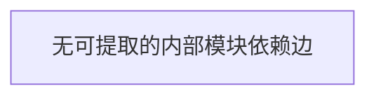

# supabase/supabase 深度分析

> 阅读档位：选型尽调（profile=adoption_due_diligence）
> 注意力预算：定位 15 / 架构 15 / 抽象 10 / ADR 10 / 扩展 5 / 经验卡 0 / 工程维护 45
> 证据约定：[事实] 确定性提取 · [判断] 有 file:line 或文档锚点 · [未获得] 当前未采集

## 导读

> **是什么**：The Postgres development platform. Supabase gives you a dedicated Postgres database to build your web, mobile, and AI applications.
> **架构一句话**：[判断] 顶层以 `apps`、`examples`、`packages` 为主，入口为 `apps/docs/data/content-listings/index.ts`（静态结构判断，未做动态跟踪）。
> **最大风险**：Top1 贡献者占比 13.97%，决策集中度需关注
> **不适合**：需要稳定 API/长期支持承诺的场景，请先核对发布节奏与维护状态；依赖链许可证与权重许可能力当前未采集，不能据此做出商用结论。

## 1. 项目定位与目标

[事实] supabase/supabase 属于 `未指定` 领域、`classic` 通道，主语言 TypeScript（73%），115,602 stars / 15,160 forks。

[事实] 项目自述：The Postgres development platform. Supabase gives you a dedicated Postgres database to build your web, mobile, and AI applications.。

[事实] README 摘要：Supabase - це альтернатива Firebase з відкритим вихідним кодом. Ми створюємо можливості Firebase, використовуючи інструменти з відкритим вихідним кодом корпоративного рівня. - [x] Розміщена база даних Postgres. Документи - [x] Аутентифікація та авторизація. Документи - [x] Автоматично згенеровані API. - [x] REST. Документи - [x] GraphQL. Документи - [x] Підписки в режимі реального часу. Документи - [x] Функції. - [x] Функції бази даних. Документи。

- **目标用户**：[判断] 应用与平台开发者；终端用户与性能调优人员
- **替代方案与差异**：[未获得] 本次未采集竞品对比与 roadmap，不得据此推断「没有替代品」。
- **不解决什么**：[未获得] 没有路线图与 issue 语料，无法可靠界定能力边界。

[判断] 阶段信号：仓库已存在 2,603 天，近一年发布 8 个版本，最近提交距今 0 天，维护状态「active」。这只说明是否仍在维护，不等于成熟度结论。

## 2. 架构全景

### 2.1 上下文边界

[判断] 架构说明文档：`apps/docs/spec/reference/README.md`, `apps/studio/lib/ai/README.md`, `i18n/README.bg.md`, `i18n/README.bn.md`, `i18n/README.de.md`；边界结论来自文档与目录结构，未经运行验证。
[事实] 硬件/内核线索：vendors=[]、kernel_langs=[]。

### 2.2 模块职责

| 模块 | 文件数 | 职责（启发式） |
|---|---:|---|
| `apps` | 15,261 | 业务实现（职责需人工确认） |
| `examples` | 1,486 | 示例与基准 |
| `packages` | 1,051 | 业务实现（职责需人工确认） |
| `.` | 21 | 业务实现（职责需人工确认） |
| `i18n` | 50 | 业务实现（职责需人工确认） |

### 2.3 一次调用的路径（运行时视图）

[判断] 静态推断：`apps/docs/data/content-listings/index.ts`, `apps/docs/features/IaNav/index.ts`, `apps/docs/features/SearchV2/index.ts`, `apps/docs/features/ui/guide/index.ts`, `apps/docs/fonts/index.ts`, `apps/docs/generator/index.ts`, `apps/docs/scripts/search/sources/index.ts`, `apps/docs/types/index.ts`, `apps/kb/api/search/index.ts`, `apps/studio/components/grid/types/index.ts`, `apps/studio/components/interfaces/Integrations/Queues/CreateQueueSheet/index.ts`, `apps/studio/components/interfaces/Organization/OAuthApps/Consent/index.ts`, `apps/studio/components/interfaces/Platform/Webhooks/index.ts`, `apps/studio/components/layouts/ProjectLayout/LayoutHeader/MobileMenuContent/index.ts`, `apps/studio/lib/ai/tools/index.ts`, `apps/studio/lib/api/self-hosted/functions/index.ts`, `apps/studio/lib/constants/index.ts`, `apps/studio/routes/api/connect/index.ts`, `apps/studio/routes/api/mcp/index.ts`, `apps/studio/routes/api/platform/auth/$ref/users/$id/index.ts`, `apps/studio/routes/api/platform/auth/$ref/users/index.ts`, `apps/studio/routes/api/platform/organizations/index.ts`, `apps/studio/routes/api/platform/pg-meta/$ref/query/index.ts`, `apps/studio/routes/api/platform/profile/index.ts`, `apps/studio/routes/api/platform/projects/$ref/config/index.ts`, `apps/studio/routes/api/platform/projects/$ref/content/folders/index.ts`, `apps/studio/routes/api/platform/projects/$ref/content/index.ts`, `apps/studio/routes/api/platform/projects/$ref/index.ts`, `apps/studio/routes/api/platform/projects/index.ts`, `apps/studio/routes/api/platform/props/project/$ref/index.ts`, `apps/studio/routes/api/platform/storage/$ref/buckets/$id/index.ts`, `apps/studio/routes/api/platform/storage/$ref/buckets/$id/objects/index.ts`, `apps/studio/routes/api/platform/storage/$ref/buckets/index.ts`, `apps/studio/routes/api/platform/storage/$ref/vector-buckets/$id/index.ts`, `apps/studio/routes/api/platform/storage/$ref/vector-buckets/$id/indexes/index.ts`, `apps/studio/routes/api/platform/storage/$ref/vector-buckets/index.ts`, `apps/studio/routes/api/v1/projects/$ref/config/auth/signing-keys/index.ts`, `apps/studio/routes/api/v1/projects/$ref/functions/$slug/index.ts`, `apps/studio/routes/api/v1/projects/$ref/functions/index.ts`, `apps/studio/types/index.ts`, `apps/ui-library/app/api/registry/tanstack-db/_generators/index.ts`, `apps/ui-library/registry/default/blocks/headless-app-tanstack/supabase/functions/mcp/tools/index.ts`, `apps/ui-library/registry/default/blocks/mcp/supabase/functions/mcp/index.ts`, `apps/ui-library/registry/default/blocks/mcp/supabase/functions/mcp/tools/index.ts`, `apps/ui-library/registry/default/platform/platform-kit-nextjs/lib/pg-meta/index.ts`, `apps/ui-library/registry/index.ts`, `apps/www/components/CodeTabs/index.ts`, `apps/www/components/LaunchWeek/11/Releases/data/index.ts`, `apps/www/components/LaunchWeek/12/Releases/data/index.ts`, `apps/www/components/LaunchWeek/13/Releases/data/index.ts`, `apps/www/components/LaunchWeek/14/Releases/data/index.ts`, `apps/www/components/LaunchWeek/15/data/index.ts`, `apps/www/components/LaunchWeek/X/Releases/data/index.ts`, `apps/www/components/Tabs/index.ts`, `apps/www/data/contribute/index.ts`, `apps/www/fonts/index.ts`, `apps/www/supabase/functions/contact-notification/index.ts`, `apps/www/supabase/functions/hubspot-notification/index.ts`, `apps/www/supabase/functions/lw11-og/index.ts`, `apps/www/supabase/functions/lwx-og/index.ts`, `apps/www/supabase/functions/lwx-ticket-og/index.ts`, `apps/www/supabase/functions/lwx-ticket/index.ts`, `blocks/vue/index.ts`, `blocks/vue/registry/index.ts`, `docker/volumes/functions/hello/index.ts`, `docker/volumes/functions/main/events/index.ts`, `docker/volumes/functions/main/index.ts`, `e2e/studio/utils/db/index.ts`, `e2e/studio/utils/storage/index.ts`, `examples/ai/aws_bedrock_image_gen/supabase/functions/image_gen/index.ts`, `examples/ai/aws_bedrock_image_search/image_search/main.py`, `examples/ai/edge-functions/supabase/functions/generate-embedding/index.ts`, `examples/ai/edge-functions/supabase/functions/search/index.ts`, `examples/ai/image_search/image_search/main.py`, `examples/ai/llamafile-edge/supabase/functions/llamafile-stream/index.ts`, `examples/ai/llamafile-edge/supabase/functions/llamafile/index.ts`, `examples/ai/llamafile-edge/supabase/functions/openai-sdk/index.ts`, `examples/caching/with-cloudflare-workers-kv/src/index.js`, `examples/edge-functions/app/src/index.js`, `examples/edge-functions/supabase/functions/auth-hook-react-email-resend/index.ts`, `examples/edge-functions/supabase/functions/background-upload-storage/index.ts`, `examples/edge-functions/supabase/functions/browser-with-cors/index.ts`, `examples/edge-functions/supabase/functions/cloudflare-turnstile/index.ts`, `examples/edge-functions/supabase/functions/connect-supabase/index.ts`, `examples/edge-functions/supabase/functions/custom-jwt-validation/index.ts`, `examples/edge-functions/supabase/functions/discord-bot/index.ts`, `examples/edge-functions/supabase/functions/drizzle/index.ts`, `examples/edge-functions/supabase/functions/elevenlabs-speech-to-text/index.ts`, `examples/edge-functions/supabase/functions/elevenlabs-text-to-speech/index.ts`, `examples/edge-functions/supabase/functions/file-upload-storage/index.ts`, `examples/edge-functions/supabase/functions/get-tshirt-competition/index.ts`, `examples/edge-functions/supabase/functions/github-action-deploy/index.ts`, `examples/edge-functions/supabase/functions/huggingface-image-captioning/index.ts`, `examples/edge-functions/supabase/functions/image-manipulation/index.ts`, `examples/edge-functions/supabase/functions/kysely-postgres/index.ts`, `examples/edge-functions/supabase/functions/location/index.ts`, `examples/edge-functions/supabase/functions/mcp/authenticated-mcp-server/index.ts`, `examples/edge-functions/supabase/functions/mcp/simple-mcp-server/index.ts`, `examples/edge-functions/supabase/functions/oak-server/index.ts`, `examples/edge-functions/supabase/functions/og-image-with-storage-cdn/index.ts`, `examples/edge-functions/supabase/functions/openai-image-generation/index.ts`, `examples/edge-functions/supabase/functions/openai/index.ts`, `examples/edge-functions/supabase/functions/opengraph/index.ts`, `examples/edge-functions/supabase/functions/postgres-on-the-edge/index.ts`, `examples/edge-functions/supabase/functions/puppeteer/index.ts`, `examples/edge-functions/supabase/functions/read-storage/index.ts`, `examples/edge-functions/supabase/functions/restful-tasks/index.ts`, `examples/edge-functions/supabase/functions/select-from-table-with-auth-rls/index.ts`, `examples/edge-functions/supabase/functions/send-email-resend/index.ts`, `examples/edge-functions/supabase/functions/send-email-smtp/index.ts`, `examples/edge-functions/supabase/functions/sentry/index.ts`, `examples/edge-functions/supabase/functions/sentryfied/index.ts`, `examples/edge-functions/supabase/functions/slack-bot-mention/index.ts`, `examples/edge-functions/supabase/functions/streams/index.ts`, `examples/edge-functions/supabase/functions/stripe-webhooks/index.ts`, `examples/edge-functions/supabase/functions/telegram-bot/index.ts`, `examples/edge-functions/supabase/functions/tweet-to-image/index.ts`, `examples/edge-functions/supabase/functions/unit-testing/process-ticket/index.ts`, `examples/edge-functions/supabase/functions/upstash-redis-counter/index.ts`, `examples/edge-functions/supabase/functions/upstash-redis-ratelimit/index.ts`, `examples/edge-functions/supabase/functions/wasm-modules/index.ts`, `examples/oauth-app-authorization-flow/src/index.ts`, `examples/slack-clone/nextjs-slack-clone-dotenvx/pages/index.js`, `examples/slack-clone/nextjs-slack-clone/pages/index.js`, `examples/storage/protomaps/supabase/functions/maps-private/index.ts`, `examples/storage/resumable-upload-signed-uppy/supabase/functions/create-upload-token/index.ts`, `examples/user-management/expo-push-notifications/supabase/functions/push/index.ts`, `examples/user-management/expo-user-management/index.js`, `examples/user-management/ionic-vue-user-management/src/router/index.ts`, `examples/user-management/ionic-vue-user-management/tests/e2e/plugins/index.js`, `examples/user-management/ionic-vue-user-management/tests/e2e/support/index.js`, `examples/user-management/refine-user-management/src/utility/index.ts`, `examples/with-cloudflare-workers/src/index.js`, `packages/ai-commands/index.ts`, `packages/api-types/index.ts`, `packages/common/constants/index.ts`, `packages/common/enabled-features/index.ts`, `packages/common/hooks/index.ts`, `packages/dev-tools/index.ts`, `packages/docs-search/src/components/index.ts`, `packages/icons/src/icons/index.ts`, `packages/marketing/index.ts`, `packages/marketing/src/crm/index.ts`, `packages/marketing/src/forms/index.ts`, `packages/marketing/src/go/index.ts`, `packages/marketing/src/go/sections/index.ts`, `packages/marketing/src/go/templates/index.ts`, `packages/pg-meta/src/index.ts`, `packages/pg-meta/src/pg-format/index.ts`, `packages/pg-meta/src/query/index.ts`, `packages/pg-meta/src/sql/studio/advisor/index.ts`, `packages/pg-meta/src/sql/studio/auth/index.ts`, `packages/pg-meta/src/sql/studio/database/index.ts`, `packages/pg-meta/src/sql/studio/integrations/index.ts`, `packages/pg-meta/src/sql/studio/sql-editor/index.ts`, `packages/pg-meta/src/sql/studio/storage/index.ts`, `packages/pg-meta/src/sql/studio/table-editor/index.ts`, `packages/shared-data/index.ts`, `packages/ui-patterns/src/AssistantChat/index.ts`, `packages/ui-patterns/src/DatePicker/index.ts`, `packages/ui-patterns/src/FilterBar/index.ts`, `packages/ui-patterns/src/McpUrlBuilder/index.ts`, `packages/ui-patterns/src/MobileSheetNav/index.ts`, `packages/ui-patterns/src/Notch/index.ts`, `packages/ui-patterns/src/SelectionListState/index.ts`, `packages/ui-patterns/src/Table/index.ts`, `packages/ui-patterns/src/Toc/index.ts`, `packages/ui-patterns/src/Trace/index.ts`, `packages/ui/src/components/LogoLoader/index.ts`, `packages/ui/src/lib/utils/index.ts`, `supabase/functions/og-images/index.ts`, `supabase/functions/search-embeddings/index.ts` → 输出。内部 import 边约 0 条，只用于判断调用方向；**未做运行时跟踪**，参数与分支需读源码确认。

### 2.4 数据与控制流

[未获得] 未检测到并行/缓存轴证据；不代表项目中不存在。

## 3. 核心抽象与契约

[未获得] 本次源码切片未识别到显式接口/注册模式；这不等于项目没有抽象层，只说明当前采集粒度不足。

入口候选（可作为契约阅读起点）：`apps/docs/data/content-listings/index.ts`、`apps/docs/features/IaNav/index.ts`、`apps/docs/features/SearchV2/index.ts`、`apps/docs/features/ui/guide/index.ts`、`apps/docs/fonts/index.ts`、`apps/docs/generator/index.ts`、`apps/docs/scripts/search/sources/index.ts`、`apps/docs/types/index.ts`、`apps/kb/api/search/index.ts`、`apps/studio/components/grid/types/index.ts`、`apps/studio/components/interfaces/Integrations/Queues/CreateQueueSheet/index.ts`、`apps/studio/components/interfaces/Organization/OAuthApps/Consent/index.ts`、`apps/studio/components/interfaces/Platform/Webhooks/index.ts`、`apps/studio/components/layouts/ProjectLayout/LayoutHeader/MobileMenuContent/index.ts`、`apps/studio/lib/ai/tools/index.ts`、`apps/studio/lib/api/self-hosted/functions/index.ts`、`apps/studio/lib/constants/index.ts`、`apps/studio/routes/api/connect/index.ts`、`apps/studio/routes/api/mcp/index.ts`、`apps/studio/routes/api/platform/auth/$ref/users/$id/index.ts`、`apps/studio/routes/api/platform/auth/$ref/users/index.ts`、`apps/studio/routes/api/platform/organizations/index.ts`、`apps/studio/routes/api/platform/pg-meta/$ref/query/index.ts`、`apps/studio/routes/api/platform/profile/index.ts`、`apps/studio/routes/api/platform/projects/$ref/config/index.ts`、`apps/studio/routes/api/platform/projects/$ref/content/folders/index.ts`、`apps/studio/routes/api/platform/projects/$ref/content/index.ts`、`apps/studio/routes/api/platform/projects/$ref/index.ts`、`apps/studio/routes/api/platform/projects/index.ts`、`apps/studio/routes/api/platform/props/project/$ref/index.ts`、`apps/studio/routes/api/platform/storage/$ref/buckets/$id/index.ts`、`apps/studio/routes/api/platform/storage/$ref/buckets/$id/objects/index.ts`、`apps/studio/routes/api/platform/storage/$ref/buckets/index.ts`、`apps/studio/routes/api/platform/storage/$ref/vector-buckets/$id/index.ts`、`apps/studio/routes/api/platform/storage/$ref/vector-buckets/$id/indexes/index.ts`、`apps/studio/routes/api/platform/storage/$ref/vector-buckets/index.ts`、`apps/studio/routes/api/v1/projects/$ref/config/auth/signing-keys/index.ts`、`apps/studio/routes/api/v1/projects/$ref/functions/$slug/index.ts`、`apps/studio/routes/api/v1/projects/$ref/functions/index.ts`、`apps/studio/types/index.ts`、`apps/ui-library/app/api/registry/tanstack-db/_generators/index.ts`、`apps/ui-library/registry/default/blocks/headless-app-tanstack/supabase/functions/mcp/tools/index.ts`、`apps/ui-library/registry/default/blocks/mcp/supabase/functions/mcp/index.ts`、`apps/ui-library/registry/default/blocks/mcp/supabase/functions/mcp/tools/index.ts`、`apps/ui-library/registry/default/platform/platform-kit-nextjs/lib/pg-meta/index.ts`、`apps/ui-library/registry/index.ts`、`apps/www/components/CodeTabs/index.ts`、`apps/www/components/LaunchWeek/11/Releases/data/index.ts`、`apps/www/components/LaunchWeek/12/Releases/data/index.ts`、`apps/www/components/LaunchWeek/13/Releases/data/index.ts`、`apps/www/components/LaunchWeek/14/Releases/data/index.ts`、`apps/www/components/LaunchWeek/15/data/index.ts`、`apps/www/components/LaunchWeek/X/Releases/data/index.ts`、`apps/www/components/Tabs/index.ts`、`apps/www/data/contribute/index.ts`、`apps/www/fonts/index.ts`、`apps/www/supabase/functions/contact-notification/index.ts`、`apps/www/supabase/functions/hubspot-notification/index.ts`、`apps/www/supabase/functions/lw11-og/index.ts`、`apps/www/supabase/functions/lwx-og/index.ts`、`apps/www/supabase/functions/lwx-ticket-og/index.ts`、`apps/www/supabase/functions/lwx-ticket/index.ts`、`blocks/vue/index.ts`、`blocks/vue/registry/index.ts`、`docker/volumes/functions/hello/index.ts`、`docker/volumes/functions/main/events/index.ts`、`docker/volumes/functions/main/index.ts`、`e2e/studio/utils/db/index.ts`、`e2e/studio/utils/storage/index.ts`、`examples/ai/aws_bedrock_image_gen/supabase/functions/image_gen/index.ts`、`examples/ai/aws_bedrock_image_search/image_search/main.py`、`examples/ai/edge-functions/supabase/functions/generate-embedding/index.ts`、`examples/ai/edge-functions/supabase/functions/search/index.ts`、`examples/ai/image_search/image_search/main.py`、`examples/ai/llamafile-edge/supabase/functions/llamafile-stream/index.ts`、`examples/ai/llamafile-edge/supabase/functions/llamafile/index.ts`、`examples/ai/llamafile-edge/supabase/functions/openai-sdk/index.ts`、`examples/caching/with-cloudflare-workers-kv/src/index.js`、`examples/edge-functions/app/src/index.js`、`examples/edge-functions/supabase/functions/auth-hook-react-email-resend/index.ts`、`examples/edge-functions/supabase/functions/background-upload-storage/index.ts`、`examples/edge-functions/supabase/functions/browser-with-cors/index.ts`、`examples/edge-functions/supabase/functions/cloudflare-turnstile/index.ts`、`examples/edge-functions/supabase/functions/connect-supabase/index.ts`、`examples/edge-functions/supabase/functions/custom-jwt-validation/index.ts`、`examples/edge-functions/supabase/functions/discord-bot/index.ts`、`examples/edge-functions/supabase/functions/drizzle/index.ts`、`examples/edge-functions/supabase/functions/elevenlabs-speech-to-text/index.ts`、`examples/edge-functions/supabase/functions/elevenlabs-text-to-speech/index.ts`、`examples/edge-functions/supabase/functions/file-upload-storage/index.ts`、`examples/edge-functions/supabase/functions/get-tshirt-competition/index.ts`、`examples/edge-functions/supabase/functions/github-action-deploy/index.ts`、`examples/edge-functions/supabase/functions/huggingface-image-captioning/index.ts`、`examples/edge-functions/supabase/functions/image-manipulation/index.ts`、`examples/edge-functions/supabase/functions/kysely-postgres/index.ts`、`examples/edge-functions/supabase/functions/location/index.ts`、`examples/edge-functions/supabase/functions/mcp/authenticated-mcp-server/index.ts`、`examples/edge-functions/supabase/functions/mcp/simple-mcp-server/index.ts`、`examples/edge-functions/supabase/functions/oak-server/index.ts`、`examples/edge-functions/supabase/functions/og-image-with-storage-cdn/index.ts`、`examples/edge-functions/supabase/functions/openai-image-generation/index.ts`、`examples/edge-functions/supabase/functions/openai/index.ts`、`examples/edge-functions/supabase/functions/opengraph/index.ts`、`examples/edge-functions/supabase/functions/postgres-on-the-edge/index.ts`、`examples/edge-functions/supabase/functions/puppeteer/index.ts`、`examples/edge-functions/supabase/functions/read-storage/index.ts`、`examples/edge-functions/supabase/functions/restful-tasks/index.ts`、`examples/edge-functions/supabase/functions/select-from-table-with-auth-rls/index.ts`、`examples/edge-functions/supabase/functions/send-email-resend/index.ts`、`examples/edge-functions/supabase/functions/send-email-smtp/index.ts`、`examples/edge-functions/supabase/functions/sentry/index.ts`、`examples/edge-functions/supabase/functions/sentryfied/index.ts`、`examples/edge-functions/supabase/functions/slack-bot-mention/index.ts`、`examples/edge-functions/supabase/functions/streams/index.ts`、`examples/edge-functions/supabase/functions/stripe-webhooks/index.ts`、`examples/edge-functions/supabase/functions/telegram-bot/index.ts`、`examples/edge-functions/supabase/functions/tweet-to-image/index.ts`、`examples/edge-functions/supabase/functions/unit-testing/process-ticket/index.ts`、`examples/edge-functions/supabase/functions/upstash-redis-counter/index.ts`、`examples/edge-functions/supabase/functions/upstash-redis-ratelimit/index.ts`、`examples/edge-functions/supabase/functions/wasm-modules/index.ts`、`examples/oauth-app-authorization-flow/src/index.ts`、`examples/slack-clone/nextjs-slack-clone-dotenvx/pages/index.js`、`examples/slack-clone/nextjs-slack-clone/pages/index.js`、`examples/storage/protomaps/supabase/functions/maps-private/index.ts`、`examples/storage/resumable-upload-signed-uppy/supabase/functions/create-upload-token/index.ts`、`examples/user-management/expo-push-notifications/supabase/functions/push/index.ts`、`examples/user-management/expo-user-management/index.js`、`examples/user-management/ionic-vue-user-management/src/router/index.ts`、`examples/user-management/ionic-vue-user-management/tests/e2e/plugins/index.js`、`examples/user-management/ionic-vue-user-management/tests/e2e/support/index.js`、`examples/user-management/refine-user-management/src/utility/index.ts`、`examples/with-cloudflare-workers/src/index.js`、`packages/ai-commands/index.ts`、`packages/api-types/index.ts`、`packages/common/constants/index.ts`、`packages/common/enabled-features/index.ts`、`packages/common/hooks/index.ts`、`packages/dev-tools/index.ts`、`packages/docs-search/src/components/index.ts`、`packages/icons/src/icons/index.ts`、`packages/marketing/index.ts`、`packages/marketing/src/crm/index.ts`、`packages/marketing/src/forms/index.ts`、`packages/marketing/src/go/index.ts`、`packages/marketing/src/go/sections/index.ts`、`packages/marketing/src/go/templates/index.ts`、`packages/pg-meta/src/index.ts`、`packages/pg-meta/src/pg-format/index.ts`、`packages/pg-meta/src/query/index.ts`、`packages/pg-meta/src/sql/studio/advisor/index.ts`、`packages/pg-meta/src/sql/studio/auth/index.ts`、`packages/pg-meta/src/sql/studio/database/index.ts`、`packages/pg-meta/src/sql/studio/integrations/index.ts`、`packages/pg-meta/src/sql/studio/sql-editor/index.ts`、`packages/pg-meta/src/sql/studio/storage/index.ts`、`packages/pg-meta/src/sql/studio/table-editor/index.ts`、`packages/shared-data/index.ts`、`packages/ui-patterns/src/AssistantChat/index.ts`、`packages/ui-patterns/src/DatePicker/index.ts`、`packages/ui-patterns/src/FilterBar/index.ts`、`packages/ui-patterns/src/McpUrlBuilder/index.ts`、`packages/ui-patterns/src/MobileSheetNav/index.ts`、`packages/ui-patterns/src/Notch/index.ts`、`packages/ui-patterns/src/SelectionListState/index.ts`、`packages/ui-patterns/src/Table/index.ts`、`packages/ui-patterns/src/Toc/index.ts`、`packages/ui-patterns/src/Trace/index.ts`、`packages/ui/src/components/LogoLoader/index.ts`、`packages/ui/src/lib/utils/index.ts`、`supabase/functions/og-images/index.ts`、`supabase/functions/search-embeddings/index.ts`

## 4. 关键设计决策（ADR）

每条固定六字段：决策 / 替代 / 代价 / 证据 / 可复用规则 / 边界·反模式。

### ADR-1 · t1: 用开源组件拼装 Firebase 式能力，而非自研后端

- **决策**：用开源组件拼装 Firebase 式能力，而非自研后端
- **替代**：自研一体化后端服务
- **代价**：需维护多组件集成与版本兼容
- **证据**：`i18n/README.uk.md:47`
- **可复用规则**：优先复用成熟开源组件拼装平台能力，自研仅补空缺
- **边界/反模式**：组件间协议/版本漂移成本高时，集成复杂度可能超过自研

### ADR-2 · t2: 客户端库按外部系统拆分为独立子库

- **决策**：客户端库按外部系统拆分为独立子库
- **替代**：单一巨型客户端 SDK
- **代价**：多仓库多语言维护与版本对齐成本
- **证据**：`i18n/README.uk.md:63`
- **可复用规则**：按外部系统边界拆分客户端子库，便于独立演进
- **边界/反模式**：子库数量过多时用户需自行组合，增加接入负担

### ADR-3 · t3: 以 Postgres 为唯一数据与权限核心

- **决策**：以 Postgres 为唯一数据与权限核心
- **替代**：独立元数据/权限服务
- **代价**：能力受 Postgres 生态与扩展限制
- **证据**：`i18n/README.uk.md:52`
- **可复用规则**：把权限与数据统一收敛到数据库，减少旁路服务
- **边界/反模式**：超大规模写入或非关系型场景下数据库会成为瓶颈

## 5. 扩展与改造路径

[未获得] 未识别到显式插件/注册点。

[判断] 新增能力的静态路径（需按实际代码复核）：

1. 在入口处接入参数/配置（入口候选：`apps/docs/data/content-listings/index.ts`, `apps/docs/features/IaNav/index.ts`, `apps/docs/features/SearchV2/index.ts`, `apps/docs/features/ui/guide/index.ts`, `apps/docs/fonts/index.ts`, `apps/docs/generator/index.ts`, `apps/docs/scripts/search/sources/index.ts`, `apps/docs/types/index.ts`, `apps/kb/api/search/index.ts`, `apps/studio/components/grid/types/index.ts`, `apps/studio/components/interfaces/Integrations/Queues/CreateQueueSheet/index.ts`, `apps/studio/components/interfaces/Organization/OAuthApps/Consent/index.ts`, `apps/studio/components/interfaces/Platform/Webhooks/index.ts`, `apps/studio/components/layouts/ProjectLayout/LayoutHeader/MobileMenuContent/index.ts`, `apps/studio/lib/ai/tools/index.ts`, `apps/studio/lib/api/self-hosted/functions/index.ts`, `apps/studio/lib/constants/index.ts`, `apps/studio/routes/api/connect/index.ts`, `apps/studio/routes/api/mcp/index.ts`, `apps/studio/routes/api/platform/auth/$ref/users/$id/index.ts`, `apps/studio/routes/api/platform/auth/$ref/users/index.ts`, `apps/studio/routes/api/platform/organizations/index.ts`, `apps/studio/routes/api/platform/pg-meta/$ref/query/index.ts`, `apps/studio/routes/api/platform/profile/index.ts`, `apps/studio/routes/api/platform/projects/$ref/config/index.ts`, `apps/studio/routes/api/platform/projects/$ref/content/folders/index.ts`, `apps/studio/routes/api/platform/projects/$ref/content/index.ts`, `apps/studio/routes/api/platform/projects/$ref/index.ts`, `apps/studio/routes/api/platform/projects/index.ts`, `apps/studio/routes/api/platform/props/project/$ref/index.ts`, `apps/studio/routes/api/platform/storage/$ref/buckets/$id/index.ts`, `apps/studio/routes/api/platform/storage/$ref/buckets/$id/objects/index.ts`, `apps/studio/routes/api/platform/storage/$ref/buckets/index.ts`, `apps/studio/routes/api/platform/storage/$ref/vector-buckets/$id/index.ts`, `apps/studio/routes/api/platform/storage/$ref/vector-buckets/$id/indexes/index.ts`, `apps/studio/routes/api/platform/storage/$ref/vector-buckets/index.ts`, `apps/studio/routes/api/v1/projects/$ref/config/auth/signing-keys/index.ts`, `apps/studio/routes/api/v1/projects/$ref/functions/$slug/index.ts`, `apps/studio/routes/api/v1/projects/$ref/functions/index.ts`, `apps/studio/types/index.ts`, `apps/ui-library/app/api/registry/tanstack-db/_generators/index.ts`, `apps/ui-library/registry/default/blocks/headless-app-tanstack/supabase/functions/mcp/tools/index.ts`, `apps/ui-library/registry/default/blocks/mcp/supabase/functions/mcp/index.ts`, `apps/ui-library/registry/default/blocks/mcp/supabase/functions/mcp/tools/index.ts`, `apps/ui-library/registry/default/platform/platform-kit-nextjs/lib/pg-meta/index.ts`, `apps/ui-library/registry/index.ts`, `apps/www/components/CodeTabs/index.ts`, `apps/www/components/LaunchWeek/11/Releases/data/index.ts`, `apps/www/components/LaunchWeek/12/Releases/data/index.ts`, `apps/www/components/LaunchWeek/13/Releases/data/index.ts`, `apps/www/components/LaunchWeek/14/Releases/data/index.ts`, `apps/www/components/LaunchWeek/15/data/index.ts`, `apps/www/components/LaunchWeek/X/Releases/data/index.ts`, `apps/www/components/Tabs/index.ts`, `apps/www/data/contribute/index.ts`, `apps/www/fonts/index.ts`, `apps/www/supabase/functions/contact-notification/index.ts`, `apps/www/supabase/functions/hubspot-notification/index.ts`, `apps/www/supabase/functions/lw11-og/index.ts`, `apps/www/supabase/functions/lwx-og/index.ts`, `apps/www/supabase/functions/lwx-ticket-og/index.ts`, `apps/www/supabase/functions/lwx-ticket/index.ts`, `blocks/vue/index.ts`, `blocks/vue/registry/index.ts`, `docker/volumes/functions/hello/index.ts`, `docker/volumes/functions/main/events/index.ts`, `docker/volumes/functions/main/index.ts`, `e2e/studio/utils/db/index.ts`, `e2e/studio/utils/storage/index.ts`, `examples/ai/aws_bedrock_image_gen/supabase/functions/image_gen/index.ts`, `examples/ai/aws_bedrock_image_search/image_search/main.py`, `examples/ai/edge-functions/supabase/functions/generate-embedding/index.ts`, `examples/ai/edge-functions/supabase/functions/search/index.ts`, `examples/ai/image_search/image_search/main.py`, `examples/ai/llamafile-edge/supabase/functions/llamafile-stream/index.ts`, `examples/ai/llamafile-edge/supabase/functions/llamafile/index.ts`, `examples/ai/llamafile-edge/supabase/functions/openai-sdk/index.ts`, `examples/caching/with-cloudflare-workers-kv/src/index.js`, `examples/edge-functions/app/src/index.js`, `examples/edge-functions/supabase/functions/auth-hook-react-email-resend/index.ts`, `examples/edge-functions/supabase/functions/background-upload-storage/index.ts`, `examples/edge-functions/supabase/functions/browser-with-cors/index.ts`, `examples/edge-functions/supabase/functions/cloudflare-turnstile/index.ts`, `examples/edge-functions/supabase/functions/connect-supabase/index.ts`, `examples/edge-functions/supabase/functions/custom-jwt-validation/index.ts`, `examples/edge-functions/supabase/functions/discord-bot/index.ts`, `examples/edge-functions/supabase/functions/drizzle/index.ts`, `examples/edge-functions/supabase/functions/elevenlabs-speech-to-text/index.ts`, `examples/edge-functions/supabase/functions/elevenlabs-text-to-speech/index.ts`, `examples/edge-functions/supabase/functions/file-upload-storage/index.ts`, `examples/edge-functions/supabase/functions/get-tshirt-competition/index.ts`, `examples/edge-functions/supabase/functions/github-action-deploy/index.ts`, `examples/edge-functions/supabase/functions/huggingface-image-captioning/index.ts`, `examples/edge-functions/supabase/functions/image-manipulation/index.ts`, `examples/edge-functions/supabase/functions/kysely-postgres/index.ts`, `examples/edge-functions/supabase/functions/location/index.ts`, `examples/edge-functions/supabase/functions/mcp/authenticated-mcp-server/index.ts`, `examples/edge-functions/supabase/functions/mcp/simple-mcp-server/index.ts`, `examples/edge-functions/supabase/functions/oak-server/index.ts`, `examples/edge-functions/supabase/functions/og-image-with-storage-cdn/index.ts`, `examples/edge-functions/supabase/functions/openai-image-generation/index.ts`, `examples/edge-functions/supabase/functions/openai/index.ts`, `examples/edge-functions/supabase/functions/opengraph/index.ts`, `examples/edge-functions/supabase/functions/postgres-on-the-edge/index.ts`, `examples/edge-functions/supabase/functions/puppeteer/index.ts`, `examples/edge-functions/supabase/functions/read-storage/index.ts`, `examples/edge-functions/supabase/functions/restful-tasks/index.ts`, `examples/edge-functions/supabase/functions/select-from-table-with-auth-rls/index.ts`, `examples/edge-functions/supabase/functions/send-email-resend/index.ts`, `examples/edge-functions/supabase/functions/send-email-smtp/index.ts`, `examples/edge-functions/supabase/functions/sentry/index.ts`, `examples/edge-functions/supabase/functions/sentryfied/index.ts`, `examples/edge-functions/supabase/functions/slack-bot-mention/index.ts`, `examples/edge-functions/supabase/functions/streams/index.ts`, `examples/edge-functions/supabase/functions/stripe-webhooks/index.ts`, `examples/edge-functions/supabase/functions/telegram-bot/index.ts`, `examples/edge-functions/supabase/functions/tweet-to-image/index.ts`, `examples/edge-functions/supabase/functions/unit-testing/process-ticket/index.ts`, `examples/edge-functions/supabase/functions/upstash-redis-counter/index.ts`, `examples/edge-functions/supabase/functions/upstash-redis-ratelimit/index.ts`, `examples/edge-functions/supabase/functions/wasm-modules/index.ts`, `examples/oauth-app-authorization-flow/src/index.ts`, `examples/slack-clone/nextjs-slack-clone-dotenvx/pages/index.js`, `examples/slack-clone/nextjs-slack-clone/pages/index.js`, `examples/storage/protomaps/supabase/functions/maps-private/index.ts`, `examples/storage/resumable-upload-signed-uppy/supabase/functions/create-upload-token/index.ts`, `examples/user-management/expo-push-notifications/supabase/functions/push/index.ts`, `examples/user-management/expo-user-management/index.js`, `examples/user-management/ionic-vue-user-management/src/router/index.ts`, `examples/user-management/ionic-vue-user-management/tests/e2e/plugins/index.js`, `examples/user-management/ionic-vue-user-management/tests/e2e/support/index.js`, `examples/user-management/refine-user-management/src/utility/index.ts`, `examples/with-cloudflare-workers/src/index.js`, `packages/ai-commands/index.ts`, `packages/api-types/index.ts`, `packages/common/constants/index.ts`, `packages/common/enabled-features/index.ts`, `packages/common/hooks/index.ts`, `packages/dev-tools/index.ts`, `packages/docs-search/src/components/index.ts`, `packages/icons/src/icons/index.ts`, `packages/marketing/index.ts`, `packages/marketing/src/crm/index.ts`, `packages/marketing/src/forms/index.ts`, `packages/marketing/src/go/index.ts`, `packages/marketing/src/go/sections/index.ts`, `packages/marketing/src/go/templates/index.ts`, `packages/pg-meta/src/index.ts`, `packages/pg-meta/src/pg-format/index.ts`, `packages/pg-meta/src/query/index.ts`, `packages/pg-meta/src/sql/studio/advisor/index.ts`, `packages/pg-meta/src/sql/studio/auth/index.ts`, `packages/pg-meta/src/sql/studio/database/index.ts`, `packages/pg-meta/src/sql/studio/integrations/index.ts`, `packages/pg-meta/src/sql/studio/sql-editor/index.ts`, `packages/pg-meta/src/sql/studio/storage/index.ts`, `packages/pg-meta/src/sql/studio/table-editor/index.ts`, `packages/shared-data/index.ts`, `packages/ui-patterns/src/AssistantChat/index.ts`, `packages/ui-patterns/src/DatePicker/index.ts`, `packages/ui-patterns/src/FilterBar/index.ts`, `packages/ui-patterns/src/McpUrlBuilder/index.ts`, `packages/ui-patterns/src/MobileSheetNav/index.ts`, `packages/ui-patterns/src/Notch/index.ts`, `packages/ui-patterns/src/SelectionListState/index.ts`, `packages/ui-patterns/src/Table/index.ts`, `packages/ui-patterns/src/Toc/index.ts`, `packages/ui-patterns/src/Trace/index.ts`, `packages/ui/src/components/LogoLoader/index.ts`, `packages/ui/src/lib/utils/index.ts`, `supabase/functions/og-images/index.ts`, `supabase/functions/search-embeddings/index.ts`）；
2. 复用上表中的注册/分派结构，实现新的后端或适配器；
3. 补对应测试与文档，再走发布流程。

- 扩展文档：[未获得]
- 改造成本：[未获得] 需要先确认契约稳定性与测试覆盖，本报告不估算人日。

## 6. 经验卡

### 经验 1 · 优先复用成熟开源组件拼装平台能力，自研仅补空缺

- **证据**：`i18n/README.uk.md:47`（来自 supabase/supabase）
- **适用边界**：组件间协议/版本漂移成本高时，集成复杂度可能超过自研
- **反模式**：在边界之外照搬「用开源组件拼装 Firebase 式能力，而非自研后端」，代价会变成「需维护多组件集成与版本兼容」
- **如果我来做**：先确认边界成立，再选择「用开源组件拼装 Firebase 式能力，而非自研后端」而非「自研一体化后端服务」

### 经验 2 · 按外部系统边界拆分客户端子库，便于独立演进

- **证据**：`i18n/README.uk.md:63`（来自 supabase/supabase）
- **适用边界**：子库数量过多时用户需自行组合，增加接入负担
- **反模式**：在边界之外照搬「客户端库按外部系统拆分为独立子库」，代价会变成「多仓库多语言维护与版本对齐成本」
- **如果我来做**：先确认边界成立，再选择「客户端库按外部系统拆分为独立子库」而非「单一巨型客户端 SDK」

### 经验 3 · 把权限与数据统一收敛到数据库，减少旁路服务

- **证据**：`i18n/README.uk.md:52`（来自 supabase/supabase）
- **适用边界**：超大规模写入或非关系型场景下数据库会成为瓶颈
- **反模式**：在边界之外照搬「以 Postgres 为唯一数据与权限核心」，代价会变成「能力受 Postgres 生态与扩展限制」
- **如果我来做**：先确认边界成立，再选择「以 Postgres 为唯一数据与权限核心」而非「独立元数据/权限服务」

## 附录 A 证据索引与未知项

### A1. 代码证据索引

| id | 决策 | 证据 |
|---|---|---|
| t1 | 用开源组件拼装 Firebase 式能力，而非自研后端 | `i18n/README.uk.md:47` |
| t2 | 客户端库按外部系统拆分为独立子库 | `i18n/README.uk.md:63` |
| t3 | 以 Postgres 为唯一数据与权限核心 | `i18n/README.uk.md:52` |

- 置信度：med
- 架构范式标签：广适配、模块化

### A2. 外部资料

- 来源：deepwiki
- url：https://deepwiki.com/supabase/supabase
- fetched_at：2026-11-27T19:53:50Z
- sha256：`6d9a99b13cae5f808917b37ec6ed8cb72b42840c204c468bb03a40b739dc111f`
- 判定：miss — 正文仅含 1 个仓库内真实路径（阈值 3）→ 视为未索引/模板页
- 原文快照：`source.txt`（与判定元数据分文件存放）
- 结论：不可用（未索引）

### A3. 未获得项

- 依赖链许可证、模型权重/数据许可、CLA —— 未采集；
- issue/PR 响应质量、CI 运行结果 —— 未采集；
- roadmap、竞品对比、用户画像 —— 未采集；
**未获得的指标**：

- `used_by`：GitHub 无公开 API；L0 标注为未获得，不估算

## 附录 B 许可证 / 维护 / 工程 / 成本

### B1. 许可证与合规风险

[事实] 主许可证 **Apache-2.0**；组织类型 —；治理文档：有。

[未获得] 依赖链是否存在 GPL/AGPL、模型权重与数据集许可、CLA 要求；这些必须人工或由后续数据源补齐，本报告不给出「可商用」结论。

### B2. 维护状态与风险

[事实] 贡献者 397 人，Top1 占比 13.97%；近 90 天 / 365 天提交 2,000 / 2,000 次；最近提交距今 0 天，维护状态「active」。

- Top1 贡献者占比 13.97%，决策集中度需关注
- 外部架构资料未命中，架构判断主要依赖本地代码切片

### B3. 运行与工程体系

[事实] 仓库约 18,409 个文件、797.8 MiB；本次采集 20 个源码切片（tarball `2d3ed0e775c92008`）。
[事实] 语言构成：Astro 0.05%、CSS 0.63%、Dockerfile 0.01%、Elixir 0.00%、HTML 0.00%、JavaScript 0.66%、MDX 24.66%、Makefile 0.02%、Mermaid 0.00%、PLpgSQL 0.11%、Shell 0.51%、Smarty 0.01%、TypeScript 73.20%、Vue 0.15%；硬件 vendors=[]、kernel_langs=[]。

[未获得] 构建脚本、依赖安装、测试体系、CI/CD、配置与 secret 管理未采集；本报告不能回答「能否在目标环境跑起来」。

**特征卡已知限制**：

- 证据来自 20 个源码切片的逐行扫描，未覆盖文件不计入
- issue_close_ratio_90d 需 search API，L0/L1 未调用
- cncf_or_foundation 与 Organization 的 org_type 细分需人工判定，置 null

### B4. 运行元数据与成本

| 项 | 值 |
|---|---|
| 仓库 | supabase/supabase |
| commit | `d85e9b8616190767254b81a5eedf61328fa4791b` |
| 分析基准时间 (as-of) | 2026-11-27T12:27:52Z |
| 通道 / 领域 | classic / 未指定 |
| 请求档位 (requested_depth) | fast |
| **实际档位** (actual_depth) | fast |
| 降级原因 (reason) | baseline — 按通道基线 |
| 配额状态 (quota_state) | strong 0/1、fast 4/5（周起点 2026-11-23）；tokens 周 44346/2000000、月 388584/6000000（月起点 2026-11-01） |
| 快照 sha256 | `31881f733a9a160e90ae974506d7fd2e7f554a0a70926fecccb50490f02ae4e4` |
| 成本说明 | 本次 ¥0.0377（模型调用 1 次）；输入 17,950 tok / 命中 256 tok / 输出 282 tok |
| 累计 | 本周 ¥0.1383 / 62,578 tok；本月 ¥1.1686 / 406,816 tok |
| 单价 | deepseek-flash 输入未命中 ¥2/M · 缓存命中 ¥0.04/M · 输出 ¥8/M（官方中文页，核对 2026-11-03，取高峰价；低谷约为一半） |
| 口径 | 本次分析的成本（不含开发期重复调用）；账户累计见 cost；成本说明同 as-of 重跑不变（幂等优先）；两者不一致是设计，不是 bug |

**档位决策链路**：

1. L1 通道基线：classic → strong；自动链按 auto_default=fast 取更省档位 → fast（非 L4 人工 override）
2. 凭据：齐全
3. L2 周配额：fast 已用 4/5，未用满
4. L3 预算：估算 8686 × 安全系数 1.3 = 11291 tok（单选上限 120000），周 44346/2000000
5. 结论：实际档位 fast（按通道基线）

**上下文组装**（裁剪发生在调用之前）：

| 块 | 优先级 | 估算 token |
|---|---|---|
| featcard | 1 | 4,430 |
| readme | 2 | 4,256 |

- 丢弃：—
- 合计 8,686 / 上限 120,000

### B5. 特征卡摘要

- 卡文件：`data/featcards/supabase__supabase__d85e9b8616190767254b81a5eedf61328fa4791b.json`（schema 1.0）
- 入口文件：apps/docs/data/content-listings/index.ts, apps/docs/features/IaNav/index.ts, apps/docs/features/SearchV2/index.ts, apps/docs/features/ui/guide/index.ts, apps/docs/fonts/index.ts, apps/docs/generator/index.ts, apps/docs/scripts/search/sources/index.ts, apps/docs/types/index.ts, apps/kb/api/search/index.ts, apps/studio/components/grid/types/index.ts, apps/studio/components/interfaces/Integrations/Queues/CreateQueueSheet/index.ts, apps/studio/components/interfaces/Organization/OAuthApps/Consent/index.ts, apps/studio/components/interfaces/Platform/Webhooks/index.ts, apps/studio/components/layouts/ProjectLayout/LayoutHeader/MobileMenuContent/index.ts, apps/studio/lib/ai/tools/index.ts, apps/studio/lib/api/self-hosted/functions/index.ts, apps/studio/lib/constants/index.ts, apps/studio/routes/api/connect/index.ts, apps/studio/routes/api/mcp/index.ts, apps/studio/routes/api/platform/auth/$ref/users/$id/index.ts, apps/studio/routes/api/platform/auth/$ref/users/index.ts, apps/studio/routes/api/platform/organizations/index.ts, apps/studio/routes/api/platform/pg-meta/$ref/query/index.ts, apps/studio/routes/api/platform/profile/index.ts, apps/studio/routes/api/platform/projects/$ref/config/index.ts, apps/studio/routes/api/platform/projects/$ref/content/folders/index.ts, apps/studio/routes/api/platform/projects/$ref/content/index.ts, apps/studio/routes/api/platform/projects/$ref/index.ts, apps/studio/routes/api/platform/projects/index.ts, apps/studio/routes/api/platform/props/project/$ref/index.ts, apps/studio/routes/api/platform/storage/$ref/buckets/$id/index.ts, apps/studio/routes/api/platform/storage/$ref/buckets/$id/objects/index.ts, apps/studio/routes/api/platform/storage/$ref/buckets/index.ts, apps/studio/routes/api/platform/storage/$ref/vector-buckets/$id/index.ts, apps/studio/routes/api/platform/storage/$ref/vector-buckets/$id/indexes/index.ts, apps/studio/routes/api/platform/storage/$ref/vector-buckets/index.ts, apps/studio/routes/api/v1/projects/$ref/config/auth/signing-keys/index.ts, apps/studio/routes/api/v1/projects/$ref/functions/$slug/index.ts, apps/studio/routes/api/v1/projects/$ref/functions/index.ts, apps/studio/types/index.ts, apps/ui-library/app/api/registry/tanstack-db/_generators/index.ts, apps/ui-library/registry/default/blocks/headless-app-tanstack/supabase/functions/mcp/tools/index.ts, apps/ui-library/registry/default/blocks/mcp/supabase/functions/mcp/index.ts, apps/ui-library/registry/default/blocks/mcp/supabase/functions/mcp/tools/index.ts, apps/ui-library/registry/default/platform/platform-kit-nextjs/lib/pg-meta/index.ts, apps/ui-library/registry/index.ts, apps/www/components/CodeTabs/index.ts, apps/www/components/LaunchWeek/11/Releases/data/index.ts, apps/www/components/LaunchWeek/12/Releases/data/index.ts, apps/www/components/LaunchWeek/13/Releases/data/index.ts, apps/www/components/LaunchWeek/14/Releases/data/index.ts, apps/www/components/LaunchWeek/15/data/index.ts, apps/www/components/LaunchWeek/X/Releases/data/index.ts, apps/www/components/Tabs/index.ts, apps/www/data/contribute/index.ts, apps/www/fonts/index.ts, apps/www/supabase/functions/contact-notification/index.ts, apps/www/supabase/functions/hubspot-notification/index.ts, apps/www/supabase/functions/lw11-og/index.ts, apps/www/supabase/functions/lwx-og/index.ts, apps/www/supabase/functions/lwx-ticket-og/index.ts, apps/www/supabase/functions/lwx-ticket/index.ts, blocks/vue/index.ts, blocks/vue/registry/index.ts, docker/volumes/functions/hello/index.ts, docker/volumes/functions/main/events/index.ts, docker/volumes/functions/main/index.ts, e2e/studio/utils/db/index.ts, e2e/studio/utils/storage/index.ts, examples/ai/aws_bedrock_image_gen/supabase/functions/image_gen/index.ts, examples/ai/aws_bedrock_image_search/image_search/main.py, examples/ai/edge-functions/supabase/functions/generate-embedding/index.ts, examples/ai/edge-functions/supabase/functions/search/index.ts, examples/ai/image_search/image_search/main.py, examples/ai/llamafile-edge/supabase/functions/llamafile-stream/index.ts, examples/ai/llamafile-edge/supabase/functions/llamafile/index.ts, examples/ai/llamafile-edge/supabase/functions/openai-sdk/index.ts, examples/caching/with-cloudflare-workers-kv/src/index.js, examples/edge-functions/app/src/index.js, examples/edge-functions/supabase/functions/auth-hook-react-email-resend/index.ts, examples/edge-functions/supabase/functions/background-upload-storage/index.ts, examples/edge-functions/supabase/functions/browser-with-cors/index.ts, examples/edge-functions/supabase/functions/cloudflare-turnstile/index.ts, examples/edge-functions/supabase/functions/connect-supabase/index.ts, examples/edge-functions/supabase/functions/custom-jwt-validation/index.ts, examples/edge-functions/supabase/functions/discord-bot/index.ts, examples/edge-functions/supabase/functions/drizzle/index.ts, examples/edge-functions/supabase/functions/elevenlabs-speech-to-text/index.ts, examples/edge-functions/supabase/functions/elevenlabs-text-to-speech/index.ts, examples/edge-functions/supabase/functions/file-upload-storage/index.ts, examples/edge-functions/supabase/functions/get-tshirt-competition/index.ts, examples/edge-functions/supabase/functions/github-action-deploy/index.ts, examples/edge-functions/supabase/functions/huggingface-image-captioning/index.ts, examples/edge-functions/supabase/functions/image-manipulation/index.ts, examples/edge-functions/supabase/functions/kysely-postgres/index.ts, examples/edge-functions/supabase/functions/location/index.ts, examples/edge-functions/supabase/functions/mcp/authenticated-mcp-server/index.ts, examples/edge-functions/supabase/functions/mcp/simple-mcp-server/index.ts, examples/edge-functions/supabase/functions/oak-server/index.ts, examples/edge-functions/supabase/functions/og-image-with-storage-cdn/index.ts, examples/edge-functions/supabase/functions/openai-image-generation/index.ts, examples/edge-functions/supabase/functions/openai/index.ts, examples/edge-functions/supabase/functions/opengraph/index.ts, examples/edge-functions/supabase/functions/postgres-on-the-edge/index.ts, examples/edge-functions/supabase/functions/puppeteer/index.ts, examples/edge-functions/supabase/functions/read-storage/index.ts, examples/edge-functions/supabase/functions/restful-tasks/index.ts, examples/edge-functions/supabase/functions/select-from-table-with-auth-rls/index.ts, examples/edge-functions/supabase/functions/send-email-resend/index.ts, examples/edge-functions/supabase/functions/send-email-smtp/index.ts, examples/edge-functions/supabase/functions/sentry/index.ts, examples/edge-functions/supabase/functions/sentryfied/index.ts, examples/edge-functions/supabase/functions/slack-bot-mention/index.ts, examples/edge-functions/supabase/functions/streams/index.ts, examples/edge-functions/supabase/functions/stripe-webhooks/index.ts, examples/edge-functions/supabase/functions/telegram-bot/index.ts, examples/edge-functions/supabase/functions/tweet-to-image/index.ts, examples/edge-functions/supabase/functions/unit-testing/process-ticket/index.ts, examples/edge-functions/supabase/functions/upstash-redis-counter/index.ts, examples/edge-functions/supabase/functions/upstash-redis-ratelimit/index.ts, examples/edge-functions/supabase/functions/wasm-modules/index.ts, examples/oauth-app-authorization-flow/src/index.ts, examples/slack-clone/nextjs-slack-clone-dotenvx/pages/index.js, examples/slack-clone/nextjs-slack-clone/pages/index.js, examples/storage/protomaps/supabase/functions/maps-private/index.ts, examples/storage/resumable-upload-signed-uppy/supabase/functions/create-upload-token/index.ts, examples/user-management/expo-push-notifications/supabase/functions/push/index.ts, examples/user-management/expo-user-management/index.js, examples/user-management/ionic-vue-user-management/src/router/index.ts, examples/user-management/ionic-vue-user-management/tests/e2e/plugins/index.js, examples/user-management/ionic-vue-user-management/tests/e2e/support/index.js, examples/user-management/refine-user-management/src/utility/index.ts, examples/with-cloudflare-workers/src/index.js, packages/ai-commands/index.ts, packages/api-types/index.ts, packages/common/constants/index.ts, packages/common/enabled-features/index.ts, packages/common/hooks/index.ts, packages/dev-tools/index.ts, packages/docs-search/src/components/index.ts, packages/icons/src/icons/index.ts, packages/marketing/index.ts, packages/marketing/src/crm/index.ts, packages/marketing/src/forms/index.ts, packages/marketing/src/go/index.ts, packages/marketing/src/go/sections/index.ts, packages/marketing/src/go/templates/index.ts, packages/pg-meta/src/index.ts, packages/pg-meta/src/pg-format/index.ts, packages/pg-meta/src/query/index.ts, packages/pg-meta/src/sql/studio/advisor/index.ts, packages/pg-meta/src/sql/studio/auth/index.ts, packages/pg-meta/src/sql/studio/database/index.ts, packages/pg-meta/src/sql/studio/integrations/index.ts, packages/pg-meta/src/sql/studio/sql-editor/index.ts, packages/pg-meta/src/sql/studio/storage/index.ts, packages/pg-meta/src/sql/studio/table-editor/index.ts, packages/shared-data/index.ts, packages/ui-patterns/src/AssistantChat/index.ts, packages/ui-patterns/src/DatePicker/index.ts, packages/ui-patterns/src/FilterBar/index.ts, packages/ui-patterns/src/McpUrlBuilder/index.ts, packages/ui-patterns/src/MobileSheetNav/index.ts, packages/ui-patterns/src/Notch/index.ts, packages/ui-patterns/src/SelectionListState/index.ts, packages/ui-patterns/src/Table/index.ts, packages/ui-patterns/src/Toc/index.ts, packages/ui-patterns/src/Trace/index.ts, packages/ui/src/components/LogoLoader/index.ts, packages/ui/src/lib/utils/index.ts, supabase/functions/og-images/index.ts, supabase/functions/search-embeddings/index.ts
- 最大目录深度：14；monorepo：是
- 源码切片：20 个文件（tarball `2d3ed0e775c92008`）
- 依赖：直接 / 传递 = — / —（L1 未解析清单文件）

**并行轴**

- 并行 `CP` = false（无证据）
- 并行 `DP` = false（无证据）
- 并行 `EP` = false（无证据）
- 并行 `PP` = false（无证据）
- 并行 `SP` = false（无证据）
- 并行 `TP` = false（无证据）

**缓存**

- 缓存 `kv_offload` = false（无证据）
- 缓存 `paged` = false（无证据）
- 缓存 `prefix_reuse` = false（无证据）
- 缓存 `radix` = false（无证据）

- 硬件：vendors=[]、arch_gates=[]、kernel_langs=[]
- 治理文档：是

**依赖图**（内部模块 import 边，节点/边排序后输出）

**已知限制**：

- 证据来自 20 个源码切片的逐行扫描，未覆盖文件不计入
- issue_close_ratio_90d 需 search API，L0/L1 未调用
- cncf_or_foundation 与 Organization 的 org_type 细分需人工判定，置 null

### B6. 体检事实（确定性，零 LLM）

| 指标 | 值 |
|---|---|
| Star / Fork | 115,602 / 15,160 |
| 被依赖 (Used by) | — |
| 贡献者 / Top1 占比 | 397 / 13.97% |
| Top10 贡献集中度 | 55.90% |
| 90 天 / 365 天提交 | 2,000 / 2,000 |
| 最近提交 / 距今天数 | 2026-11-27T12:24:54Z / 0 |
| 维护状态 | active |
| 项目年龄 / 发布数(365d) | 2,603 天 / 8 |
| 组织类型 / 许可证 | — / Apache-2.0 |
| 文件数 / 体积 | 18,409 / 797.8 MiB |
| 内部模块依赖边 | 0 |

**语言构成**：Astro 0.05%、CSS 0.63%、Dockerfile 0.01%、Elixir 0.00%、HTML 0.00%、JavaScript 0.66%、MDX 24.66%、Makefile 0.02%、Mermaid 0.00%、PLpgSQL 0.11%、Shell 0.51%、Smarty 0.01%、TypeScript 73.20%、Vue 0.15%

**模块体量 Top10**

| 模块 | 文件数 | 字节 |
|---|---|---|
| apps | 15,261 | 801,554,201 |
| examples | 1,486 | 22,846,658 |
| packages | 1,051 | 7,354,331 |
| . | 21 | 1,470,656 |
| i18n | 50 | 756,370 |
| docker | 70 | 697,064 |
| e2e | 119 | 645,366 |
| .agents | 81 | 479,771 |
| supabase | 65 | 363,578 |
| .github | 66 | 164,878 |

**未获得的指标**：

- `used_by`：GitHub 无公开 API；L0 标注为未获得，不估算
